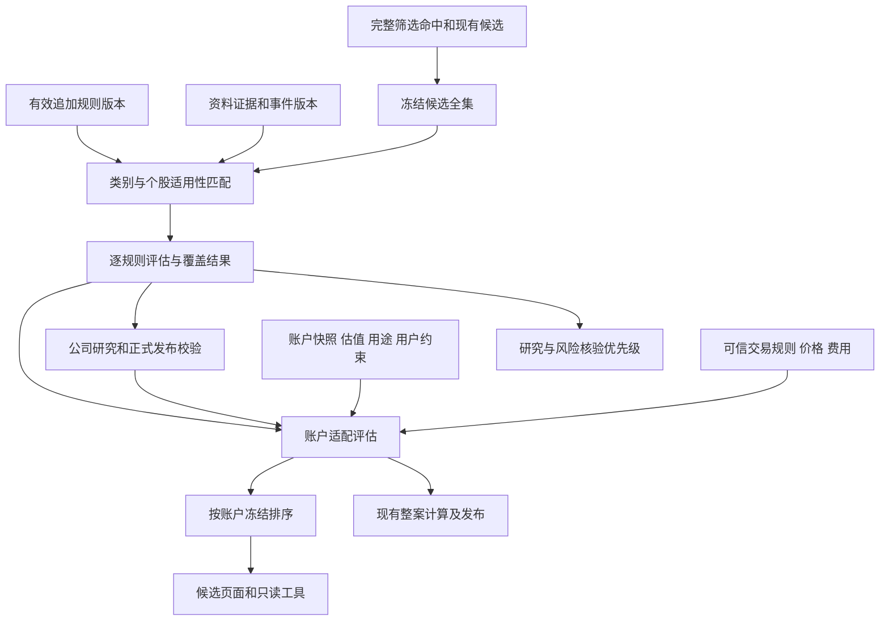

# 账户适配度与类别、个股追加规则设计

日期：2026-10-16（Asia/Shanghai）。状态：经代码对照修订的分阶段设计；P0/P1已实施并通过主代理工程验收，P2及以后仍为设计。用户已认可分层方向，本文件细化数据模型、接口、生命周期与实施验收；原设计审查依据见第16节，实施差异与证据见P0/P1验收记录。

本文保留设计阶段的决策与审查依据。P0/P1已按用户后续授权实施，实际模块、050迁移、修复和验证证据以[交付索引](plans/account-fit-p0-p1/README.md)及其验收记录为准；P2及以后仍是拟议契约，不能据其描述推断已有运行能力。实施和测试没有修改生产数据库或启用生产开关。

关联设计：[领域契约](investor-agent-contracts.md)、[漏斗设计](funnel-design.md)、[组合验收](ag24-portfolio-acceptance.md)、[资金用途](ag29-funding-purposes.md)、[方法版本](ag30-method-evolution.md)、[行业参照](industry-peer-technical-design.md)。

P0/P1的任务顺序、文件边界、依赖及逐项验收见[实施计划](plans/account-fit-p0-p1-plan.md)。该计划对应已交付的P0/P1；类别、个股规则和政策事件等后续阶段尚未实施。

## 1. 目标与设计决策

系统需要分别回答三个问题：企业的基础指标如何；计入类别特征与最新事项后，当前公司研究结论是什么；这只股票是否符合指定账户、用途和动作的约束。

| 层次 | 输出 | 影响范围 |
| --- | --- | --- |
| 通用与行业基础分析 | 因子、模型适用性、基础评分、质量与缺失 | 维持既有确定性内核语义 |
| 类别、个股补充评估 | 额外指标检查、研究要求、事件影响、反证和待核问题 | 可以改变当前公司观点、价格判断、证据充分度与有效性 |
| 账户适配评估 | 财务约束状态、研究可用状态、限制与计算依据 | 影响指定账户的候选组织和整案前置检查 |

核心决策：

1. 不将账户资金、政策新闻或任意个股备注直接加减到基础分数。事件改变当前判断，账户约束改变账户适配；基础事实更正仍走原有快照与内核更新。
2. 类别与个股是适用范围，指标条件、研究要求与事件影响是规则类型，两者正交。
3. 研究优先级与配置评估顺序分别表达。重大风险可以提高核验优先级，同时限制配置判断。
4. 第一版采用结构化状态与理由，不建立未经校准的统一投资总分。
5. 账户适配通过仅代表满足已检查的约束，不表示建议买入，也不预留现金。多股票配置继续经过整案共享现金计算。
6. 股票当前不适配账户，不删除候选、不自动改变候选生命周期、不自动减持已有持仓。
7. 茅台与阳光电源用于说明两种不同机制，不形成硬编码规则或本轮投资事实判断。

首期为现有组合计算支持的人民币 A 股账户。港美股身份和资料可以参与公司研究；外币适配、跨币种资产净值及交易单位按独立扩展验收，不从资料已支持推导账户计算已支持。

## 2. 现有代码与必要增量

| 能力 | 当前代码与实情 | 复用与增量 |
| --- | --- | --- |
| 基础评分 | [scoring.py](../../src/investment_agent/research_kernel/scoring.py)、[scoring_models.py](../../src/investment_agent/research_kernel/scoring_models.py) | 已有行业模型、质量和研究优先标签；保留原输入输出，不将事件覆盖写回分数 |
| 策略模板 | [schema.py](../../src/investment_agent/rules/schema.py) | 已有 applicable_groups、因子条件树、候选/持仓 zones、参数范围和说明；复用指标 DSL，新增独立追加规则集合 |
| 个股主规则 | [规则存储模型](../../src/investment_agent/storage/models/rules.py) | 每个 listing/scope 最多一个 active 实例；追加规则不占用或替换此槽位 |
| 筛选排名 | [screen.py](../../src/investment_agent/rules/screen.py) | strength 是条件命中余量；同模板内可用，跨模板不可解释为统一预期收益 |
| 候选进入 | [screen_intake.py](../../src/investment_agent/candidates/screen_intake.py) | 自动进入仅处理 outcome=hit；truncated 也满足条件但被 hit_cap 截断，需要新候选全集读取接缝 |
| 候选列表 | [candidate repository](../../src/investment_agent/storage/repositories/candidate.py)、[API](../../src/investment_agent/api/routes/candidates.py) | 目前 opened_at/id 倒序和 offset 分页；新增独立排序快照，不在当前页内重排 |
| 公司与证券 | [reference.py](../../src/investment_agent/storage/models/reference.py) | company_id 归并公司，listing_id 保留证券身份；公司事件可关联多个 listing，交易约束仍逐 listing 检查 |
| 用户约定 | [PortfolioConstraints / Mandate](../../src/investment_agent/investor/contracts.py) | 已有单股、行业、现金约束和账户绑定；自由文本不是正式数值约束 |
| 账户、估值与用途 | [portfolio service](../../src/investment_agent/portfolio/service.py)、[valuation.py](../../src/investment_agent/portfolio/valuation.py)、[purposes.py](../../src/investment_agent/portfolio/purposes.py) | 精确绑定事实快照、估值、用途版本；用途是同一现金上的规划，不能另造资金池 |
| 计算与交易单位 | [calculation_contracts.py](../../src/investment_agent/portfolio/calculation_contracts.py)、[calculations.py](../../src/investment_agent/portfolio/calculations.py) | 复用 Decimal、费用和交易单位校验；默认 UnavailableTradingRules 仍不可用，可信供应是正式适配判断的前置增量 |
| 正式公司观点 | [contracts.py](../../src/investment_agent/investor/contracts.py)、[publication.py](../../src/investment_agent/investor/publication.py) | 已有七维评估、fact/assumption/inference、反证、期限和依赖；增加追加规则覆盖校验与新依赖适配器 |
| 监控与复核 | [monitoring.py](../../src/investment_agent/investor/monitoring.py) | 复用 ReviewCycle、幂等合并和 outbox；目前不等于具备任意政策新闻采集与公司暴露判断 |
| 引用与数值 | [common.py](../../src/investment_agent/investor/common.py)、[publication_numbers.py](../../src/investment_agent/investor/publication_numbers.py)、[PortfolioNumericResolver](../../src/investment_agent/portfolio/plans.py) | 公司NumericResolver逐个把fact_refs当公司证据，不能直接读取账户计算；账户适配须复用/抽取组合专属解析接缝，不放宽公司解析器 |
| 任务知识窗口 | [observation.py](../../src/investment_agent/agent/observation.py)、[research_publication.py](../../src/investment_agent/agent/research_publication.py) | 历史任务冻结窗口；current_research仅可由已关联且提交成功的采集器回执推进effective_cutoff，不等于永远固定在admission.as_of |
| 幂等与HTTP错误 | [InvestorMutation](../../src/investment_agent/storage/models/investor.py)、[api/deps.py](../../src/investment_agent/api/deps.py) | 可复用owner/UUID收据；writes_disabled已固定403，不能为新接口改成503或改变旧路由 |

现有 PublicationArtifact 要求 case_id，不适合直接存尚未有 case 的候选评估。追加规则、事件和适配结果使用独立存储；数值计算继续复用 SavedCalculation，避免复制计算账本。

## 3. 模块边界与数据流

拟新增 `supplemental_rules/`：contracts、store、matching、evaluation、publication_binding、jobs；新增 `portfolio/suitability.py` 和 `candidates/ranking.py`。存储仍归 `storage/`，HTTP 仍归现有 `api/`，事实采集归 providers/materials/evidence。不在 HTTP、页面和模型工具中各实现一份规则判断。

公司研究可以独立于账户执行；没有公司结论时仍可展示已完成的财务约束检查，但不能把它展示为完整配置判断。评估worker只执行本地匹配、计算、覆盖校验和已保存判断的投影，不从原件自动推导政策含义或业务影响。需要语义判断时，记录未解问题，经既有授权研究任务产生带来源的主张和评审后再引用；评估接口不隐式采集或调用模型。

## 4. 公共契约与时间语义

新正式对象采用 UUID、schema_version、revision、created_at、actor、origin_ref。金额、股数和比例使用 Decimal 字符串与单位；缺失为 null，加 unknowns；不可变版本只追加。时间保存带时区 UTC，交易日和用户计划日期以 Asia/Shanghai 解释。

`as_of` 为本次评估知识截止点；证据 available_from、取得时间、政策公布/生效时间、规则批准时间、账户事实时间、价格基础时间分别保存。旧生效日期不能使新取得的规则或资料倒流进历史。未来生效的政策可以作为已知前瞻事项，但不得标记已生效。

区分三个时间：研究admission_as_of、服务端可信的effective_cutoff、产物evaluated_at/created_at。历史任务不移动窗口；当前研究沿现有observation.py采集回执机制推进窗口，不能由请求参数或墙上时间任意推进。本功能首期不新增政策采集器推进窗口的权限，迟到事件只能限制旧结论并等待既有授权下的新研究。

新评估请求有mode=live/historical_replay。live由服务端在接收时冻结as_of与本地输入清单；historical_replay显式指定过去时点，仅使用当时已可用的事实、规则与匹配记录，标记回放，不进入当前正式排序。历史回放的推导产物可在今天构建，必须同时保留input_as_of和created_at；不能据此伪装成当时已存在的研究，或注入当时冻结的任务。历史可见性和当前失效检查分开，客户端旧as_of不能绕过发布时的当前风险限制。

新增 UUID 命名空间拟为 `supplemental_rule / research_event / rule_application / rule_coverage / account_fit / candidate_ranking / research_rule_binding`。company_id使用已存在整数身份，选择器通过listing→company核实，不伪造尚不存在的company ObjectRef。IndustryClassification目前没有独立不可变版本，首期冻结实际行内容、取得时间和hash作为matching_manifest；不能把当前可变分类行或标量标签当历史知识版本。新导入业务名单才可使用经专用适配的research_dataset/evidence引用；资料不足时匹配unknown。

引用只声明身份，不自动授予权限或可信性。所有新 kind 都要有 exact owner、subject、revision、as_of 和 current-limits 解析；不通过扩大通用白名单绕过单公司来源核验。

## 5. 数据模型

### 5.1 SupplementalRuleRevision：追加规则定义

| 字段 | 语义与约束 |
| --- | --- |
| id、revision、owner_id、schema_version | 稳定规则身份及不可变定义版本 |
| name、rationale、source_refs | 可读目的和规则由来；规则声明本身不是业务事实 |
| selector | 判别式 `listing / company / category`；类别支持带版本行业、产品/地区业务名单，首期只做有来源的显式集合和浅层 all/any |
| contexts | `company_research / candidate / account_fit / holding_review` 的显式集合 |
| rule_type | `metric_condition / research_requirement / event_impact` |
| definition | 对应类型的严格结构，拒绝任意代码、自由执行表达式与未知字段 |
| dimensions | 复用当前七维评估枚举；不得动态创造维度或暗改其含义 |
| effects | 首期仅 `annotate / require_evidence / require_review / limit_conclusion` 的显式集合；不直接写账户硬约束 |
| severity、materiality | `info / warning / critical` 与重要性理由；不自动等同概率或损失金额 |
| event_ref、issue_key | 可空精确事件引用及同一问题去重键；不同法律措施不因标题相似合并 |
| valid_from、valid_until、review_due_at | 规则适用时间、审查期限；valid_until 可空，review_due_at 必填 |
| release_requirements | 可核验解除条件；不能仅写“到期解除” |
| content_hash、semantic_hash | 前者覆盖完整定义；后者覆盖适用范围、条件、效果、时间和证据引用，排除名称等展示文字；二者均不含生命周期字段 |

三种 definition：

- 指标条件：复用现有 ConditionGroup、因子注册表及参数范围校验；限制因子适用性、单位、时效和数据质量。条件未知时不算通过。
- 研究要求：question、required_evidence、completion_criteria、falsification_criteria、check_by、未完成时的限制。必须能判定“已回答/未回答”，不能只有一段提示词。
- 事件影响：event_ref、需要核实的产品/主体/地区/订单范围、暴露证据要求、影响路径和解除条件。事实与影响推断分别关联证据。

首期取消apply_constraint：现有Mandate.portfolio_constraints已经明确绑定账户，另造公司级规则的硬约束通道会出现账户范围不明及双重权威。希望收紧单股/行业/现金要求时，经现有用户确认路径追加Mandate版本；本功能只读取并核验。追加规则可限制研究结论，但不能改用户约定、自动形成交易禁令或通过“个股优先”放宽硬约束。未来如需条件式账户约束，须另行设计账户选择器、冲突合并与审批，不列入P0—P4。

规则时间区间采用[valid_from,valid_until)，有截止时必须非空，review_due_at须不早于valid_from且不晚于valid_until。批准时review_due_at必须在当前时点之后；不能批准一条刚激活就已复核逾期的定义。不同类型definition由rule_type判别，类型专属字段不允许以空对象混填。

### 5.2 ResearchEventRevision：业务事件

字段：id/revision、owner_id、event_key、title、event_type、jurisdiction、affected_products、affected_subjects、policy_stage、published_at（可空）、effective_from/to（可空）、acquired_at、available_from、source_refs、verification、conflict、previous_ref、content_hash。相同事件追加revision，previous_ref必须指向同id的前版；不同事件归并仅登记有据别名，不改写旧id。

policy_stage为proposed/enacted/effective/modified/repealed/unknown/not_applicable，非政策事件用not_applicable；verification为candidate/verified/user_report，冲突独立表达。时间精度或公布时间未知时留限制，不伪造EvidenceRecord所需时间。事件核验只能由可信证据流程产生；用户确认收到消息不等于核验事实。

同一事件一次保存、多个公司评估引用。公司受到何种影响存于 RuleApplication，而非写成所有相关公司的共享事实。事件自然业务键不直接取新闻标题；别名归并须留审计，无法确认是否同一事件则暂不合并。

### 5.3 RuleApplication：逐规则评估结果

字段：id/revision、owner_id、listing_ref、company_id、context、rule_ref、rules_generation、events_generation、matching_manifest_hash、event_ref、as_of、evaluated_at、valid_until、review_due_at、input_hash、matcher_version、evaluator_version、dependencies、series_key、application_sequence、previous_application_ref。每次评估新UUID/revision=1；series_key稳定标识(owner, listing, rule_id, context, issue_key)，同series的sequence单调递增，不把新计算当作旧行改写。

评估正文包含：

| 字段 | 枚举或要求 |
| --- | --- |
| applicability | applicable / not_applicable / unknown；附分类、名单或例外依据 |
| condition_result | triggered / not_triggered / unknown / not_applicable |
| evidence_status | verified / pending / conflicted / not_applicable |
| event_fact、company_exposure、impact_assessment | 分开的事实、暴露和影响项，分别带 refs、未知项和推断身份 |
| assessment_status | clear / unresolved / supported / mitigated / resolved / inconclusive；clear仅表示本次无新问题，不能关闭此前未决项 |
| effective_effects | 本次确实成立的影响；每项有依据和不能成立的原因 |
| semantic_status、semantic_review_ref | mechanical / pending / reviewed；语义判断未经绑定评审不得用来解除风险或授权正面结论，评审ref必须能回读匹配的内容hash |
| claims、counter_evidence_refs、hypothesis_refs、gaps | 复用研究主张与假设的语义，不以模型文字代替事实核验 |
| issue_key、dedup_group、covered_rule_refs | 类别和个股规则覆盖去重；保留每条规则原始结果 |

每次绑定生成逐规则 application 集合及覆盖清单；unknown、not_applicable 也进入覆盖结果，避免只保存触发项后误以为其余都安全。无数据不能产出 not_triggered。类别规则和个股规则同命中时合并展示影响，不重复扣分；互相矛盾时保留冲突并要求复核。

一致性约束：applicability=not_applicable时condition_result/evidence_status均为not_applicable；匹配unknown时condition_result只能unknown，且不能得出clear/resolved。condition_result=not_triggered且无历史未决项可为clear；事件缺暴露证据不能为supported。verified仅说明来源核验，不说明影响推断正确；纯机械worker只能复用已评审判断或保留pending，不能生成新的reviewed语义结论。

未决问题不用新增通用Issue平台：在application序列中保存open_issue_refs与closure_refs。每次评估承接前版未决项，只有有据闭合评估才能移除；查询范围为当前适用规则加历史未决序列，即使规则已暂停、退役或不再命中也必须读取。类别/个股按事件和issue_key合并展示，闭合时列明覆盖了哪些序列，未覆盖的继续未解。序列分配和前版校验在短写事务中完成；索引为(owner, listing, series_key, application_sequence)。

### 5.4 AccountFitAssessment：账户适配结果

主键身份：id/revision、owner_id、account_id、listing_ref、purpose_binding、action、as_of。action首期open/add/hold；减持/退出检查后续接入，不能从不适配反推卖出。purpose_binding为selected（exact purpose_ref+purpose_id）、confirmed_empty（exact空用途版本）、none_recorded（本次已核实不存在用途头）、unselected（非空用途版本未选条目）、unknown（读取不完整）；不能用同一个null代表全部情形。

必须绑定：snapshot_ref、valuation_ref、mandate_ref、purpose_binding、method_version、input_hash、valid_until。open/add另需价格/费用/交易规则来源；来源缺失用typed missing binding，不伪造exact ref。hold的交易输入为not_applicable。company_view_ref可空。P1的supplemental_binding固定为not_integrated；P2起为bound（rules/events generation、主体集合hash、application refs）或unknown，不能因为字段缺失而当作“零条规则且已全覆盖”。

| 字段 | 语义 |
| --- | --- |
| financial_status | pass / warning / blocked / unknown |
| research_status | current / review_required / unavailable / not_assessed |
| company_alignment | supportive / restrictive / undetermined / not_assessed；附正式主张/条件引用；current不等于正面、支持增持或满足行动条件 |
| checks | 逐项passed/limited/violated/unknown/not_applicable/not_configured/not_assessed，带hard/soft、actual、threshold、result_ref和reason_code；后两类不能冒充通过 |
| violations、limitations、unknowns | 三者同时保存；发现硬违规并不隐藏其他未知项 |
| calculation_refs | SavedCalculation 精确引用；数值只从已核验的 result_paths 读取 |
| coverage | 已检查、未支持、未知的检查项与类别规则覆盖，不输出“无风险” |
| ranking_bucket | ready / limited / incomplete / blocked，按下节规则投影 |
| current_limits | 查询时另算有效性，不改写本体；过期结果不可继续显示绿色通过 |

每个结果只评估一只股票相对于同一账户起点，不预留现金；多只同时通过不证明可以同时买入。

现有公司结论即使published也可能为avoid/sell或条件尚未满足，不能仅据research_status=current进入ready。company_alignment按所评估动作，从正式观点及已核实条件生成可读判断；没有明确动作依据时undetermined，不从business_view=favorable猜出买入支持。

首期 open/add 的 trial_basis 固定为 minimum_increment，hold 为 existing_position，必须展示在 DTO 和页面。最小单位试算通过不代表任意更大数量通过；指定数量、目标仓位或不同价格的方案仍走现有整案计算，不复用最小单位的 pass。

valid_until取该方法最大有效期、必要来源有效期及下一规则/复核边界中的最早值；缺失输入的unknown结果也有有限缓存期限。current-limits始终可以提前使结果stale，不能把valid_until当成期间内免检承诺。registry_generation等探测字段不单独决定company_alignment。

### 5.5 ResearchRuleBinding：研究任务规则绑定

分两步绑定，避免在取证前要求最终评估存在：admission只冻结task_id、listing_ref、method_ref、admission_as_of、rules/events generation、候选规则定义集合/selector hash和已有匹配资料引用；未知匹配显式保留。task_id唯一，重试不更换规则定义或审批语义。准入事务不执行模型、网络或大范围匹配。

取证后prepare阶段建立独立不可变coverage_manifest（stage=prepared），保存rule_binding_ref、effective_cutoff、逐规则application_refs、最终匹配依据、旧未决事项、材料hash和覆盖结果。manifest存于investment_assessment（kind=rule_coverage），使用同名ObjectRef；不是回写admission绑定。同一任务可因新证据生成新manifest，发布须绑定本次评审的精确prepared_manifest_ref；成功后追加stage=published的commit manifest，保存prepared_ref/hash、semantic_review_ref及提交的闭合application refs，不覆写prepared内容。resolver核对两者的语义内容和服务端分配映射，不能借提交时填充审计ref改变已评审判断。

任务开始后新增关键规则时，原绑定供历史审计，当前发布检查比较与该主体实际相关的语义集合；未覆盖的新关键规则限制方向性发布，不能仅因全局generation变化就阻止无关公司的研究。沿用现有可信观测窗口而非任意移动as_of，不静默更换定义或重置预算。旧任务无绑定永久legacy_unbound，不能声称已执行新增规则；在功能关闭且未进入新流程时保留既有发布行为，功能启用后关键已知风险的当前视图/发布检查仍生效，历史重放不追认覆盖。

### 5.6 CandidateRankingSnapshot：候选排序快照

字段：id/revision、owner_id、view（research/account）、account_id（按视图可空）、action_policy、purpose_binding、as_of、generated_at、source_run_refs、candidate_membership、universe_hash、coverage、ranking_policy_version、binding_hash、supplemental_binding、account_refs、entry_count、valid_until。action_policy首期account=consider_buy（逐股按确认持仓解析open/add），research不构造统一交易动作；hold评估通过单股接口调用。

每个entry保存listing_ref、candidate_ref（可空）、全部来源模板与来源行、模板内名次、fit_ref（research视图可空）、rule_application_refs、bucket（仅account视图）、research_urgency、reason_codes、ordinal。唯一约束(ranking_id,revision,listing_id)与(ranking_id,revision,ordinal)；多模板命中只占一条，不等于多票加权。

排序快照不能只有前一页，必须包含本批声明全集的完整有序条目。来源缺失或达到处理上限时 coverage=partial，并明确未处理数量和范围，不把它宣称为全市场排序。

“完整排序”指source_manifest中每个成员恰有一个entry，不等于资料完整。单项评估失败以incomplete占位（fit_ref可空、evaluation_failed），保留failed_items；不能因失败删除该股票。声明来源本身不全时coverage=partial；进程中止、未完成所有冻结成员或租约丢失时不提交ranking_ref。完整entry提交、run状态和制品映射在同一租约校验事务完成。

### 5.7 最小存储布局

| 拟新增表 | 内容及主要约束 | 引入阶段 |
| --- | --- | --- |
| supplemental_rule_revision | PK(id, revision)，owner、definition JSON、hash；不可变 | P2 |
| supplemental_rule_head | PK(owner, rule_id)，active_ref、latest_draft_ref、active_state、head_revision；CAS，新草案不挤掉active_ref | P2 |
| supplemental_rule_event | append-only sequence、rule/revision、命令/旧新状态、操作者、诊断/hash；一命令可含多项状态变化，不将idempotency_key设为事件表单行唯一 | P2 |
| supplemental_registry_head | 每owner的rules_generation、events_generation、语义hash及时间边界；写事务推进相应generation，时间边界在读时派生，不由GET更新 | P2 |
| research_event_revision | PK(id, revision)，事件结构和来源；不可变 | P2 |
| investment_assessment | PK(id, revision)，kind=rule_application/rule_coverage/account_fit/candidate_ranking，owner/listing/account/as_of/input_hash/payload；kind专属严格DTO，不是任意JSON平台 | P1起分阶段，rule_coverage为P3 |
| candidate_ranking_entry | 完整排序条目；FK(ranking_id,revision)及rank/listing唯一约束均包含revision，冻结来源与条目；不可变 | P1 |
| research_rule_binding | task_id唯一，另有UUID id/revision供ObjectRef读取，精确入场定义绑定；不可变 | P3 |

registry 生效历史可从 rule_event 重建，current head 只是加速索引。用途、账户、正式公司观点和实际交易事实不复制到新表。数值计算复用 SavedCalculation；适配状态等离散结果由 investment_assessment 保存。input_hash 覆盖方法版本、as_of、所有输入值/引用、缺失与排除状态；相同 owner/kind/方法及输入可复用结果，不更新时间冒充新研究。每阶段只增加所需表和索引，不提前建立通用政策平台或全量新闻库。

共8张候选新表，并非P1一次创建：P1仅assessment和ranking_entry两张；P2加规则/事件5张；P3加task binding。删除独立assessment_dependency表：首期依赖以严格数组保存在payload，按owner/account/listing/series索引进行有界扫描，正式观点继续用PublicationDependency；规模指标证明必要后再设计专用反向投影。所有权+kind校验先于载荷解析；新评估UUID均revision=1，业务重评新建UUID/previous_ref，定义和事件才沿稳定id追加revision。

## 6. 账户适配的计算与合并规则

### 6.1 财务检查

open/add：按可信buy_minimum/buy_increment确定最小可买增量；费用计入支出。open要求已确认数量为0，add/hold要求已确认数量大于0；partial账户中找不到持仓不能视为数量0，返回holding_presence_unknown。动作与已知持仓冲突时422，未知数量保留unknown而非猜动作。

使用账户同一估值版本、新标的明确的未复权估值价格及execution_price；二者分别绑定，不能混用。没有可信规则、价格或费用时，对应检查unknown。fee=fixed_fee+q×execution_price×fee_rate，两项费用参数均须显式已知（可以明确为0），一个总费用数字不能直接当成现有两项参数。首期不引入完整券商费率引擎，仍是有来源的情景假设。

与现有calculations.py一致，以估值价格v、假设成交价格e、最小单位q计算：cash_after=cash_before−q×e−fee；holding_value_after=(existing_quantity+q)×v；NAV_after=cash_after+全部情景后持仓估值。只有v=e且其余持仓同一估值基础不变时，才可简化为NAV_before−fee，不能将此简式用于不同成交价格。费用、币种、精度和result_paths采用现有计算契约，阈值比较用未格式化Decimal，展示舍入不影响通过/违规。

不能直接把PortfolioCalculationService.rebuild当新适配服务：该函数以valuation.knowledge_cutoff（或snapshot.valuation_at）同时解析价格、分类与交易规则；本功能的用途确认、规则和事件可能是在此后、assessment.as_of之前才已知。新适配器必须分别绑定assessment_as_of（账户/约束/规则/已知资料）、price_basis_at（估值价格）及执行假设，逐输入验证可用时间，不移动旧估值时间来容纳新信息。

实施时复用/抽取现有只读身份与来源校验，调用现有纯calculate/check_scenarios/reference_outputs完成算术；新增SavedCalculation方法account_fit_checks、method_version=1、完整method-owned details与result_paths。历史ag22-v1/v2及其rebuild默认行为不变，账户适配不能把新语义伪装成旧版本。hold使用no_action结果（适配器可构造不含行动的命名情景），不造0股交易。适配数值通过独立AccountFitNumericResolver复用组合路径校验，不放宽公司NumericResolver；整案仍独立生成其原有方法计算，不将新适配方法纳入目标数量允许集合。

检查包括：可用现金、单股占比、行业占比、现金金额/比例下限、用途预算（含费用）、全部用途保留现金、资产覆盖、价格和交易规则时效。行业未知不能默认为无行业暴露；partial NAV 不得用于完整比例。

用途预算与现金上限同时成立；同一现金保留要求不重复相加。账户最低现金与用途保留分别检查，除非明确独立叠加，不把两个对同一现金的下限重复扣除。卖出资产或其他候选拟卖出所得不能提前计入当前现金。

open/add在非空用途版本中须选具体purpose_id；未选则用途检查unknown。confirmed_empty表示用户明确撤销全部用途分配，none_recorded表示本次已核实没有用途头，二者均可作为无额外用途限制的当前起点，但以后首次确认用途时都会使适配过期。读取失败为unknown；不能将其当成空版本。用途期限已过不自动释放保留现金。

hold：交易单位、执行价、交易费用和新增用途支出为not_applicable，不因无交易规则而失败，也不要求给已有股票猜一个purpose_id。仍检查已有集中度、估值、账户现金和所有用途保留要求；用途规划不证明某只证券属于某项用途，缺乏明确关联时该持仓的用途期限适配单列not_assessed。即使持仓超限也不自动生成卖出行动。

未设置某一数值约束时，该项为not_configured；不是0或无限上限。若对应Mandate没有本账户的结构化约束、仍有未结构化硬要求，或资产覆盖不足以判断必要比例，整体unknown；不能把无约束模板显示为全面通过。

软限制必须来自显式偏好或版本化政策，记录阈值来源；不能擅自把“单股10%”等研究假设变成用户硬约束。期限匹配缺乏公司现金流和风险期限依据时 unknown；“长期”标签不保证适合短期用途。

### 6.2 合并规则与结论边界

1. 存在可信且适用的 hard violation → financial_status=blocked；未知项继续保留。
2. 无已证实 hard violation，但必要检查缺失/冲突/过期 → unknown。
3. 必要检查已通过，存在明确 soft limitation → warning。
4. 必要检查均通过且无 soft limitation → pass；未支持检查写 coverage，不能隐藏。

research_status单独由正式公司观点有效性、规则覆盖和重要未解事项决定。重大待核政策影响通常令research_status=review_required，不凭消息生成financial_status=blocked；账户数值约束仍以Mandate为唯一权威。

ranking_bucket：financial blocked→blocked；否则必要未知、研究非current、company_alignment未明确或关键规则覆盖不完整→incomplete；其余financial warning、company_alignment=restrictive或非阻断研究限制→limited；只有其余均通过且company_alignment=supportive才为ready。ready文案为“满足本次已检查条件”，limited中须区分财务限制与公司观点限制，不暗示都值得配置。P1因supplemental_binding=not_integrated不能进入完整ready，页面仍可独立显示financial_status=pass。

数值检查通过与当前结论可用分别展示。高基础分不能抵消 hard violation，负面事件不改历史财务原值；证据支持当前经营或价格判断改变时，发布新公司观点版本。

## 7. 候选全集、排序与分页

### 7.1 候选全集

维持现有hit_cap自动提名和规则起草行为。account视图的source reader读取用户所选筛选批次中hit+truncated、现有open候选及显式手动纳入；不因读取truncated创建CandidateRecord、起草任务或付费研究。research视图另合入已有非归档case、仍有已知关键未决项的跟踪对象，以及显式账户的已确认正持仓；即使已在观察池、没有open候选或已被排除配置，也保留风险复核条目，不重开候选。归档/暂停影响调度授权，已确认持仓的风险不能因其不在候选池而消失。

同一模板默认采用 as_of 前最新完成且来源完整的一个批次，精确 run/version 冻结进快照；用户也可指定批次。手动候选无模板仍保留，展示单独来源分组。沿用观察池、dismiss 冷却和 expired 生命周期策略；本账户结果不偷偷复活被用户排除的标的。被排除项与缺失批次进入覆盖审计。

ScreenResultRecord的来源行可能被同一次运行重试改写，不能只保存row ID。接收POST并入队之前即冻结outcome/rank/strength/reasons/context、template version、run完成时间与hash、候选状态和排除依据，形成source_manifest；worker只读此manifest，不再按“最新”重选。服务端在事务内重查来源状态和摘要一致，不在事务内执行模型或全部计算。现有可变分类/候选行无法证明历史当时状态时，historical_replay必须使用旧manifest或标记历史覆盖缺失，不能从今天状态倒推。

候选提名/排除/到期、观察池及case/持仓变更进入universe state hash；使当前排序过期，但不改旧快照次序。新批次在入队后完成，属于下一份排序而不是本次隐式扩充。大于单次fit上限时，由ranking worker对同一manifest分批，每个条目仍共享同一账户和时间绑定。

读取必须遍历声明批次的完整分页。无法完整处理时显式 partial，而非再次只取前 N 后称账户排名。停止/失败不覆盖此前已完成快照；查询展示最后完整结果及过期限制。

### 7.2 排序政策 v1

account 视图按 ready、limited、incomplete、blocked 分组；默认不隐藏后两组，支持显式筛选。同组按来源策略分组，同模板内沿用模板 rank，最终用 listing_id 稳定去重；跨模板不直接比较 strength。

合并视图使用可解释的 round-robin：模板按固定 ID/version 顺序，各模板取组内下一条尚未出现的 listing，直至完成；P1中仅open来源在模板轮转后进入独立尾队列：先非手动open，再手动open，队列内按opened_at/listing_id稳定排序；不借此新增研究优先级。多模板标的保留所有理由，但只输出一次。该顺序表示处理顺序，不声称收益高低；政策版本`account_round_robin_v1`冻结于run及快照，并纳入最终input_hash。

research 视图先列影响已有持仓/有效观点的 critical 待核事项，再列其他重要待核事项，再列常规研究线索。组内按已逾期/最近到期、稳定来源顺序和 listing_id；没有账户上下文时不冒充掌握持仓。纯线索不自动激活规则，也不自动启动任务。

### 7.3 稳定分页与当前有效性

创建排序快照时先完成冻结、评估、去重和全局排序，再按 ordinal 提供 cursor 分页。cursor 绑定 ranking_ref、过滤条件 hash 和位置，禁止跨快照复用。

读取历史快照顺序永远稳定。有效性current_status=valid/stale与覆盖coverage=complete/partial为两个独立字段，允许同时partial和stale，回放另有mode标记；不再用partial冒充互斥有效性状态。返回stale_reasons与refresh_required，条目旧结果供审计但不得显示当前通过。新快照显式返回previous_ref和变化理由，不原地重排旧分页。

没有先“当前页查20条再重排”的实现路径；旧 GET /candidates 的时间排序、offset 和候选状态契约保持兼容，新视图走独立接口。

## 8. 追加规则与事件生命周期

### 8.1 规则定义的状态机

定义版本不可变，状态写在 head 和 append-only event；修改内容总是创建新 revision。生命周期与风险是否解除是两回事。

同一规则可以同时有仍在生效的active_ref和新版latest_draft_ref。草案编辑、校验或拒绝只影响草案，不移动active_ref；新版获批时才同事务替代旧版。生命周期事件明确revision，head_revision负责整个槽位并发控制；registry generation记录激活/替代/暂停/退役等集合变更，而review_due和时间失效在读取时根据已保存时间派生，不要求GET写head或等待定时job。

approve只能针对head.latest_draft_ref，且草案处于validated；旧validated草案即使仍能读到，也不能在另一更新草案之后被直接批准。用户若要回退旧内容，先以旧内容创建新revision并重新校验。定义revision按rule_id在短事务分配，head_revision独立推进，不能把两种revision当作同一个计数器。

| 转换 | 发起与必要条件 | 对当前结果的影响 |
| --- | --- | --- |
| 无→draft | 用户或已授权模型提交结构化草案 | 不产生正式限制；草案明确可见 |
| draft→validated | 确定性校验通过：schema、因子、单位、范围、引用、权限、时间、效果上限；保存validation_hash和规则content_hash | 仅证明可执行；校验失败留draft及诊断，不自动变用户rejected |
| validated→active | 用户显式批准精确 revision/hash，CAS 当前 head | generation 增加，相关覆盖与结果重评；模型不能批准 |
| active→review_due（派生） | 复核时间到期或重要证据/匹配变化 | 保留已有未决事项，标记需复核；GET不写状态 |
| active/review_due→suspended | 用户明确暂停，理由必填 | 停止产生新的规则要求；历史未决序列继续读取，不变resolved |
| active/review_due→superseded | 新版本批准原子替代 | 旧版历史可读；新任务用新版本，旧任务维持绑定但受当前变更限制 |
| 任一有效状态→retired | 用户明确退役并记录未决问题处置 | 停止新应用，不能将未解问题标记 resolved |
| draft/validated→rejected | 用户明确拒绝对应草案版本 | 留审计，不影响另一active_ref |

暂停/退役恢复、active规则到期续用及review_due续审均追加新定义revision，重新校验批准，不就地修改时间或复活旧版。批准须valid_from≤批准时点<valid_until（若有）；首期拒绝未来valid_from的预约激活，不增加scheduled_ref/定时原子替代状态。未来生效政策仍可以当前已知事件进入研究。valid_until到期后不产生新规则要求，但历史未决序列继续限制结论；current-limits同步检查下一复核/到期边界，job只记录审计与安排重评。

“已批准规则”与“已核验事件”分开：用户可批准“出现此类消息就要求核实”的流程规则，不能通过批准动作把消息变成 verified。

### 8.2 事件与评估的变化

新消息→保存 candidate/user_report 事件→原件和适用范围核验→追加 verified/conflicted 事件版本→逐公司暴露评估→形成 supported/inconclusive 影响→发布或限制公司结论→后续材料触发新评估。

定义中的event_ref固定规则编写时的依据；评估必须另绑定同event id在effective_cutoff内最新可见的事件revision，并保存其与原锚点的关系。新事件版本使旧评估受限，不要求把每次资料更新都变成规则定义修改；若资料改变了规则适用范围或判断逻辑，则追加规则版本。不能因定义仍引用旧event revision就忽略新限制/新反证。

补充材料、政策修改、例外批准、法院裁定、合同变化和风险解除均追加版本。解除必须同时解释原风险对应范围是否已消除，以及是否有残留影响；主规则退役、来源过期、到期或没查到新新闻，都不是风险解除证据。

同一公司、issue_key和受影响维度形成展示上的问题集合，实际未决项由5.3节的application序列承接。issue_review评估以先前已打开问题的范围为适用性依据，不因当前规则已退役或匹配退出就视为not_applicable；须引用previous_application_ref、解除证据和语义评审，未满足时继续unresolved/inconclusive。类别要求和个股有据例外分别保留；缺乏例外证据或正反证冲突时review_required。

### 8.3 并发、幂等与失效

变更请求含idempotency_key、完整body hash、expected_head_revision、expected_rule_ref；创建时expected_head_revision=0（不放宽既有Mutation）。幂等收据复用InvestorMutation，hash包含路由/命令类型和完整正文，使用owner/UUID全局键；同key同body先返回原结果，同key异命令/异body返回409。同一批准可同时替代旧版、激活新版和留下多个审计项，不能把命令键限制为只能有一行审计事件。

批准、暂停、替代、退役在同一短事务更新head、registry generation、生命周期审计、InvestorMutation收据和幂等PipelineRun重评任务；复用SQLite writer reservation。校验结果必须绑定相同content_hash，批准时重新核对引用和时效，不能使用过期validation_hash。无需新建通用失效outbox；PublicationOutbox保留既有正式观点通知用途，不把私有规则job冒充外部通知。

异步POST接收事务同时保存服务端冻结的source_manifest、带owner/命令前缀的PipelineRun幂等键和收据；work/retry不重选输入、不重复接收。请求丢回执后先重放原收据，再检查当前开关/CAS；关闭状态也不能阻止认证用户取回原收据。前端保留完整pending请求。

事件追加在同一短事务校验expected_event_revision/previous_ref，保存不可变新revision、推进events_generation、记录收据并入队本地重评；不先提交“verified事件”再异步更新探测戳。同事件并发更新一个成功、另一个409；最新可见版本按owner/id/revision与可用时间查询，不另建事件head平台。

新增规则或全新事件可能不在旧观点依赖列表中，不能只反查旧引用。规则集合变更推进rules_generation，事件新增/修订推进events_generation；主体匹配还绑定matching_manifest_hash。current-limits比较这些探测戳及下一时间边界，再对本公司做有界本地重匹配。新关键相关事项尚未覆盖时coverage_pending；确定无关则不让全局变化阻断该公司。

scope_semantic_hash按相关rule_id/semantic_hash、事件内容、匹配状态和未决项计算，不把展示文字、全局generation或无关规则revision当成业务变化。generation只是发现新事项的快捷探针；迟到的同id事件revision及全新event id都需检查。源资料缺失或超出扫描上限时显式unknown，不把扫描失败等同“无变化”。

已知依赖变更通过有界主体查询及正式观点既有依赖索引定位并合并重评，不假设首期已实现通用反向依赖表。名称等语义不变的变更不触发付费研究。可信读取同步检查版本/边界；队列负责持久重算，正式观点outbox只处理既有通知，后台延迟不形成“安全窗口”。

## 9. 接口契约

以下采用当前应用同源路由风格，无额外 /api 前缀。9.1账户视图已在P1实现，9.2及研究视图仍为后续阶段。P1实际DTO/文件和验收见[验收记录](plans/account-fit-p0-p1/acceptance.md)。读接口不采集、不调用模型、不修改正式头；写接口沿用认证、CSRF、owner/account 边界。仅 POST 请求创建不可变评估或后台运行。

### 9.1 账户评估与候选排序

| 接口 | 核心输入 | 返回和约束 |
| --- | --- | --- |
| POST /portfolio/fit-assessments | operation_id（唯一操作UUID，即幂等键）、mode、account_id、items（1..100，每项listing_ref/action/trade_assumptions）、snapshot_ref、mandate_ref、valuation_binding、purpose_binding；historical_replay另需run_ref/manifest_hash/input_as_of | 202接收回执；同股不得重复，服务端确定live as_of和动作合法性；不接受客户端声明的可信交易规则或通过结果 |
| GET /portfolio/fit-assessments/{id} | exact revision、account_id | assessment + 当前有效性 + 数值计算引用；owner/account/subject 精确校验 |
| GET /portfolio/fit-assessments/current | account_id、listing_id、action、purpose_binding_key、calculation_basis_key | 最新live匹配评估及current_limits；binding_key由精确用途状态/版本/id生成，不能只用purpose_id；不存在返回200 status=missing，存在但过期返回stale |
| POST /candidates/rankings | operation_id、mode、view=account、action_policy=consider_buy、source_policy、trade_assumptions及与单股检查相同的精确账户绑定；历史回放另需historical_replay | 202接收回执；入队时冻结完整来源，逐股解析open/add；未知持仓进入incomplete，不提名truncated或启动研究 |
| GET /candidates/rankings/{id} | account_id、revision、cursor、limit（1..100）、bucket、financial_status | 完整快照上的稳定分页、覆盖率、当前有效性；筛选变更重置 cursor |
| GET /candidates/rankings/{id}/entries/{listing_id} | exact snapshot identity | 所有来源、fit、规则和排序理由；无 case 也可读 |
| GET /investment-assessment-runs/{run_id} | 整数pipeline_run ID | 检查服务端保存的owner、允许的job kind和命令收据，返回进度、status、failed_items和产物refs；不直接暴露request_json或假定现有ResearchRunDetail已有新批次DTO |

任务复用现有PipelineRun/JobHandler/租约/心跳，run状态沿用队列契约，不另造pending字符串。PipelineRun.id是整数，产物assessment/ranking是UUID，两者不得在同一{id}路径或引用中混用。新handler需注册并由新批次查询DTO返回制品映射；现有ResearchRunDetail只处理研究快照，不能据worker复用就宣称其已有批次结果支持。

live请求的exact refs须在接收时匹配当前账户/估值/约定/用途状态，否则409；不存在、主体不符或时间非法为422。worker使用接收时已冻结输入，期间有变更可以完成旧绑定的审计结果，但首次读取即stale；最终正式发布须再验当前版本。单股数据缺失形成unknown评估；执行失败才进入failed_items。

价格和费用情景必须标记来源、假设性质及范围。第一版不提供目标仓位或由账户适配直接生成订单数量的接口；最小单位只作约束试算。hold 请求不得携带新增买入数量。

### 9.2 规则、事件和评估

| 接口 | 行为 |
| --- | --- |
| GET /supplemental-rules | 按 selector/context/state 分页读取规则和当前头 |
| POST /supplemental-rules | 创建 draft revision，带幂等键 |
| POST /supplemental-rules/{id}/revisions | 新不可变草案，携带 expected head/revision |
| POST /supplemental-rules/{id}/validations | 精确rule_ref、idempotency_key、expected_head_revision；保存诊断及validation_hash；不批准，失败不拒绝草案 |
| POST /supplemental-rules/{id}/decisions | approve/suspend/retire/reject；用户身份、精确rule_ref/content_hash、CAS、理由，approve另需validation_hash；禁止模型工具调用 |
| GET /supplemental-rules/{id}/history | 定义版本、校验和生命周期事件 |
| POST /research-events | 保存 user_report 线索；客户端不能指定 verified，原始文字保留 |
| POST /research-events/{id}/revisions | 用户补充/更正线索，expected_event_revision、previous_ref、idempotency_key；仍为user_report，不能覆盖已核验原件 |
| GET /research-events/{id} | exact revision、来源与当前更正/冲突状态 |
| POST /supplemental-rule-evaluations | idempotency_key、mode、evaluation_purpose=coverage/issue_review、listing_refs、context、精确输入清单；issue_review另需prior_application_refs及已保存解除证据/评审ref；202，不隐式产生语义判断 |
| GET /supplemental-rule-applications/{id} | 精确UUID/revision的单条application、前版/未决链与当前限制；评估批次通过run接口读取 |
| GET /supplemental-rule-coverages/{id} | 精确coverage_manifest、准入绑定、逐规则覆盖与材料hash；不隐式重新评估 |

verified 事件版本仅由 evidence/materials 可信适配服务在核验后追加，不开放“把 verification 改成 verified”的通用客户端接口。政策原件、公司回应和产品暴露的证据所有权及主体范围分别核验。

### 9.3 共同错误与返回语义

- 401/403：认证、操作权限不足或writes_disabled；沿用现有INVESTOR_ERROR_STATUS，不为功能关闭创造503；保留未确认请求的幂等键和正文。
- 404：不存在或不属于当前 owner/account 的 exact 对象，避免越权探测。
- 409：版本、头、幂等异参或输入绑定冲突；返回 current_refs，不自动改 body 重发。
- 422：schema、单位、时间、动作/用途组合或来源语义非法；给 field_errors。
- 503：仅实际临时服务不可用且无法接收任务；不是功能关闭或数据缺失。数据缺失为评估unknown，旧结果和认证后的原收据可读。

run构建采用分项检查点，只有完整entry集合完成才提交ranking_ref，coverage可独立为partial。相同request/body恢复原run；进程中止不产生半份正式排序。读取入口采用鉴权分页DTO，默认显示名称和原因，UUID/hash仅审计展开。

异步POST接收响应统一含operation_id、run_ref、accepted_as_of、request_hash、source_manifest_hash、replayed；P1请求直接使用operation_id作为幂等UUID，不另收idempotency_key字段。P2命令仍沿用后续契约。完成制品清单含assessment_refs或ranking_ref、failed_items、coverage。GET账户检查返回不可变payload与current_limits；排序返回不可变snapshot、分页entries与独立current_limits。当前有效性不回写已保存制品。枚举错误码仍经api/deps.py的统一映射；新增422类code须显式注册，不能落入默认409。

P1读取授权run时从原始client_request与命令kind重算请求摘要，对照run和接收收据；worker与历史回放还须核验整批冻结内容摘要及其适用的来源摘要绑定。fit的source_manifest_hash对应账户冻结清单，ranking的该字段对应候选SourceManifest，二者不能混比。排序expanded_items及未知动作分区是原请求、冻结持仓和候选清单在冻结政策版本下的确定性派生值，执行与回放前重建预期并逐项核对，拒绝重复、动作或费用不一致；不以重算覆盖损坏清单。摘要核验对历史回放规范mode的同时，另行要求请求mode与实际冻结mode一致。保持已有合法收据与缺省v1政策的兼容，不改写旧请求摘要或制品。

最小请求组合约定：open/add条目提供execution_price、fixed_fee、fee_rate及assumption_source/nature（均可缺失但检查unknown），hold不接受交易输入；purpose_binding为none_recorded时服务端必须核实用途头不存在。静态/current和/runs路径在动态/{id}之前注册，并以真实HTTP覆盖，防止FastAPI把current当UUID后返回422。cursor含ranking_ref、筛选hash、ordinal；无效或跨快照cursor为422，不从客户端offset推导安全状态。

首期 reason_code 至少固定下列集合，产品显示对应中文解释，数值与输入来源另附引用：

| 分类 | reason_code |
| --- | --- |
| 确认违规 | cash_shortfall、max_single_weight、max_sector_weight、minimum_cash、minimum_cash_weight、purpose_budget_exceeded、purpose_required_cash_shortfall |
| 必要未知 | known_cash_missing、holding_presence_unknown、complete_nav_missing、trading_rules_unavailable、execution_price_missing、fee_unknown、sector_coverage_missing、purpose_selection_required、formal_constraints_unstructured |
| 研究与覆盖 | company_view_missing、company_view_review_required、company_view_restrictive、company_action_condition_unknown、critical_issue_unresolved、rule_applicability_unknown、rule_coverage_pending、supplemental_rules_not_integrated、rule_review_due、source_conflict |
| 时效与来源 | snapshot_changed、valuation_changed、mandate_changed、purpose_constraints_changed、rule_set_changed、event_revision_changed、price_basis_stale、candidate_universe_changed、evaluation_failed |

可复用的既有code保持原含义；新增code不能把来源缺失解释为投资风险已经发生。未知code使用可读通用回退文案，不暴露内部异常堆栈。

## 10. 公司结论、整案与 Agent 接入

### 10.1 正式公司结论

在现有prepare/publish路径加入准入binding和本次coverage_manifest检查，每条规则须有评估或有据not_applicable，历史未决项另列。由服务端从task_id和保存的准备产物派生绑定，不新增模型可自行填写的CompanyViewInput可信绑定字段；不把这些新字段灌入历史grant、工具参数或旧候选JSON。

新准备回执的candidate_hash/material_set_hash必须同时覆盖规则定义、prepared coverage、event revision、相关证据、待评审主张/closure提案及已评审application内容。原代码prepare只按claim来源生成materials，新规则若仅挂依赖而不进入评审hash，会被漏审。新增固定摘要适配器应沿现有32份来源/64k摘要边界，超限返回明确受限，不能静默截掉规则后判覆盖完整；仅有规则定义或event对象引用不能代替fact的evidence来源。

正式推荐由服务端附加critical的Dependency(ref=published rule_coverage, fields=rules/open_issues/materials)，存入既有PublicationDependency；commit manifest精确连接prepared manifest与不可变task binding。新增_reference与_dependency_limits专用分支须验证该类型，不能仅扩充ObjectRef枚举。账户适配引用只用于组合解析，公司claims仍引用真实evidence。user_report事件进入待核事项和覆盖元数据，不能因摘要适配而变成NumericResolver可用的已核验fact；没有足够已知事实时保留研究进度与缺口，不伪造正式claim。

避免解除风险的“先有评审还是先有应用”循环：已有评审的解除可由issue_review机械复用；本次研究提出的新解除先作为prepare载荷中的closure_proposals，列出exact旧问题、证据、对应claim与提案hash，不提前关闭application序列。SemanticInput/SemanticReview新增仅适用于新链路的逐规则评审项（旧字段缺省不序列化），绑定同一准备回执、manifest及提案hash；成功publish在同一写事务保存review、追加闭合application、正式coverage和观点依赖。检查失败只保存草稿/诊断，未决项保持。发布中的当前限制检查仅可应用本次已评审、范围匹配的闭合，不得屏蔽并发新增事件；任何失败均不可留下“风险已解除但观点未发布”的半状态。

逐规则的事实进入 claims，影响路径进入 inference/hypothesis，关键反证进入 counter_case，未解问题进入 gaps/conditions，并成为正式依赖。跨公司政策资料作为背景来源仍须经过专用主体与暴露适配，不能放开现有单公司证据检查。

critical未解决且影响本次核心判断：保守输出undetermined与wait，或只发布有明确范围、未跨出已核实部分的有限结论。bounded本身不是绕过门槛的通行证：现有PublicationService.check明确拒绝directional且semantic.unresolved_questions非空；不能只加一句风险提示就发布方向性动作。对核心问题尚未核实的情况保存partial/evidence_blocked，保留已知事实与缺口。范围外事项若有据不影响本问题，可以说明排除原因。

新规则/事件使原观点不充分时，RecommendationView 先返回 review_required 及具体原因，旧正文不重写；重新研究发布新 revision。maintain/续期必须重新核实当前规则覆盖、关键事件与未决问题，不能只确认旧引用存在就延长有效期。

company_view 仍不携带账户 position_proposal。账户适配作为页面并列区域及组合前置依据，不改变公司观点的账户无关语义。

### 10.2 整案与任务

整案中的buy/add准备与发布重新核验所需fit/规则/current-limits；最小单位pass不授权方案更大数量，仍逐行动核算。hold采用已有持仓检查。reduce/exit沿既有公司论据或portfolio_constraint改善例外检查，不能因首期未实现减持fit而被一刀切阻断；wait/further_research与no_action无需买入fit通过。全账户方案仍校验共享现金、费用、用途与集中度，不信任客户端缓存结果，也不将适配blocked反推卖出。

模型可读取规则、适配和覆盖结果，可在既有授权范围内提出草案或核验问题；不能批准规则、改用户约定、把假设变事实、写实际账本或自动预留资金。研究调度沿用原 task grant、取消、暂停、每日和生命周期预算；本设计不增加自动付费授权。

新工具拟为 get_applicable_rules、get_rule_applications、get_account_fit、get_candidate_ranking；工具、HTTP 和页面共享应用服务。是否增加 evaluate 工具在P3按现有执行权限注册，不能仅因新增 HTTP 就把内部写接口暴露给模型或 MCP。

### 10.3 变更传播

| 变化 | 重算/限制范围 |
| --- | --- |
| 现金、持仓、估值、费用、交易规则、用途预算或约束 | 相关账户适配、排序、整案；不使公司基本观点因账户变化失效 |
| 政策事实、公司业务暴露、关键反证变化 | 相关规则应用、公司观点、依赖它的适配/排序/整案 |
| 新类别/个股规则生效或匹配名单变化 | 主体覆盖需重算；关键受影响观点先限制；无关主体确定性匹配后解除 coverage_pending |
| 规则到期、暂停、退役或风险解除 | 复核当前效果和未决问题；不自动恢复旧正面观点 |
| 规则名称、用途名称等语义不变 | 更新展示审计，不触发付费研究或重算基础分 |

## 11. 页面与兼容策略

候选页保留“按进入时间”的旧入口，新增“研究候选”和“本账户候选”。账户、动作、用途选择显式展示；未选账户不显示账户适配通过。列表展示分组、主要限制、资料截止点和待核标记；详情展示财务检查与研究可用性两栏，并可展开规则、证据和变化历史。

单股页分别展示基础分析、当前公司观点、补充事项、指定账户适配，避免用一个颜色代表所有结论。已有持仓发生重大事项时进入风险复核，不把“买不起一手”当作退出理由。

旧 CandidateRecord 的 open/promoted/dismissed/expired 状态、主规则槽位、观察池和既有端点保持兼容。只有排序条目不代表已提名；用户显式提名时走现有流程。缺少新绑定的历史观点标记“未覆盖新增规则”，原 hash/原 JSON 不被回填修改。

新命名空间和可选字段需要贯通 legacy 缺字段重放、input_hash、serialization、task admission、数值解析、publication/current-limits/renewal、前端 DTO 和迁移测试。旧结果不会因反序列化默认值出现就被宣称验证过。

新写能力分别受 account_fit_enabled、supplemental_rules_enabled、candidate_ranking_enabled 拟议开关控制，默认关闭，并与现有组合/Agent开关取交集。关闭禁止新评估或批准，不删除历史、不停止已知关键限制的读取、不免除已有正式观点依赖检查；因此不能用关闭开关绕过新链路的发布要求。开启不推导实盘或真实研究质量门槛已通过。

## 12. 示例与验收样本

### 12.1 最低建仓占用：茅台示例

测试使用明确合成价格1500元、buy_minimum=100股；这不是当前行情或本轮核验的交易规则。所有 fixture 标识为合成，不作为生产可信供应。

20万元账户、单股上限10%、合成已知费用10元：最低本金15万元已远超单股额度，最小建仓检查不通过。正式违规判断需依赖可信交易单位和可核验完整估值；否则仅展示条件情景。200万元、同上限、已知费用和其他条件通过时，最低买入约7.5%的试算不会仅因单股价格高而被扣基础分。另设费用未知样本，费用及依赖它的占比/现金结果保持unknown，不补零；只有独立于该未知量的检查确有违规时才合并为blocked。

同一公司在两个账户结果可以不同；已有持仓的 add 计入原市值；hold 不因最低建仓金额而失败。无可信交易规则时均不能发布正式数量依据。

### 12.2 政策与业务暴露：阳光电源示例

“美国限制可能影响阳光电源”只作待核线索，不在本文断言任何具体禁令、适用产品或财务影响已成立。实施样本应使用冻结的监管原件和公司披露，或明确合成的离线资料，不从本设计文字生成 verified 事实。

阶段A：user_report 线索→提高核验优先级，记录待核问题；不凭消息把股票标记为违反硬约束。阶段B：监管事实 verified，但公司暴露未知→研究结论受限。阶段C：公司某些产品/订单暴露得到证据支持→形成范围明确的风险推断和新公司结论，其他业务不被默认为同样受影响。阶段D：例外、产品获批、限制修改或解除→重新评估残留影响并发布新版本；不恢复旧结论或删除历史。

验收包含：新/旧认证范围不同、拟议/生效不同、存量/新增订单不同、美国收入占比未知、公司回应与监管原文冲突、同事件类别/个股重复命中、两家公司暴露不同、事件到期但影响未消失，以及正面解除证据。

## 13. 分阶段实施与退出标准

所有阶段必须有文档、实现、专项证据和剩余限制；“工程通过”和“生产数据/研究质量通过”分别记录。阶段退出不以日历或测试数量代替关键行为。

| 阶段 | 交付范围 | 前置与退出标准 |
| --- | --- | --- |
| P0 契约冻结与样本 | 新契约、引用矩阵、reason code、规则覆盖政策；冻结合成/真实来源样本 | 两个示例、未知/冲突/解除/跨账户/历史时点均有 expected 结果；确认正式交易规则供应与证据适配缺口；本文件评审完成后再开工 |
| P1 账户适配与账户排序 | 仅2张新表，account_fit_checks来源重建/组合专属数值解析、候选全集、稳定排序与只读页面；supplemental_binding=not_integrated | 全量命中含truncated；不自动提名/起草；分页稳定；缺交易规则时unknown；hold不依赖交易输入；资金/用途/估值变化即时过期，不能整体ready；不依赖P2注册表，也不改ag22历史语义 |
| P2 追加规则与事件评估 | 规则/事件模型、生命周期、类别匹配、逐规则评估、覆盖与去重、管理界面 | 类别/个股同时生效；模型不能批准；CAS/幂等/时间边界通过；未知匹配和未解问题不漏掉；暂停/到期不自动解风险；尚未接正式发布前只展示评估，不宣称闭环 |
| P3 正式研究及整案闭环 | 准入定义绑定、准备coverage、逐规则语义评审/原子闭合、publish/current-limits/maintain、研究优先级 | 新规则和新事件都能限制旧观点；现有可信采集窗口不回归；负面但仍有效观点不进入ready；reduce/exit不因缺买入fit被误阻；账户变化不污染公司观点 |
| P4 持续更新与受控启用 | 本地事件/资料变更、定时复核、幂等队列及正式通知outbox、恢复与观测、真实样本评审 | 重启不漏事件、不重复付费；关闭/恢复不绕过限制；只在已有授权内调度；完成生产交易规则及真实证据来源验收后才开放相应正式能力；不扩张为条件式账户约束或预约规则激活 |

P1可独立提供“财务约束检查”，P2可独立提供“补充事项”；只有P3完成才称“追加规则影响正式分析结论的闭环”。P4不预设全网新闻监控覆盖，首批仅接明确监管/披露来源及用户线索；采集失败和来源覆盖必须可见。

## 14. 验收矩阵

以下为实施时必须新增或扩展的测试，不是本次已运行结果。

| 编号 | 场景 | 可判定通过条件 |
| --- | --- | --- |
| AF01 | 高价与低预算、多账户 | 同股不同账户结果不同，原基础分逐字段相同；高价本身不触发风险扣分 |
| AF02 | 最低单位、已有仓位、费用 | open/add正确累计原仓位；费用计入现金和分母；hold不应用首次购买门槛 |
| AF03 | 未知与部分覆盖 | 未知现金/费用/交易规则/行业/完整NAV均保留unknown；原始0与缺失不同 |
| AF04 | 用途与共享现金 | 未选用途不假定无用途；保留现金不重复扣；两股单独通过仍需整案共同校验 |
| AF05 | 期限与硬软限制 | 短期用途不因长期标签自动通过；模型假设不成为硬约束；可信违规与未知并存 |
| RK01 | hit_cap截断 | fixture中仅truncated标的适配，仍进入声明全集；不自动提名或新建LLM任务 |
| RK02 | 多模板与分页 | 同股一条、所有来源可见、跨模板无strength相加；页合并恰等于全集顺序，无重复遗漏 |
| RK03 | 变化与失败恢复 | 账户/资料改变后旧排序稳定但stale；批次中断不发布半份排序；新快照有差异理由 |
| SR01 | 规则及主体匹配 | 类别+个股叠加；缺类别证据为unknown；公司事件不混同证券交易单位 |
| SR02 | 生命周期与并发 | 两SQLite会话批准同head仅一成功；同键同body重放、异body409；新定义不覆写旧版 |
| SR03 | 到期、暂停、退役、解除 | 到期/暂停不把未决问题变resolved；解除须来源依据；恢复追加版本 |
| SR04 | 事实—暴露—影响 | 政策verified不能推出公司暴露verified；未知收入比例不补数；冲突与正反证保留 |
| SR05 | 去重与约束 | 同事件不重复施加影响；追加规则无写Mandate权限，无据个股例外不能放宽硬约束 |
| TM01 | 时间与前视 | 迟获资料、迟批准规则、未来生效、未知时间精度均不倒填历史；期限边界即使无job也限制读取 |
| PB01 | 任务与发布 | 新任务绑定精确规则；重试不跟随最新；旧任务无绑定有明确legacy限制 |
| PB02 | 新风险与未依赖规则 | 新关键规则激活后旧观点即受限，未重评不能续期；无关匹配确认后不滥触发研究 |
| PB03 | 公司观点与整案 | 事件可更新公司观点而不改原财务分；账户变化只更新账户/整案；发布事务再次检查当前限制 |
| AU01 | 身份与权限 | exact owner/account/subject/revision核验；客户端不能伪造verified、可信交易规则、批准或通过结果 |
| AU02 | 默认关闭与重放 | 关闭不删除结果或风险限制；原收据先于开关/CAS读取；无隐式采集、付费任务或账本副作用 |
| CP01 | 兼容 | 旧候选/主规则/报告/任务/计算JSON、hash、幂等重放与历史重建保持原语义 |
| UI01 | 真浏览器 | 桌面1440与手机390：账户/用途切换、四分组、待核、证据、过期、分页、丢回执恢复、409；无溢出或跨账户残留 |
| MG01 | 迁移与恢复 | 临时file SQLite fresh和上一个实际head往返；新模型注册完整；不可变守卫/索引/旧数据均保留 |
| AF06 | 动作与费用语义 | 0持仓open、正持仓add/hold；partial缺标的不猜0；v≠e按情景重算NAV；明确总费用不能被当成两项费率参数；新约束确认晚于价格基础但不晚于assessment_as_of时按新方法正确绑定 |
| AF07 | 无交易与用途状态 | hold无交易单位/费用/purpose_id仍可完成相关检查；none_recorded、confirmed_empty、unselected和unknown不混同，首次新增用途使旧适配stale |
| RK04 | 正面与有效分离 | published且avoid/sell或条件未核实不能只凭current进ready；research视图包含无open候选的持仓/跟踪风险 |
| RK05 | 入队快照与双状态 | 入队后来源批次、分类或候选状态改变不重选输入；partial与stale可同时返回；旧cursor不改变集合 |
| SR06 | 未决序列闭合 | 规则退出匹配/暂停/退役后仍查到旧问题；closure仅解除精确覆盖序列，并发前版变化拒绝覆盖 |
| SR07 | 规则校验与审批 | 失败校验保持draft；过期或不匹配hash不能批准；旧validated草案不能替换另一最新草案；首期未来规则激活422，未来政策仍可研究 |
| TM02 | 准入与取证分离 | admission无需最终application；current_research沿现有可信回执推进cutoff，历史窗口不变；晚建回放产物不冒充旧任务已有结果 |
| PB04 | 原子语义评审 | 规则、closure提案和coverage进入评审hash；无有效评审不闭合；publication失败不改未决状态；现有32/64k窗口超限明确受限 |
| PB05 | 全新事件发现 | 旧观点无新event id依赖时仍发现相关关键线索；无关事件仅更新探测不触发研究；旧event锚点不能遮蔽新revision |
| AU03 | 接口与收据 | /current不被UUID动态路由吞掉；writes_disabled403；认证后同key原body重放先于开关；run整数与产物UUID分开，批次查询不泄露raw request |
| CP02 | 阶段与存储边界 | P1不读取P2表；rule_coverage命名空间全链路可解析；旧公司NumericResolver仍拒绝账户fact_refs，reduce/exit/wait回归保持 |

测试分层：纯函数/契约专项→真实HTTP与文件SQLite→现有native worker/FunctionModel发布流程→实际浏览器→受影响回归及离线全量。复用并扩展现有 candidates/rules、portfolio calculations/purposes/plans、investor publication/monitoring、reference/serialization 和迁移专项。fixture证明工程行为，不证明真实研究质量或生产来源可信。

实施门禁：Ruff、mypy、新JS/TS检查、git diff --check、迁移单head、专项及必要全量；所有数据库/运行目录使用临时位置。真实资料验证、监管/业务范围人工复核和生产交易规则验证另记来源、日期及未决问题，不将skip或合成fixture当真实验收。

## 15. 实施前需落实的依赖与本轮交付边界

1. 可信交易规则供应：确定主板/创业板/科创板/北交所逐市场规则、有效区间、来源和版本；不可把100股写成全A股常量。未完成前正式财务适配保持unknown，离线情景可独立验收。
2. 类别来源：首期采用现有有版本行业分类与受控名单；产品/地区暴露以原件支持的名单扩展，不把自由标签当可审计事实。
3. 事件原件：确认首批监管与公司披露的受控采集/人工导入方式，保留原件hash、定位和可用时间；不承诺通用新闻全面覆盖。
4. 费用与价格基础：复用现有情景契约，未知不补零；正式适配需明确可核验基础，不能以UI默认值冒充用户确认。
5. 性能基线：P0固定代表性全集规模，P1记录实际评估条数、查询数、耗时、缓存命中、缺失/过期数量和覆盖率；先保证批处理/完整分页与失效正确，再按数据优化，不预设无依据的延迟承诺。

以上依赖各自限制相关能力，不阻止先完成契约、离线算法和可审计的unknown输出。本次交付仅为本设计文档；未进行迁移、规则激活、模型调用、行情核验、事件事实核验或生产功能启用。

## 16. 2026-10-16 代码对照审查与修订记录

本节记录本轮发现的设计问题和已落实的文档修订，不是代码缺陷清单或已实现证明。未运行业务测试；验收矩阵均为未来实施要求。检查依据为当前源码，历史验收文档仅作背景。

| 编号/影响 | 问题与代码依据 | 已修订的约定 |
| --- | --- | --- |
| DR01 高：模型/取证循环 | [MethodService.freeze_task](../../src/investment_agent/investor/methods.py)只冻结准入定义；原稿却要求准入时已有最终application。[effective_cutoff](../../src/investment_agent/agent/observation.py)还允许可信当前采集推进窗口 | 定义准入绑定与取证后coverage分离，沿用可信cutoff；补原子语义闭合，避免先关闭风险再发布 |
| DR02 高：当前有效性漏检 | [PublicationDependency](../../src/investment_agent/storage/models/publication.py)仅记录已引用对象；仅比较规则generation看不到全新event id | rules/events双探测及主体语义重匹配；未解application序列在规则退役后仍被读取 |
| DR03 高：账户公式/解析不兼容 | [calculations.py](../../src/investment_agent/portfolio/calculations.py)分开execution_price/估值、两项费用，但rebuild共用估值知识时点；[NumericResolver](../../src/investment_agent/investor/publication_numbers.py)要求公司fact_refs | 删除通用NAV减费假设；独立account_fit_checks方法分开知识/价格时点；明确动作、用途、费用和专属解析，旧ag22不改 |
| DR04 高：排序错误支持买入 | [CompanyRecommendation](../../src/investment_agent/investor/contracts.py)包含正负观点及条件；published只代表有效；候选池还不包含所有持仓/跟踪对象 | 新增company_alignment，current不直接ready；research全集另含持仓、跟踪及旧未决项 |
| DR05 高：语义审核可能遗漏 | [prepare](../../src/investment_agent/agent/research_publication.py)从claim来源构造materials；[PublicationService.check](../../src/investment_agent/investor/publication.py)拒绝方向性结论含未解语义问题 | coverage/事件/closure绑定评审hash；补专用依赖读取与current-limits，bounded不能绕过现有发布门槛 |
| DR06 中：规则与账户双重权威 | [PortfolioConstraints](../../src/investment_agent/investor/contracts.py)已绑定精确账户，原apply_constraint无对应账户范围和冲突协议 | 删除首期apply_constraint，所有账户硬约束沿既有Mandate用户确认版本；保留研究限制效果 |
| DR07 中：生命周期不闭合 | 原稿缺校验失败、review_due续审、定时派生与草案替代细则，未来生效又要求立即原子替代 | 失败不等于拒绝；草案不挤掉active；时间状态读取派生；续用新增版本；预约激活移出首期 |
| DR08 中：幂等/批次接口不完整 | [InvestorMutation](../../src/investment_agent/storage/models/investor.py)可复用；[PipelineRun](../../src/investment_agent/storage/models/analysis.py)为整数且无新批次结果DTO | 收据与审计事件分开；入队冻结manifest；新增受控批次查询；run ID/产物ID分开，补事件修订及issue_review路径 |
| DR09 中：HTTP与路由兼容 | [api/deps.py](../../src/investment_agent/api/deps.py)固定writes_disabled=403、未知code默认409；动态UUID路由可能吞掉current | 恢复403，新增输入错误明确映射；静态路由优先并列入真实HTTP验收 |
| DR10 中：版本与历史不可重建 | [IndustryClassification](../../src/investment_agent/storage/models/pit_snapshot.py)无不可变revision；筛选行/候选状态也会变化 | 入队冻结实际分类/来源/候选内容；历史缺manifest诚实缺失；有效性和覆盖分成独立轴 |
| DR11 中：阶段依赖倒置/过度设计 | 原P1强制P2注册表，另建依赖表/泛化失效outbox，尚无规模证据 | P1显式not_integrated，仅2新表；删除独立依赖表与新outbox，复用现有收据/队列；总计8张拟议表按阶段引入 |

本轮结论：上述缺口已在设计层面修订并补入AF06—07、RK04—05、SR06—07、TM02、PB04—05、AU03及CP02验收。可信交易规则供应、业务类别来源和真实事件原件仍是明确的实施依赖；本轮未将它们宣称为已可用，也未启动实现。
