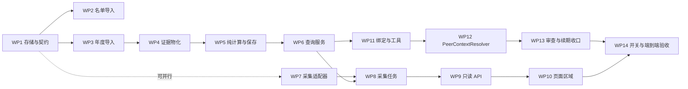

# 行业与同行参照实施拆分（sub-task 方案）

日期：2026-10-12。状态：阶段 A（WP1–WP6 固定证据接入与计算）与阶段 B（WP7–WP8 后台补采，离线验证）已实现并通过各自退出条件
（2026-10-12，门禁 3150 passed / mypy 0 错）。关键裁决：run-02 字段无披露日期依据，按设计不物化 EvidenceRecord，golden 三项统计在
纯函数层复现，保存链路以带日期合成夹具验证，批次映射制品格式与离线提交命令由 WP6 定义、WP8 复用；WP8 在线采集数据带
NOTICE_DATE/UPDATE_DATE → 可物化。阶段 C/D 未开始。
依据[技术设计](industry-peer-technical-design.md)（已经代码对照审查）与[首期范围](industry-peer-scope-draft.md)。
本稿只做执行拆分，不修改任何设计决定；实现中发现与设计冲突时，以设计为准并回改本稿，不静默偏航。

## 1. 拆分原则

- **工作包粒度**：一个 WP 是一次可独立提交、可独立回归的工作量；沿用现有执行纪律，每 WP 提交前跑全量门禁
  （pytest 全量，环境覆盖 `DATA_DIR` / `DATABASE_URL` / `API_KEY`；mypy 0 错）。
- **阶段门禁**：按设计的四段顺序推进——固定证据接入与计算 → 后台补采 → 页面接入 → Agent 接入；
  每段退出条件（设计第 11 节表格）达成后才进入下一段。段内存在并行位（§3）。
- **golden 纪律**：固定基准为 run-02 证据（[名单](../../research/industry-data-validation/evidence/run-02/sample.json)、
  [同行结果](../../research/industry-data-validation/evidence/run-02/derived/baijiu-peer-sample.json)、
  [原件核对](../../research/industry-data-validation/evidence/run-02/derived/baijiu-official-audit.json)）
  与设计第 11 节的三项统计数字。测试断言这些数值；基准变化必须回设计修订，不静默改 golden。
- **默认关闭**：`industry_peer_context_enabled` 默认 off。开关的 enforcement 随各 WP 落地（WP1 建配置，
  WP9/WP10/WP11 分别在 API、页面、Agent 生效）；在线采集与外部模型数据发送不在本拆分内启用（§10）。
- **红线（不做）**：不重构旧 `peer_comparison` 与评分内核；不动 `FinancialSnapshot` 默认查询与评分字段注册表；
  不建 bundle 表、发布指针表、通用插件系统、通用 PDF 解析器或全量同行监控；首期不为多市场预建 provider 框架；
  不把参照结果接入现有评分、筛选与 `report_views` 强弱总结。

## 2. 模块落点总览

| 落点 | 内容 | WP |
|---|---|---|
| `src/investment_agent/industry_peers/contracts.py` | DTO、整体与逐指标状态枚举、Quantity 兼容结构 | WP1 |
| `src/investment_agent/storage/models/peer.py` + `storage/repositories/peer.py` | 两张不可变快照表及查询 | WP1 |
| `src/investment_agent/industry_peers/evidence.py` | 年度字段 → `EvidenceRecord` 可信适配与物化 | WP4 |
| `src/investment_agent/industry_peers/calculations.py` | 固定名单纯函数与三项指标计算 | WP5 |
| `src/investment_agent/industry_peers/service.py` | 只读查询与批次映射组装 | WP6 |
| `src/investment_agent/providers/`（新年度适配器） | 限定主机年度 HTTP 采集 | WP7 |
| `src/investment_agent/industry_peers/jobs.py` + `research/worker.py` 注册 | `industry_peer_collect` 任务 | WP8 |
| `src/investment_agent/api/routes/research.py` | 两个只读 GET 端点与 DTO | WP9 |
| `web/templates/stock.html` + `web/static/industry_peers.js` | 独立参照区域 | WP10 |
| `agent/`（contracts、tools、resolver、publication） | 绑定、工具、专用校验与发布收口 | WP11–WP13 |

## 3. 依赖与并行

- WP2 与 WP3 在 WP1 后可并行；WP7 只依赖 WP1 的年度快照存储，可与 WP4–WP6 并行开发。
- WP8 需要 WP5+WP6（任务内先采集冻结输入、再调纯计算并统一提交映射）。
- WP9 可先对着离线导入批次开发联调（离线导入同样产出一份已提交批次映射），pending / 运行摘要等状态
  以 WP8 的假源运行覆盖后再收口。

## 4. 阶段 A：固定证据接入与计算（WP1–WP6）

全部离线完成：无真实 HTTP、无 LLM。退出条件（设计第 11 节）：19 家名单及 114 项核对可追溯、
三项统计复现、单位与排除规则正确、迁移和备份恢复通过。

### WP1 存储层与公共契约

- 新增 `PeerCohortSnapshot`、`PeerAnnualSnapshot` 模型与 repository；注册
  `ObjectRef.kind = peer_cohort_snapshot / peer_annual_snapshot`（UUID）。
- 年度快照唯一键 `(company_id, report_period, provider, adapter_version, semantic_hash)`；
  两表只追加、不可变，查询显式选版本；首次 `captured_at` 不变，重复读取的最后核查时间另记批次制品。
- 迁移一次到位：两张快照表 + `ResearchSnapshot` 可空 JSON 列 `industry_peer_context`
  + `ExecutionGrant` 等 JSON 契约的可空字段。迁移在数据库副本验证；回退方式为恢复迁移前备份（演练一次）。
- `industry_peers/contracts.py`：整体状态 `ready/partial/pending/not_supported/missing/conflict/stale/failed`、
  逐指标状态 `comparable/target_not_applicable/insufficient_peers/missing/conflict`、
  `{value: 十进制字符串或 null, unit, currency, unknown_reason}` 数值结构。
- `settings` 增加 `industry_peer_context_enabled`（默认关）及节流、重试等配置位。
- 测试与退出：迁移升降在副本通过、备份恢复后表与引用完整；唯一键并发去重；不可变约束（更新被拒绝）；
  模型注册进现有 metadata。

### WP2 名单快照离线导入

- 管理命令导入 run-02 `sample.json` 固定 19 家 → 不可变名单快照：`cohort_key=baijiu_current`、
  分类体系/版本、代码 `340501`、指数 `851251.SI`、来源定位与 hash、观察日期、取得时间、核对状态、纳入规则版本；
  逐公司 `company_id`、代表 `listing_id`、代码、名称、分类与上市状态证据引用、ST 与混合业务等可比性标记；
  纳入与排除名单及逐公司理由。
- 身份解析只走现有目录的 `company_id`/`listing_id`，不靠名称合并；无身份条目直接报错停下，不猜。
- 不注册为默认筛选池、不写观察池；公开时间未知的来源单独保留精度。
- 测试与退出：golden 19 家与 sample.json 一致；重复导入幂等（不产生新 revision）；无身份条目报错；
  追加新 revision 不改旧快照。

### WP3 年度事实快照导入与核对证明

- 导入 `baijiu-peer-sample.json`（字段值）与 `baijiu-official-audit.json`（114 项核对）→ `peer_annual_snapshot`。
- JSON 字段值保存：十进制字符串（不先转 float）、单位、币种、期间类型与 basis、原字段名、原始值、
  来源版本、披露与更新日期、取得时间、核对状态；缺失值带原因，原始零值完整保留，布尔、NaN、无穷拒绝入库。
- 逐字段核对证明入快照 JSON：原件 ObjectRef、PDF 与定位 hash、报告身份、页码、表头、原始值、原单位、
  期间、会计范围、核对时间、规则版本或核对人；明确排除母公司单体表与上期比较列。
- 导入校验必须实测数据与原件绑定、单位与 114 项一致性，不信任 JSON 里的成功标志；
  `acquired_at` 用实际导入时间，研究采集时间保留为来源元数据；导入时登记原件与受控制品到既有备份覆盖目录。
- ROE 上游 percent → fraction 除以 100 只做一次；`revenue_total_check` 只存核对项。
- 测试与退出：114 项核对全部复现且可从每项追溯到原响应 hash 与原字段定位；百分比不重复转换；
  零值与缺失分开；精度保持；伪造成功标志的导入被拒绝。

### WP4 可信字段适配与证据物化

- `industry_peers/evidence.py`：年度快照字段 → 现有 `EvidenceRecord`，subject 为该字段所属 listing，
  source 指向快照版本与字段定位；`EvidenceService.save_evidence` 增加明确分支，重核值、单位、期间、身份与 hash。
- verified 只能由可信适配器在读取实际原件与清单校验后生成；客户端或模型上传任意值声明 verified 一律拒绝。
- 同一快照字段证据只物化一次：以版本+字段定位派生稳定操作标识复用现有幂等收据；
  重试重建必须使用已保存快照的时间和 payload。
- 专用冲突与更正查询（按公司、指标语义、期间、单位、会计范围），不自动进入 `_source_conflict` /
  `document_limits` 全部路径；只有明确更正依据才连 `correction_refs`。
- 日期精度：NOTICE_DATE 只有版本通知日时保留 approx 语义；连日期依据都未知的行只落原始年度快照，
  不物化为必填 `published_at` 的 EvidenceRecord、不进可引用统计。
- 测试与退出：伪造 verified 被拒；同操作标识不同 payload 被拒；供应商更新不判原值错误（只标待核/冲突）；
  无日期行不产生 EvidenceRecord；物化幂等。

### WP5 纯计算与 SavedCalculation 保存

- `calculations.py` 纯函数：固定名单、同年度口径、逐项排除、标准库 median；
  达到 5 家有效同行才出中位数，目标也适用才出相对位置；目标不适用时中位数仍可用；
  不足 5 家只保存覆盖数量与原因；三项指标互相独立（现金流缺失不阻断 ROE）。
- 复用 `SavedCalculation`：method `industry_peer_context`、版本 `1.0`、`details.metric_key`
  固定 `roe / contract_revenue / cfo_parent_profit`；`results` 只含本指标实际可用键
  （target、peer_median、ascending_position、valid_peer_count、candidate_peer_count）。
- `input_hash` 覆盖名单 hash、目标身份、年度、精确输入版本、排除状态与依据、方法规则；
  `fact_refs` 含实际数值与纳入资格证据（非正分母利润、ROE 适用性净资产），缺失与冲突以排除审计保存。
- 单位：fraction / ratio / percent / count；ROE 与合同负债比以 fraction 保存、按 percent 展示；
  位置以 percent 保存；现金流比保存 4 位小数语义（展示格式注册在 WP13 统一落地）。
- 相同输入复用旧计算 UUID（核验输入与方法一致，不改其原始批次），不同输入追加新记录；
  SQL 按 method、目标、年度、metric_key 筛选。
- 测试与退出（golden）：茅台 ROE 32.53%、中位 7.39%、位置 94.44%；合同负债收入比 4.74%、16.30%、16.67%；
  现金流归母利润比 0.7474、0.5792、73.33%；有效同行 18/18、18/18、15/18。
  失效边界用例：收入口径误用、百分比重复转换、公司重复、跨行业补样本、年度不一致、空值与零值、
  亏损目标、负现金流、少于 5 家、相同值位置。

### WP6 只读查询服务

- `service.py`：读取已提交批次映射（有效提交映射的最大 generation，不按 finished_at），
  不发起上游请求；cutoff 校验——来源的取得、可得与核对记录不得晚于研究绑定的 cutoff。
- 目标年度确定复用本地实际披露记录的查询逻辑（不调用会发上游请求的 `/report-year` 路由）；
  只有上一年度结果时明确作为旧参照返回，不冒充当前年度。
- 组装整体状态、逐指标状态、warnings、混合取得时间（最早/最晚分开）、核对覆盖计数、
  设计第 8 节状态表（名单外 / pending / partial / 不适用 / conflict / stale / missing / failed）的映射。
- 完全无可用事实返回 missing、不建 status=ok 记录；已知更正或更新中的旧结果标待复核。
- 测试与退出：cutoff 之后的取得时间被排除；跨批次不混用（不能拼三份最新记录）；
  上一年度旧参照语义正确；各状态行映射与设计表格一致。

## 5. 阶段 B：后台补采（WP7–WP8）

退出条件：假源和已保存响应验证部分失败、幂等、重试及修订；实际来源的在线验证不在本拆分内（§10）。

### WP7 年度采集适配器

- `providers/` 新增限定主机的年度 HTTP 适配器：保存请求、状态、响应 hash 与 Retry-After；
  初始超时 30 秒、每公司串行、暂态错误最多重试 2 次、429 遵从 Retry-After、明确 schema 错误不盲重试；
  复用现有错误类型、节流与熔断，不复制研究脚本的全局缓存与固定日期逻辑。
- 字段映射按设计表格：`OPERATE_INCOME→operating_revenue`、`PARENT_NETPROFIT→net_profit_parent`、
  `TOTAL_PARENT_EQUITY→equity_parent`、`CONTRACT_LIAB→contract_liabilities`、`NETCASH_OPERATE→operating_cash_flow`、
  `ROEJQ→roe_weighted_annual`（/100）、`TOTAL_OPERATE_INCOME→revenue_total_check`（仅核对项）；
  完整报表按明确年度 dates 请求，不拉全市场摘要或全公司历史。
- 公司类型经财务页 ctype 元数据或有来源的已存元数据取得，无法确认即停止该公司，不猜默认类型。
- 请求前先检查既有原始响应是否已覆盖所需字段与相同版本，可用则不重复请求。
- 测试与退出（假源/已保存响应）：HTTP 200 返回 HTML、分页截断、重复期间判错；
  修订日期不同不自动判版本冲突（按同年度原件、来源版本与字段一致性判定，无法确认兼容 → 受影响指标待核）；
  旧快照复用条件（语义、期间、原始响应、时间、冲突状态逐项确认后留引用）。

### WP8 采集任务与批次管理

- `industry_peers/jobs.py`：新 kind `industry_peer_collect` 注册进 `default_job_handlers`
  （`research/worker.py`）；payload 由可信应用生成，绑定 cohort_ref、report_period、provider 与适配器版本、
  采集模式与刷新 generation；名单内 ticker 从保存快照解析，不接受模型传入代码集合。
- 去重范围 `(cohort_ref, 年度, provider, adapter_version)`：先复用 queued/running；generation 由上一已终结批次派生；
  用现有 `(kind, idempotency_key)` 唯一约束防并发重复。
- 执行模型：按公司检查点（单公司来源保存后提交，不跨整组长事务）；每次写入、检查点与最终提交同事务
  `fence_writes`；崩溃恢复与有限重试；冻结批次清单（本次引用 / 复用旧引用 / 缺口）；
  最终事务保存同批引用映射并标 success/partial；单家公司失败不把整组判成功或全组失败。
- 原始制品按 run_id 存既有 research-runs 数据目录（进备份覆盖范围），metadata_json 保存 hash、路径与检查点。
- 管理命令：名单初始化与显式重试；目标研究提交时的准入检查（首次缺失、确认新年报或更正 → 合并入队一个任务；
  其余重复缺失 24 小时冷却只返回原缺口）。GET 与 Agent 均不触发采集。
- 测试与退出：租约丢失的旧 worker 无法写入；崩溃重试复用检查点；并发去重；
  旧批次晚完成不覆盖较新 generation；跨批次混用被拒；失败重试产生下一 generation；
  部分失败映射 partial 且逐指标原因可见。

## 6. 阶段 C：页面接入（WP9–WP10）

退出条件：无评分也能读参照、历史不串新结果、未知及不足样本明确可见。

### WP9 只读 API 与研究绑定

- `GET /stocks/{ticker}/industry-peer-context`：无参读当前已提交批次；`batch_run_id` 精确读该批次映射。
  按现有 local_owner 身份校验批次 kind、名单成员与映射目标，禁止借任意 run_id 读取其他采集或计算。
- 响应包含 `schema_version`、业务状态、target、report_period、cohort、batch_run_id、`metric_calculation_refs`、
  `data_as_of`、构建与最后核查时间、逐项 metrics、warnings 与运行摘要；金额比率用
  `{value, unit, currency, unknown_reason}`；as_of 带时区。
- `GET /stocks/{ticker}/industry-peer-context/companies?batch_run_id=...`：按批次映射返回固定版本同行明细
  与原字段证据；数值全部来自服务端，浏览器不重算中位数。
- 错误契约：非法代码 422；目标不存在或历史结果不属于目标 404；网络错误与字段缺失分开显示；
  结构正确但未覆盖返回正常业务状态（含 null 与原因）。
- `ResearchJobPayload` 入队时冻结 `industry_peer_context` 绑定，快照写入时原样保存；
  `artifact_manifest` 继续只存文件路径；旧快照字段为 null。
- 测试与退出：无评分快照时可读；带 batch_run_id 的历史读取不串新批次；状态枚举齐全；
  422/404 边界；DTO 随 run detail 返回。

### WP10 个股页面参照区域

- `stock.html` 新增独立"行业与同行参照"区域，`web/static/industry_peers.js` 调用 WP9 服务；
  原生 JS、同源认证、现有错误提示模式；不依赖 `loadStockDetail` 已取得评分。
- 两个区域明确区分：独立当前参照（最新已提交批次）与"该次研究的参照"（run 快照绑定）；
  旧快照 null 显示"该次研究未保存同行参照"，不用最新结果回填。
- 逐指标展示 target 值、同行中位数、位置、有效/候选数、核对覆盖、排除公司与可点击证据引用；
  不足 5 家不展示统计；pending 显示运行摘要；单位、日期与状态面向用户表达，不暴露 provider 字段名或内部 hash。
- 验证：除单测外，按现有 Web 验证方法在 dev 环境自签 cookie 真实渲染走查（无评分、部分、缺口、旧快照四类页面）。

## 7. 阶段 D：Agent 接入（WP11–WP14）

退出条件：离线假模型验证页面与工具引用一致、越界及伪证据被拒绝；真实启用条件另见 §10。

### WP11 授权绑定与读取工具

- `ExecutionGrant.peer_context`（默认 null 兼容旧任务）：任务准入时由可信应用固定，
  结构与研究绑定一致（target、cohort_ref、batch_run_id、年度、cutoff、metric_calculation_refs）；
  同任务重试用原绑定；子任务续跑只在目标、cutoff 与方法一致且来源仍可用时继承；普通新消息重新绑定。
- `get_industry_peer_context` 工具：注册进现有 ToolRegistration 与授权白名单；模型业务参数仅 target ticker；
  授权经 operation 所属任务读取持久化 grant，控制字段不进模型 schema。
- 返回复用现有 `ToolResult` 外层状态（不新增 partial 枚举），覆盖状态放 data；
  无绑定返回 missing 与缺口；后台有任务只给运行线索，不返回触发自动延迟等待的 pending/dependency_id；
  读取预计算结果时检查记录与来源均在 cutoff 前提交。
- 普通返回只含三项指标可用值、单位、报告期、样本数、核对覆盖、限制与各指标 `calculation.results.*` 引用，
  不回传原始响应、同行身份表或 PDF。
- 测试与退出：历史 conversation 中的 UUID / 旧工具返回不能恢复权限；未绑定同行读取被拒；
  cutoff 之后创建的结果不进旧任务；旧任务 grant 序列化兼容（新字段 null）。

### WP12 PeerContextResolver 与统一方法入口

- 方法专属 `PeerContextResolver`：仅处理 method、method_version、metric_key、目标与可信绑定一致的计算；
  校验真实主体、名单成员、排除目标、公司去重、年度与逐字段期间、语义、单位、币种、可得与取得时间、
  原件证明、跨源冲突、排除依据、结果键、input hash 与计数；批次归属由已提交映射证明；
  复用旧 UUID 时核验输入清单兼容；同请求内缓存、不跨请求不跨更正检查。
- 统一方法入口注册五个固定操作 `scope / verify / numeric_output / review_material / current_limits`，
  仅注册本方法；研究进度验证、准备语义审查、正式发布检查、渲染、当前意见依赖复核全部走它。
- `validate_progress` 的单公司前置判定增加方法限定分支（从可信计算绑定读目标身份），
  不能只改 NumericResolver 留下前置拒绝；正式发布与依赖复核中直接遍历 `calculation.fact_refs` 的路径
  改走方法专属依赖接口；实体节点仍只允许目标公司。
- 比较任务窄分支：任务只授权一个目标且比较主张使用绑定的本方法指标引用时，按固定样本统计规则核验，
  不要求模型取得同行原始证据；其他多公司比较仍走原规则。
- `require_verified_counter_evidence` 保持要求原始 SavedEvidence，同行统计不能替代。
- 测试与退出：改 subject_ref 伪装同行事实被拒；伪造 calculation_ref 被拒；
  通用 resolver 不接受任意公司；前置拒绝绕过被堵；混入任意同行事实的比较任务不放行。

### WP13 审查材料、发布格式与续期收口

- 本方法固定 material formatter：后端核验完整指标输入清单，模型收到指标计算摘要
  （定义、目标、年度、结果、数量、纳入与排除规则、核对状态、限制、清单 hash），不展开全部 fact_refs；
  整体摘要仍受既有大小与数量限制，超限仍阻止。
- `material_set_hash` 绑定完整指标清单与排除审计，模型摘要 hash 另记；`checked_sources` 引用计算记录，
  服务端沿 fact_refs 与审计逐一复核；来源核验不足保持 pending。
- 发布协议：引用比较结果的主张用现有 inference 类型并标明描述性计算（Claim.kind 不新增枚举）；
  `NumericNode.role = output`；注册本方法现金流比 4 位小数格式规则，其他方法保持 2 位；
  ROE 与合同负债比 fraction 保存、percent 展示；页面与 Agent 对同一值不得看似不同。
- `verify_unchanged_review` / `extend_recommendation`：包含关键同行计算依赖的意见明确阻止
  "维持不变并延长有效期"，返回需重新研究的原因；原意见既定有效期与已知变化限制保持。
- `check_progress_round` 识别新材料并登记实际 calculation refs；重试走既有动作收据；
  续跑与上下文压缩按已绑定指标摘要恢复，不依赖 `recovered_evidence` 猜计算权限。
- `current_limits` 扩展：新名单、影响本指标的同行字段修订、核对失效或方法版本变化 → 待复核原因。
- 测试与退出：32 material / 64000 字符边界（摘要超限仍阻止、不裁剪放行）；统计解释边界
  （不生成 stronger/weaker、不自动推导渠道库存或竞争优势）；关键同行依赖续期被拒；
  旧评分与 `report_views` 不消费本结果。

### WP14 开关 enforcement 与端到端离线验收

- `industry_peer_context_enabled` 在 API、页面、Agent 三处统一生效；配置默认关，打开仅暴露离线已导入结果。
- 端到端离线验收：假模型跑通"页面与工具引用一致"；越界读取与伪证据在端到端路径被拒；
  备份 → 恢复后原件与引用可读；`docs/review/` 记录验收日志。
- 对照设计第 11 节"验证重点"清单逐条核对测试覆盖（§8 映射表），缺一条补一条。
- 全量门禁：pytest 全量（env 覆盖三变量）、mypy 0 错；不访问生产库、不调真实 LLM。

## 8. 验证重点 → WP 映射

| 设计验证重点 | 覆盖 WP |
|---|---|
| 收入口径误用、百分比重复转换、空值与零值、亏损目标、负现金流、少于 5 家、相同值位置、公司重复、年度不一致 | WP3、WP5 |
| 跨行业补样本 | WP5（名单限定）、WP12（名单成员校验） |
| 母公司单体表、无法确认修订兼容 | WP3（核对清单）、WP7（版本判定） |
| HTTP 200 HTML、分页截断 | WP7 |
| 租约丢失与崩溃重试、并发去重及旧批次晚提交 | WP8 |
| 跨批次混用 | WP6、WP8、WP9 |
| 已知更正 | WP4（correction_refs）、WP6（待复核）、WP13（current_limits） |
| 任务 cutoff | WP6、WP11 |
| 伪造 calculation_ref、读取未绑定同行、比较任务前置拒绝、原始反证要求 | WP12 |
| 关键同行依赖的续期拒绝、来源摘要超过限额 | WP13 |
| 旧评分与旧授权兼容 | WP11、WP14 |
| 备份恢复后的原件读取 | WP1（迁移/备份演练）、WP14（端到端） |

## 9. 提交与门禁节奏

- 每 WP 一个提交（消息注明 WP 编号）；提交前：该 WP 测试 + 全量 pytest + mypy。
- 阶段切换点（WP6、WP8、WP10、WP14 完成时）对照设计第 11 节退出条件做一次阶段小结，
  结论记入本稿状态行；不满足不进入下一段。
- 实现中的小决定（命名、文件归属、测试组织）按既有纪律自主推进并在提交信息中说明；
  涉及语义或契约的决定回设计文档确认后动手。

## 10. 不在本拆分内完成的启用条件

- 在线采集：候选来源的自动获取、长期保存、备份与展示条件按[核对矩阵](../../research/industry-data-validation/evidence/run-02/rights-matrix.json)落实，
  并通过真实年度请求的有限验收后才启用。
- 真实 Agent：明确允许发送的数据范围（外部 LLM 可发送范围）与解释质量人工评阅后启用。
- 2025 固定样本的结论不外推到其他行业、全市场或完整历史；名单变更、多市场扩展、同行续期监控
  均为后续设计项。
