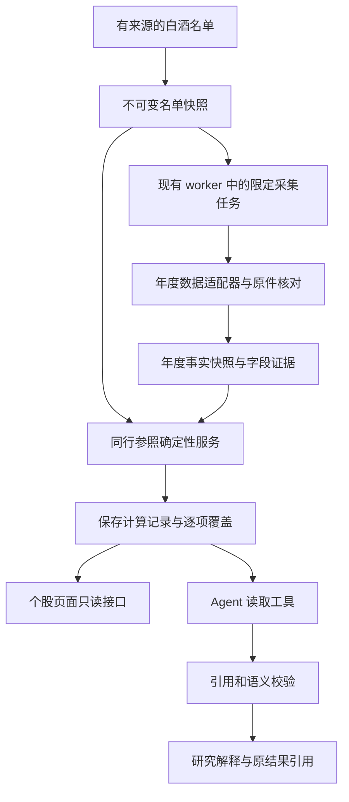

# 个股研究行业与同行参照技术设计

日期：2026-10-12。状态：经代码对照审查并修订，可进入本地固定证据驱动的首期开发；在线数据与真实 Agent 启用另行验收。本轮仅修改设计文档，未开始应用开发。范围依据为[已确定的首期范围](industry-peer-scope-draft.md)，审查问题见[审查记录](industry-peer-design-review.md)。拟新增模块、表、接口和配置均是设计约定。

首期在现有个股研究中增加白酒年度财务参照。复用公司与上市证券身份、后台队列、证据存储、确定性计算记录和现有页面；新增明确名单、年度字段采集适配和同行统计服务。页面与 Agent 引用同一份不可变结果，参照结果不进入现有评分与筛选链路。

2026-10-13 实现补正：首期离线功能已完成并通过修复复验，详见[验收记录](../review/industry-peer-fix-acceptance-2026-10-13.md)。映射文件必须匹配同一事务提交的不可变操作收据后才可读取；旧任务沿用准入 generation。固定样本导入增加实际原件和公告元数据，原件核验不足仍保持 candidate，不放宽引用要求。原始年度字段引用也检查原件和已知修订；在线及真实外部 Agent 的启用条件继续保留。

## 现有实现与复用边界

| 能力 | 已核实的代码 | 首期复用及必要增量 |
|---|---|---|
| 公司与证券身份 | [Company 与 Listing](../../src/investment_agent/storage/models/reference.py) | 以 company_id 去重，保留代表 A 股 listing_id；不靠名称合并公司 |
| 行业分类 | [申万适配器](../../src/investment_agent/providers/akshare_shenwan.py)、[分类同步](../../src/investment_agent/snapshots/shenwan.py) | 复用分类代码、目录与 TLS 校验；另存本次采用的标签和名单快照，不把分类有效区间当作完整历史知识版本 |
| 同行计算 | [peer_comparison.py](../../src/investment_agent/research_kernel/peer_comparison.py) | 复用业务约定与标准库 median；新增纯函数处理固定名单、同年度口径与逐项排除。旧函数读评分结构且映射强弱，首期不为此先重构旧内核 |
| 东财采集 | [provider](../../src/investment_agent/providers/akshare_eastmoney.py)、[collector](../../src/investment_agent/snapshots/eastmoney.py) | 复用错误类型、节流和熔断等基础能力；新增限定年度请求适配。旧摘要拉全市场，旧现金流请求拉全历史，不能把它们当作四个现成的按年接口 |
| 财务快照 | [FinancialSnapshot](../../src/investment_agent/storage/models/pit_snapshot.py) | 可作为已有字段的候选来源；首期年度参照另存专用事实快照，避免新字段或 provider 混入旧因子选择逻辑 |
| 后台执行 | [worker](../../src/investment_agent/research/worker.py)、[JobHandler](../../src/investment_agent/jobs/base.py)、[任务契约](../../src/investment_agent/snapshots/jobs.py) | 复用 PipelineRun、租约、心跳和失败恢复；新增名单限定 handler、公司检查点与原始制品。不假设现有运行中心或暂停取消接口支持这个新 kind |
| 证据与计算 | [EvidenceService](../../src/investment_agent/evidence/store.py)、[契约](../../src/investment_agent/evidence/contracts.py)、[存储](../../src/investment_agent/storage/models/evidence.py) | 继续使用 SavedEvidence、SavedCalculation、Quantity 和 ObjectRef；新增可信年度字段适配器及方法专属输入校验 |
| 公告原件 | [disclosures](../../src/investment_agent/evidence/disclosures.py)、[documents](../../src/investment_agent/evidence/documents.py) | 复用来源校验、原件 hash、片段定位；先接入已有核对清单及受控人工核对，不将通用年报自动解析器作为首期前置项 |
| 旧研究页面 | [stock.html](../../src/investment_agent/web/templates/stock.html)、[app.js](../../src/investment_agent/web/static/app.js)、[research 路由](../../src/investment_agent/api/routes/research.py) | 增加独立参照区和只读接口，保留旧研究快照固定引用；该区域能在无评分快照时加载 |
| Agent | [tools](../../src/investment_agent/agent/tools.py)、[research](../../src/investment_agent/agent/research.py)、[数值解析](../../src/investment_agent/investor/publication_numbers.py) | 新增结果读取工具、固定任务引用、方法限定的多公司输入核验；不放宽通用单公司证据边界 |

现有数据适配必须保留两个语义区别：东财摘要的 `revenue_total` 是营业总收入，`total_equity` 是股东权益合计，不能替代营业收入与归母净资产。现有公告解析中“营业收入”也映射为 `revenue_total`，新功能需使用独立版本的准确映射，不直接拿该标签作为同口径证明。

## 模块与数据流

拟新增 `industry_peers/` 应用模块，包含 `contracts.py`、`service.py`、`calculations.py`、`evidence.py` 和 `jobs.py`。HTTP 和 Agent 共享该模块的查询服务；采集适配仍放在 `providers/`，数据库模型与查询放在 `storage/`。

查询服务不发起上游请求。同一后台任务先采集，冻结批次输入后调用纯计算服务，为名单内可支持的目标构建三项结果，再统一提交引用映射。首个 19 家名单最多新增 57 份小型计算记录，不调用 LLM；这样无需再引入按目标计算的队列、终结后改写批次映射或查询时写入。GET 与模型工具只读已提交结果；未取得结果的本次研究保留缺口，结果供后续读取。

## 数据对象与保存方式

### 名单快照

新增 `peer_cohort_snapshot`，使用 UUID、固定 revision 和不可变 JSON 保存名单，内容包括：

- `cohort_key=baijiu_current`、分类体系与版本、分类代码 `340501`；来源是指数成分时另记指数代码 `851251.SI`。
- 名单来源、来源定位及 hash、观察日期、取得时间、核对状态、纳入规则版本。
- 每家公司 company_id、代表 listing_id、代码、名称、分类和上市状态证据引用，以及 ST、混合业务等可比性标记。
- 纳入与排除名单、逐公司理由、与其他名单来源的差异；失去身份或存在未核实冲突的条目不进入确认样本。

不将研究名单注册为默认筛选池，也不写入观察池。公司身份可以沿用现有目录同步建立，但没有身份的条目须先解决，不能由名称猜测。首个离线快照按[验证名单](../../research/industry-data-validation/evidence/run-02/sample.json)固定 19 家；之后名单变化产生新快照。

新增 `ObjectRef.kind=peer_cohort_snapshot`，使用 UUID。分类和名单源的公开时间可未知，单独保留精度；不把观察日期伪装成正式成分调整生效日。

### 年度事实快照

新增 `peer_annual_snapshot`，按公司、财报年度和数据来源保存不可变版本。索引列至少包括 UUID、company_id、listing_id、report_period、provider、adapter_version、captured_at、content_hash；字段及证据元数据保存在 JSON 中，原始响应保存在既有运行制品目录。

字段值以 Decimal 对应的十进制字符串保存，带单位、币种、期间类型、合并或归母范围、原字段、原始值、来源版本、披露与更新日期、取得时间和核对状态。请求 JSON 在解析数值时保留十进制精度，不先转 float。缺失值带原因，原始零值完整保留，布尔值、NaN 与无穷值拒绝进入统计。原响应 hash 和原字段定位必须能从每一项追溯。

收入、利润和现金流的 Period 为 1 月 1 日至 12 月 31 日、basis 为 `period_to_date/annual`；净资产和合同负债的 Period 为 12 月 31 日单点、basis 为 `point_in_time`；ROE 为明确的全年披露比率。方法按指标允许存量与流量组合，不拿整个 Period 对象相等作为这三个比率的通用校验。

新增 `ObjectRef.kind=peer_annual_snapshot`，使用 UUID。年度快照不进入 `FinancialSnapshot` 默认查询或现有评分字段注册表，防止旧查询按最新 provider/part 选择到未经兼容处理的数据。

可信适配器把可用字段转换为现有 `EvidenceRecord`：subject 仍为该字段所属 listing，source 指向年度快照的版本和字段定位。`EvidenceService.save_evidence` 增加明确分支，重新核对已保存的值、单位、期间、身份与 hash；不允许客户端或模型上传任意值并声明为 verified。

同一年度快照的字段证据只物化一次，供名单内各目标计算共享引用。写入使用版本和字段定位派生的稳定操作标识复用现有幂等收据；新增快照以唯一内容约束防止并发重复，内容变化或核对状态变化生成新版本。与现有不可变证据一样，只允许追加，查询时明确选择版本。

唯一键按 `(company_id, report_period, provider, adapter_version, semantic_hash)` 定义，hash 覆盖金额、语义、源修订版本、核对证明及冲突状态，不包含本次重试时间或本地保存路径。首次保存的 captured_at 不变，重复读取的最后核查时间另记批次制品。重试重建证据必须使用已保存快照的时间和 payload，不能向同一操作标识提交带新时间的不同 payload。

专用来源不会自动进入现有 `_source_conflict` 或 `document_limits` 全部路径。适配器须建立按公司、指标语义、期间、单位和会计范围匹配的冲突及更正查询，保存原件证明引用；verified 的年度字段继续校验该证明是否已更正或失效。不同原件值只标为待核或冲突；只有明确更正依据才连接 correction_refs，不能因供应商更新就宣布原值错误。

逐字段核对证明保存在年度快照 JSON 中，包含原件 ObjectRef、PDF 与定位 hash、报告身份、页码、表头、原始值、原单位、期间、会计范围、核对时间及规则版本或核对人。可信适配器读取实际原件和清单校验后才能生成 verified。现有 `DocumentProvenance.reporting_scope` 只支持 consolidated/unknown，通用文档指标表也不足以表达这些新字段；首期不强塞归母净资产或 ROE 到旧映射，不扩大整个文档解析协议，专用来源直接解析并核验上述证明。

### 同行计算记录

复用 `SavedCalculation`，方法为 `industry_peer_context`、方法版本 `1.0`。每个目标与年度最多保存三份指标记录，`details.metric_key` 固定为 `roe / contract_revenue / cfo_parent_profit`，其余 details 保存目标 listing、名单引用、批次、纳入与排除公司、字段证据和质量状态。这样沿用现有按计算记录引用、声明依赖及核验的方式，不另建通用“逐结果依赖图”。

每份 `results` 仅有本指标的 `target`、`peer_median`、`ascending_position`、`valid_peer_count`、`candidate_peer_count` 中实际可用的键。单位为 fraction、ratio、percent 和 count，禁止把同行位置与历史估值分位混用。记录的 fact_refs 包含该指标的实际数值与纳入资格证据，包括用于判断非正分母的利润、用于 ROE 适用性检查的净资产；缺失或冲突条目以排除审计保存，不能伪装为可用数值事实。

达到 5 家有效同行时保存中位数；目标也适用时再保存相对位置。目标不适用时同行中位数仍可用；不足 5 家时只保存可核验的覆盖数量与原因，不生成中位数或位置。完全没有可用来源事实时只保留批次缺口，返回 missing，不创建 status=ok 的计算。其他记录的 ok 表示其实际存在的结果键已算对，不代表来源全部 verified。

`input_hash` 覆盖本指标名单 hash、目标身份、年度、精确输入版本、排除状态与依据以及方法规则；可用输入与排除审计一并决定计数。同一指标的全部输出共享这份依赖范围，首期不做逐结果键的依赖裁剪。三项独立核验，所以现金流数据缺失不会阻断已完成的 ROE 比较。

同批指标引用在 DTO 中组成 `metric_calculation_refs`，批次制品保存每个已构建目标的引用映射，终结后该映射不可改写；不新增 bundle 表或 bundle ObjectRef。当前结果使用选定的已提交批次，不能跨批次取三份最新记录拼成一个结果。相同输入可复用旧计算 UUID，不同输入追加新记录；复用时从旧记录中验证输入及方法，不修改其原始构建批次，新的批次映射记录这次关联。SQL 按 method、目标、年度和 metric_key 筛选，并从批次映射精确读引用。

首期只新增上述两类实体表，比较结果复用现有计算表。查询规模为单个小名单；若后续扩大，再根据查询情况增加索引投影，不预建行业平台。

## 补采字段与接口适配

候选源为本地验证过的东财网页财务接口，尚未确定为长期数据提供方。以下映射是该候选适配器的要求，替换来源时须满足相同语义和验收条件。

| 首期字段 | 专用字段名与单位 | 已验证的东财原字段 | 现有链路与补采要求 |
|---|---|---|---|
| 营业收入 | `operating_revenue`，CNY | 完整利润表 `OPERATE_INCOME` | 新增；不能取营业总收入或主营业务收入 |
| 归母净利润 | `net_profit_parent`，CNY | 完整利润表 `PARENT_NETPROFIT` | 旧摘要有对应值；同期间和修订口径一致才复用，完整表作一致性核对 |
| 归母净资产 | `equity_parent`，CNY | 完整资产负债表 `TOTAL_PARENT_EQUITY` | 新增；不能取股东权益合计 |
| 合同负债 | `contract_liabilities`，CNY | 完整资产负债表 `CONTRACT_LIAB` | 新增；摘要表不足 |
| 经营现金流 | `operating_cash_flow`，CNY | 完整现金流表 `NETCASH_OPERATE` | 可复用现有接口及原响应；须匹配财报期、币种和版本 |
| 年度加权平均 ROE | `roe_weighted_annual`，fraction | 主要指标表 `ROEJQ`，上游单位 percent | 新增准确语义的映射，除以 100；不复用未确认口径的泛化 `roe` |
| 营业总收入 | `revenue_total_check`，CNY | 完整利润表 `TOTAL_OPERATE_INCOME` | 保存为核对项，不作为比率分母 |

本地接口依据见[完整财务采集脚本](../../research/industry-data-validation/scripts/round2_extra.py)与[字段映射](../../research/industry-data-validation/scripts/round2_analyze.py)。正式适配器复用已有 provider 错误类型、节流、熔断和测试替身，不复制研究脚本的全局缓存和固定日期逻辑。新增小型限定主机的年度 HTTP 适配器保存请求、状态、响应 hash 与 Retry-After；现有 AKShare 请求包装器没有提供这些完整能力，不能假定原样复用就已支持。

公司类型通过已验证的财务页 ctype 元数据解析或有来源的已存元数据取得；无法确认时停止该公司的采集，不调用 AKShare 私有函数或给全部公司猜一个默认类型。完整报表优先按明确年度 dates 请求，不为白酒比较拉取全市场摘要或全公司历史。初期不为未来多市场预建 provider 框架，使用一个可替换、可注入假源的年度采集协议即可。

东财候选通道按指定公司与年度调用主要指标表，以及完整利润、资产负债、现金流三表。先检查现有原始响应是否已覆盖所需字段及相同版本；可用则不重复请求。预计每家公司最多需要 4 类财务请求，另有公司类型和公告元数据获取；19 家按此得到 76 个财务请求单元，但实际 HTTP 数受分页、元数据请求和重试影响，不作为固定计费或稳定性承诺。

`companyType`、REPORT_DATE、SECUCODE、CURRENCY 和合并报表范围均需验证。分页完整性、重复期间和 HTTP 200 返回 HTML 要视为数据错误；声明缺失的列与上游明确空值分别记录。修订日期不同本身不证明版本冲突；对照同年度原件、来源版本标记与字段一致性判定，无法确认兼容时受影响指标进入待核，不自动拼接不同版本。不能用一个来源的归母利润与另一个来源的现金流掩盖已知差异。

旧快照只作为候选复用来源：逐字段确认语义、期间、原始响应、时间和冲突状态后，年度适配器留下引用和核对结果。不能仅凭字段名相同或数值恰好一致宣称原件 verified。

## 年报选择与原件核对

默认采用目标公司已确认披露的最近完整年度年报；每次研究冻结该年度，同行缺失同年度数据就保留缺口，不替换为其自己的“最新一期”。日期到了不代表年报已披露。首期验收固定 2025 年报，产品不会永久硬编码这个年度。

当前查询先确定这个目标年度，再找该年度结果；如果只有上一年度结果，将它明确作为旧参照并显示当前年度尚缺数据，不把它静默当成当前年度比较。首期不提供用户切换历史年度的控件。

名单、年度事实与计算保存各自时间。查询 cutoff 是研究任务绑定时间；来源的取得、可得与核对记录都不得晚于它。公告只有日期时保留日期精度，在可用性判断中采用保守日期边界；缺正式披露依据时保持待核，不给必填 published_at 编造时间。系统获得最新修订值的时间，不能回填成多年前的知识时间。

年度选择复用本地实际披露记录的查询逻辑，不能直接调用可能发起上游请求的 `/stocks/{ticker}/report-year` 路由。官方披露时间优先；供应商 NOTICE_DATE 仅有版本通知日期时保留 approx 语义，与原公告日期分开。日期精度进入 datetime 契约时使用该日结束的保守边界并注明精度，available_from 不早于可证实的版本可用时间。连日期依据也未知的行先只落原始年度快照，不物化为必填时间的 EvidenceRecord，也不进入可引用统计。

原件核对先采用版本化的字段核对清单：收入、归母利润、归母净资产和 ROE 对照年度关键指标；合同负债对照合并资产负债表；现金流对照合并现金流量表。清单保存报告身份、表头、单位、当期列、范围、PDF hash、页码、行或片段 hash 和核对原因，明确排除母公司单体与上期比较列。

已有原件存储和文本提取可以复用，但“提取片段”不等于“验证会计字段”。首期只实现已有固定样本导入校验、人工核对清单的受控保存和候选字段展示，保留准确独立的指标映射；不要求先完成可自动处理所有白酒年报版式的解析器。新年度或无法确认的版式保持 candidate，人工核对或以后新增经过验收的特定解析规则。API 与原件属于同一发行人披露源，匹配证明口径一致，不计作独立来源的重复佐证。

首个离线导入使用已有[原件核对记录](../../research/industry-data-validation/evidence/run-02/derived/baijiu-official-audit.json)和原件 hash。导入校验须核对数据与原件绑定关系、单位和 114 项一致性，不直接信任 JSON 中一个成功标志。导入时 acquired_at 采用实际系统导入时间，原研究采集时间保留为来源元数据。

有 API 值、时间和口径依据但无原件确认的字段可以以 candidate 状态展示，统计显示核对覆盖。critical 主张依赖某指标时，该指标的数值、适用性和排除依据都须满足核验要求；采集失败条目仍可描述为部分样本，但不得将未知字段或其排除理由提升为已核对。候选参照不能提升为关键结论证据。

## 任务触发与失败处理

新增独立任务类型 `industry_peer_collect`，在 `default_job_handlers` 注册，不扩展旧 `FinancialSnapshotPayload` 的观察池或目标池语义。任务请求由可信应用生成，绑定 cohort_ref、report_period、provider 与适配器版本、采集模式及刷新批次；名单内实际 ticker 从保存的快照解析，不接受模型传入任意代码集合。

现有 `/research/runs` 和 run detail 只支持 ifind_research；首期不把新采集任务强塞进这套 DTO，也不先改造通用运行中心。参照 API 提供该名单的运行摘要及错误覆盖，初始化和显式重试由窄范围管理命令负责。原始制品按 run_id 存在既有数据目录中，metadata_json 保存 hash、路径与检查点；不会调用要求 ResearchSnapshot 的旧制品下载接口。若需页面手动刷新，再增加单独受控入口，不把它混入 GET。

首期手动初始化名单并执行年度补采。目标研究提交时，应用检查已提交结果及其覆盖；首次缺失、已确认新年报或更正、显式重试可以合并入队一个该名单年度任务。其他重复缺失或失败在上次核查后 24 小时内只返回原缺口，避免每次提问都重采；该冷却期可按来源条件配置。GET 页面读取不触发采集，Agent 也不通过通用 refresh 工具刷新整个观察池。

已有结果在任务准入时固定；先前尚无结果的研究可记录缺口继续完成，补采产生的结果供新研究使用。首期不让 Agent 隐式等待整组采集完成，也不自动扩展其 cutoff 来吸收新数据。名单变更须经过来源和纳入规则核对后才成为新的采集范围，不能因为外部页面多出代码直接扩大范围。

采集按公司留检查点，在完成单公司来源保存后提交，不跨整组维持长数据库事务。每次事实写入、检查点和最终结果提交均在同一事务中执行现有 fence_writes，防止失去租约的旧 worker 继续写入。复用崩溃恢复和有限重试；首期不新增暂停或用户取消能力，不能把 AgentTask 的取消当成 PipelineRun 已有功能。

冻结的批次清单明确记录每家公司本次事实引用、允许复用的旧引用或缺口，不在计算中逐项查“当前最新”而混入另一进行中的批次。允许复用旧输入时显示各自取得时间。构建各指标结果后，最终事务保存同批引用映射并标记 success/partial；失败重试复用已完成检查点，查询只采用已发布的完整映射。

初始请求默认超时 30 秒，每公司串行处理，暂态错误最多重试 2 次，429 遵从 Retry-After；明确 schema 错误不盲重试。已有节流和熔断能力优先复用，具体频率根据实际来源条件配置。首期不增加每天全量扫描；年报发布或已知更正可触发限定年度刷新，显式重试使用前述管理命令。

去重范围是 `(cohort_ref, 年度, provider, adapter_version)`，先复用该范围内 queued/running 任务；刷新批次不能由每个请求随机生成。可信应用按上一已终结批次派生下一 generation，使用现有 `(kind, idempotency_key)` 唯一约束防止并发重复；请求 payload 使用同一规范内容，触发来源另作审计。新更正或显式重试可创建下一批次，旧成功不会永久挡住刷新。当前选择在可信指定的名单版本、年度和来源适配范围内，查询具有有效提交映射的最大 generation，不按 finished_at 排序，也不另建发布指针表；较旧批次晚完成不能覆盖较新结果。名单与来源版本切换由可信配置确认，不比较不同范围的 generation。

| 状态 | 页面与研究处理 |
|---|---|
| 名单外或功能未覆盖 | 显示尚未覆盖，旧个股研究继续 |
| 有待执行任务 | 返回 pending 与运行引用；读取已有结果时同时标明它的日期 |
| 部分来源缺失或失败 | 返回 partial，逐指标显示有效数和具体原因；不足 5 家不展示统计 |
| 目标指标不适用 | 保留同行明细与足量同行中位数，不生成目标相对位置 |
| 已知字段或名单冲突 | 标记 conflict，排除未核实输入；不隐藏冲突，也不选择一个更有利的值 |
| 已知更正或更新中的旧结果 | 旧版供历史查看；当前展示标记待复核，Agent 不引用为当前有效依据 |
| 全部不可用 | 返回 missing 或 failed 与运行错误摘要，不影响评分区显示 |

来源数据采集完整度、原件核对覆盖和计算适用性分开统计。单家公司 failure 不将整组变为成功，也不把所有研究任务一起标记失败。

## 页面与接口接入

在 `stock.html` 新增独立“行业与同行参照”区域，`industry_peers.js` 调用共享只读服务，不依赖 `loadStockDetail` 已取得评分才能显示。保持现有 Jinja、原生 JS、同源认证和错误提示模式。

拟新增 `GET /stocks/{ticker}/industry-peer-context`，无参数时读取已保存的当前年度批次结果；历史研究传 `batch_run_id` 精确读取该批次对该目标的指标引用映射。按现有 local_owner 身份校验批次 kind、名单成员与映射目标，禁止借任意 run_id 读取其他采集或计算。历史引用同时保存三项实际 calculation refs，不能由一个复用的指标 UUID 反查“最近含它的批次”来拼历史结果。

响应明确包含 `schema_version`、业务状态、target、report_period、cohort、batch_run_id、metric_calculation_refs、data_as_of、构建与最后核查时间、逐项 metrics、warnings 和关联运行摘要。逐项数据包含 target_value、peer_median、ascending_position、candidate_count、valid_count、verification_counts、excluded_companies 及可点击证据引用。混合取得日期的批次明确展示最早与最晚取得时间，不用单个最新时间掩盖较旧输入。

金额和比率使用 `{value: 十进制字符串或 null, unit, currency, unknown_reason}`，兼容现有 Quantity；数量为非负整数，状态为枚举。所有 as_of 与构建时间传带时区时间，展示统一为 Asia/Shanghai。API 状态固定为 `ready / partial / pending / not_supported / missing / conflict / stale / failed`；逐指标状态另记 `comparable / target_not_applicable / insufficient_peers / missing / conflict`，不靠一个整体成功标志推断每行都适用。

同一服务提供 `GET /stocks/{ticker}/industry-peer-context/companies?batch_run_id=...`，按该批次映射返回固定版本的同行明细及原字段证据。首期不做年度切换控件或自选同行编辑；细表按需展开，数值、名单与证据都来自服务端结果，不在浏览器重新计算中位数。

固定返回结构保留 null 与原因；结构正确且业务尚未覆盖返回正常业务状态，非法代码返回 422、目标不存在或历史结果不属于目标返回 404。网络错误与“字段缺失”分开显示。单位、日期和状态面向用户表达，不把 provider 字段名或内部 hash 堆在默认区域。

新研究快照新增可空 JSON 列 `industry_peer_context`，保存 target、cohort_ref、batch_run_id、年度、cutoff 与实际 metric_calculation_refs；同名可空 DTO 字段随 run detail 返回。内部 ResearchJobPayload 在入队时冻结这个绑定，快照写入时原样保存，旧 HTTP 提交方不能指定任意绑定。`artifact_manifest` 继续只存文件路径，不能存 ObjectRef 或 UUID，否则会被制品接口误作下载文件。

旧快照字段默认为 null，显示“该次研究未保存同行参照”，不以最新结果回填到旧研究下方。独立当前参照区域与“该次研究的参照”明确区分；score_json、解释和 change_tracking 不接收这份元数据，已有评分兼容。旧 LLM 解释链路首期不注入新同行结果；保留确定性附加区域，避免未经新引用校验的解释自动改变评分含义。

Agent 对话工作台复用结果卡片和现有证据面板：先展示简要比较，用户展开查看同一批次与指标计算的明细。证据服务扩展专用快照来源读取，保留现有 `/investor/evidence/{id}` 与计算详情入口；没有读取许可的原 PDF 只显示允许的元数据和源链接。

## Agent 工具与引用校验

新增 `get_industry_peer_context`，模型业务参数仅为 target ticker；cutoff、年度、名单、批次和指标引用由服务端已绑定上下文决定。首期只读取已保存结果，不接入任意名单、网页 URL 或在线采集工具。工具仍注册在现有 ToolRegistration 和授权白名单中，业务适配通过 operation 所属任务读取持久化授权，控制字段不进入模型 schema。

任务准入时，可信应用固定 `ExecutionGrant.peer_context`，结构与上述研究绑定一致，默认 null 兼容旧任务。它是唯一授权来源；ContextBinding 保持现有结构，可信上下文由授权生成摘要，不另存第二份可变许可。允许结果键由已支持方法和 metric_key 推导，不保留另一个可能漂移的自由列表。当前数据用途限制由应用配置与来源规则检查，不把一个入队时许可布尔值永久当作有效授权。

没有可用结果则工具返回覆盖缺口；同任务重试使用原绑定，子任务续跑只在目标、cutoff 与方法一致且来源仍可用时继承，普通新消息重新绑定。历史 conversation 中出现的计算 UUID、旧工具返回或模型引用不能自行恢复权限。

复用现有 `ToolResult` 外层状态，不为它新增 partial 等枚举；具体覆盖状态放在 data 中。无可用绑定返回 missing 和缺口，若后台已有任务只提供运行线索，不返回会触发自动延迟等待的 pending/dependency_id。读取预计算结果时检查记录及其来源都已在 cutoff 前提交；未来创建的结果不能因输入年度较早而进入旧任务。

该绑定仅允许指定目标读取固定同行统计与必要来源摘要，不把同行 listing 全部加入通用 `scope_refs`，也不扩大 `get_snapshot`、原件下载、研究写入或发布其他公司意见的权限。scope resolver 校验目标；工具适配器和引用解析器另查保存的名单与计算绑定，模型不能自授多公司权限。

普通返回只包含三项指标的可用值、单位、报告期、样本数、核对覆盖、限制及各指标 `calculation.results.*` 引用，不回传整组原始响应、同行身份表或 PDF。首期不增加同行原始证据子工具；明细由页面读取，模型需要单独研究同行时另开明确授权的公司研究。汇总校验不依赖模型逐家读原件。

### 多公司计算的专用校验

现有 `NumericResolver.calculation()` 将全部输入交给目标公司的 `fact()`，会拒绝其他公司事实。不能通过改 subject_ref 把同行事实伪装为目标事实，也不能让全局 resolver 接受任意公司。

新增方法专属 `PeerContextResolver`：仅处理 method、method_version、metric_key、目标与可信绑定一致的计算。校验真实主体、名单成员、排除目标、公司去重、年度与逐字段期间、语义、单位、币种、可得与取得时间、原件证明、跨源冲突、排除依据、结果键、输入 hash 和计数。批次归属由已提交映射证明，复用旧 UUID 时核验输入清单兼容，不要求其原始 details.batch_run_id 等于本次批次，也不能凭这个旧字段自行恢复授权。可信构建服务保存前重算；读取时一次按批次核验并可在同次请求内缓存结果，避免每个 NumericNode 重扫所有证据。缓存不能跨越新请求和当前更正检查。

统一引用入口对这个方法调用该 resolver；其他方法仍执行原 NumericResolver。必须覆盖研究进度验证、准备语义审查、正式发布检查、渲染以及当前意见依赖复核，不能只在工具返回时放行。实体节点仍只允许目标公司；默认 Agent 不单独发布同行公司的数值或身份结论，细表由服务端展示。

`validate_progress` 在调用 NumericResolver 前还要求计算事实只属于一个公司，因此该入口也须增加方法限定分支，从可信计算绑定读取目标身份，逐结果检查真实多公司依赖；不能只改 NumericResolver 而留下前置拒绝。正式发布与依赖复核中直接遍历 `calculation.fact_refs` 的代码也要改走方法专属依赖接口，按真实主体核验，通用单公司路径保持原规则。

自动分类会将“比较”任务归为现有 comparison，其 answered 校验另要求至少两家公司、同期间字段的原始证据。新增一个窄分支：任务只授权一个目标，且比较主张使用已绑定的本方法指标引用时，按固定样本统计规则核验，不要求模型取得同行原始证据。其他多公司比较仍走原规则，混入任意同行事实或其他计算不能借此放行；无需新增 ResearchKind 或改变通用分类规则。

关键主张依赖同行计算时，专用解析器要求该指标全部必要字段及纳入、排除依据通过核验。比较结果已算对不能代替来源核对，也不能把 coverage count 当作行业代表性证明。名字和名单来源按“明确研究样本”核对，不宣称已独立核实官方完整成分。

采集缺口的审计只证明本次未取得可用字段，不能证明该公司指标不适用；非正分母等适用性排除须有对应字段证据。部分样本的关键引用必须明确限定为已核对的有效样本。既有 `require_verified_counter_evidence` 继续要求原始 SavedEvidence，同行统计不能替代方法规定的反证来源。

同行中位数和位置属于派生计算，NumericNode.role 使用 output；现有发布协议的 Claim.kind=fact 只允许 evidence 作为支持来源，首期不新增 Claim 枚举。引用比较结果的主张使用现有 inference 类型并标明描述性计算，不能把统计值写成直接披露的历史事实。

现有准备审查会展开所有 fact_refs，并在超过 32 个 material 或 64000 字符时阻止审查。原样扩展会阻断 ROE 等多公司计算。为这个方法提供固定 material formatter：后端核验完整指标输入清单，模型收到一份该指标计算摘要，含定义、目标、年度、结果、数量、纳入与排除规则、核对状态、限制及清单 hash；其他方法仍沿用原展开方式。整体摘要继续受既有大小和数量限制，超限仍阻止，不能裁掉限制后通过。

审查 material_set_hash 绑定完整指标清单和排除审计，模型摘要 hash 另外记录。checked_sources 引用指标计算记录，服务端沿其 fact_refs 和审计逐一复核。模型语义审查负责统计解释与推断边界，不宣称逐家阅读过原始财报；原件事实核验由可信适配和核对证明承担。来源核验不足时保持 pending，不靠摘要把它改为 verified。

统一方法入口提供 scope、verify、numeric_output、review_material 和 current_limits 五个固定操作，仅注册本方法，不先建设通用插件系统。研究校验中的两处单主体判定、关键来源循环、语义材料构建、意见渲染和依赖复核均调用它。正式意见读取没有当前会话 grant 时，依据可信保存的发布 origin task 绑定核验；历史读取与当前复核分别使用历史 cutoff 和当前检查时间，不能为了渲染公开结果而放宽任意 UUID 访问。

同时将新读取工具加入 check_progress_round 的有效材料识别，ActionResult 登记实际 calculation refs；重试通过既有动作收据重放。续跑与上下文压缩按已绑定指标摘要恢复，不依赖当前只恢复 EvidenceRecord 的 recovered_evidence 逻辑来猜计算权限，也不把大份计算 details 自动塞回模型。工作台显示和持久化绑定一致。

ROE 和合同负债比以 fraction 保存、按 percent 展示；位置以 percent 保存。页面现金流比展示 4 位小数，现有数值发布格式默认 2 位，需为本方法明确注册 4 位格式规则，同时保持其他方法原有精度，避免页面与 Agent 对同一值产生看似不同的结果。所有具体数值继续使用 NumericNode，不埋入普通文本。

研究提示与语义审查明确区分数值高低和经营质量：不生成统一 stronger/weaker 字段，不自动推导渠道库存、销量、竞争优势或预期收益。既有 `report_views` 的强弱总结不消费本结果；正式研究中的推断仍需额外证据。

## 更新与历史可追溯性

更新名单、年度字段、原件核对、可见更正或计算规则均生成新结果；前一研究引用保持原 UUID。当前接口读取最新已提交且适用的结果，已知修订时标为待复核。选择新版本不自动覆盖旧结论，也不触发评分或买卖信号。

历史界面可以读取旧事实和旧结果以解释当时研究；当前发布校验仍检查已知更正和冲突，二者不能混用。首期扩展已有 current_limits 依赖检查：新名单、影响本指标的同行字段修订、核对失效或方法版本变化返回待复核原因，避免只检查目标公司。相同语义输入的重复采集不制造变化事件，不建设主动扫描全部同行的独立监控系统。

现有 `verify_unchanged_review` 和 `extend_recommendation` 按单公司事实与已查询原始证据校验，不能自动支持这种多公司计算。首期对包含关键同行计算依赖的意见明确阻止“维持不变并延长有效期”，返回需重新研究的原因；新任务绑定新结果，完成研究后发布新意见。仍保留原意见的既定有效期和已知变化限制，不因新工具读过旧摘要就续期。涉及原始证据的其他意见沿用原流程；完整的同行续期监控留待后续设计。

存储同时保留原源日期、系统取得时间和核对记录，保证导入后记录可复现。这里保留的是应用实际保存过的版本，不能恢复应用接入前所有历史知识时点，不提供历史行业回测能力。

## 数据用途与运行配置

拟新增 `industry_peer_context_enabled`，默认关闭；名单来源、年度适配器、请求节流、重试、原件保存方式和外部 LLM 可发送范围使用现有配置机制。首期不默认调用 iFinD、不启用付费核对，也不把数据源许可作为模型参数。

候选来源的自动获取、长期保存、备份、展示及外部模型传输条件见[已有核对矩阵](../../research/industry-data-validation/evidence/run-02/rights-matrix.json)，仍待落实。来源未落实时可继续本地固定证据的设计验证；拟上线的持续采集和外部模型数据发送按各自条件启用。配置中的用途许可标志由可信操作维护，不能仅靠勾选自行生成数据授权。

迁移只新增两张快照表及 ResearchSnapshot 的一个可空列，注册模型、不可变约束、外键和必要索引；ExecutionGrant 等 JSON 契约的新字段默认 null，不重写旧证据或授权。迁移和回退须在数据库副本验证，回退不得删除新增实体后留下已发布的悬空引用；以恢复迁移前备份作为首期安全回退方式。

应用整体备份应包含新增表、计算和原始制品，恢复后保留 UUID、hash 和引用关系。现有备份复制 SQLite 以及 `research-runs/`、`notifications/`；原件字节由 DisclosureBlob 随数据库保存，新制品应放在既有备份覆盖的 research-runs 下，不能仅引用研究脚本的临时目录。导入时登记原件和受控制品，不依赖源工作区永远存在。数据源对原件保存或合同结束后的要求落实后，另定义保留策略；不能以删除原件却保留“可回看原件”入口的方式处理。

## 验收与后续开发顺序

本轮不执行下面的开发任务。将来的实现按依赖分成四段，每段通过后再扩展：

| 阶段 | 交付物 | 退出条件 |
|---|---|---|
| 固定证据接入与计算 | 两类不可变快照、可信字段适配、纯函数、保存计算 | 19 家名单及 114 项核对可追溯，三项统计复现，单位、排除规则、迁移和备份恢复通过 |
| 后台补采 | provider 增量、限定名单任务、检查点与运行制品 | 假源和已保存响应验证部分失败、幂等、重试及修订；实际来源用途条件落实后才验证在线采集 |
| 页面接入 | 当前结果、固定旧版结果、明细和证据入口 | 无评分也能读参照，历史不串新结果，未知及不足样本明确可见 |
| Agent 接入 | 只读绑定与工具、专用 resolver、语义和依赖复核 | 离线假模型验证页面与工具引用一致、越界及伪证据被拒绝；真实启用再完成用途检查与研究人工评阅 |

固定基准为[2025 年白酒同行结果](../../research/industry-data-validation/evidence/run-02/derived/baijiu-peer-sample.json)：茅台 ROE 为 32.53%，同行中位数 7.39%，位置 94.44%；合同负债与收入比为 4.74%，同行中位数 16.30%，位置 16.67%；现金流与归母利润比为 0.7474 倍，同行中位数 0.5792 倍，位置 73.33%。三项有效同行分别为 18/18、18/18、15/18。

验证重点为真实失效边界：收入口径误用、百分比重复转换、公司重复、跨行业补样本、年度不一致、母公司单体表、无法确认修订兼容、空值与零值、亏损目标、负现金流、少于 5 家、相同值位置、HTTP 200 HTML、分页截断、租约丢失与崩溃重试、并发去重及旧批次晚提交、跨批次混用、已知更正、任务 cutoff、伪造 calculation_ref、读取未绑定同行、比较任务前置拒绝、原始反证要求、关键同行依赖的续期拒绝、来源摘要超过限额、旧评分与旧授权兼容以及备份恢复后的原件读取。

验收测试不访问生产数据库或调用真实 LLM。计算与引用校验通过后，再以授权范围内有限真实研究检查解释是否准确、是否把参照误写为优劣判断；结果应记录数据覆盖与模型限制。免费接口的一次成功或离线回放不证明长期稳定性。

## 审查后的开发判断

可以进入首期开发，先完成固定证据接入、确定性计算、限定任务的离线验证与页面，再接入 Agent 的离线契约校验。现有模块边界和必要增量已经按当前代码核对；没有需要先建设行业平台、通用 PDF 解析器或完整监控系统的设计前置项。本判断表示可以开始实现，不表示拟新增能力已通过测试；本轮只改文档。

持续在线补采与展示需落实来源、用途和名单更新依据，并通过真实年度请求的有限验收；真实外部 Agent 还需明确允许发送的数据范围和解释质量。这些是对应能力的启用条件，可以与离线开发并行落实。2025 年固定样本不能扩展为银行、光伏、全市场或完整历史的通过结论。功能默认关闭，按上述阶段验收后分别启用；未解决来源条件时不启用在线请求或外部数据发送。
