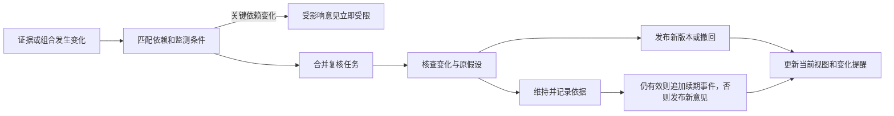

# 个人投资 Agent 领域契约与交互流程

日期：2026-10-10。状态：完整设计草案，尚未实现。

业务对象承载长期事实与判断，会话提供交互上下文，任务负责有限执行。三者分别保存，任何页面、模型输出或任务重试都不能绕过正式对象的版本、权限和发布规则。研究行为以[研究与运营设计](investor-agent-research-policy.md)为准；本文细化其存储边界、状态、界面和验收契约。

## 通用约定与对象所有权

所有正式对象包含 `id、schema_version、created_at、actor、origin_ref`。ID 由应用生成；时间戳保存 UTC 且带时区，交易日和计划日期以 Asia/Shanghai 解释。金额、数量、比例使用十进制值并携带单位；比例存小数而非百分数。未知值为 null 并给出原因，不以零代替。接口的 Decimal 使用字符串传输。

可变对象带单调递增 revision，修改请求携带 expected_revision；不匹配返回冲突及最新引用，不能静默覆盖。正式版本与历史事件追加保存；草稿可修改，但修改要留审计。引用固定 ID 与 revision，不指向“最新”别名。`as_of` 描述本次研究截止点，不代替各条证据自己的时间。

| 对象与所有者 | 必备内容和约束 |
|---|---|
| mandate，investor 服务 | 用户目标、范围、硬约束、明确未知项、研究授权与引用来源；研究授权包含探索范围、每日预算、每批线索上限与新建任务上限，默认值来自运行时设置；权限和预算从当前有效版本校验，模型配置独立保存 |
| case 与 episode，investor 服务 | 同一用户、同一 listing 一个稳定 case；当前研究状态、episode、用户固定标记、当前 thesis 指针；重新研究增加 episode |
| research_plan，investor 服务 | 问题、完成标准、关键假设、取证步骤、停止条件、预算引用、当前进度；每个计划版本关联 episode |
| thesis_revision，investor 服务 | 前版、变化原因、问题范围、七项状态、claims、假设、反证、证据集 hash、方法版本和 as_of |
| evidence_record，evidence 服务 | 来源对象和修订、定位、hash、主体、期间、发布时间、取得时间、available_from、核验与冲突状态 |
| calculation_record，计算服务 | 方法与版本、事实 refs、假设 refs、单位、适用性、状态、结果、误差与质量；输入相同可复用 |
| recommendation，investor 服务 | 判别式 scope、thesis、证据充分度、可读主张、条件、有效期、必要依赖、monitor refs、完整来源版本 |
| review_event，investor 服务 | 触发事件集合、原意见、证据差异、结果、新版本或维持理由、due_at、started_at、completed_at |
| user_decision，investor 服务 | accept、reject、defer 或 independent；目标建议或 case、用户原文、可空理由与时间；A1a 即支持 |
| portfolio_event 与 snapshot，portfolio 服务 | 已确认事实、投影截止点、价格引用、完整性、可用现金与未知项；A1b 支持 |
| portfolio_plan，portfolio 服务 | 一个组合 snapshot、共同约束、互斥选项、每项行动、资金与暴露计算及前案引用；同一组合仅一份当前正式方案，新方案原子替代旧方案；A1b 支持 |
| memory 与 method_revision，investor 服务 | 来源、适用范围、状态、有效期、替代关系；方法变更与用户偏好不混存 |
| conversation、message、task，agent 服务 | 对话序号、明确对象绑定、用户意图、父消息、任务与产物引用；不是研究事实源 |

claim 与假设可嵌入 thesis JSON；episode、research_plan 初期可作 case 下的版本化对象，不要求每个名词建表。检索、并发和独立生命周期需要的对象才独立存储。HTTP、内部工具与 MCP 复用领域查询；内部写服务不对只读 MCP 开放。

## 主张与意见的发布结构

claim 必须包含 `id、kind、text、materiality、support_refs、opposition_refs、assumption_refs、verification、impact_if_wrong`。kind 为 fact、assumption、inference；materiality 为 critical 或 context。事实没有来源不得发布；假设必须说明来源和适用范围；推断必须关联支撑它的事实或假设，避免只有形式引用。

假设另有稳定 `hypothesis_id`、观察指标或问题、支持条件、证伪条件、检查期限、当前状态与上次检查引用。同一假设的阈值或定义变化生成新版本，不将“现金流改善”悄悄改成另一个更容易满足的条件。

`InvestmentRecommendation` 使用两个明确分支：

```text
common:
  id, case_ids, thesis_revision_refs, scope, as_of, created_at
  question_scope, assessed_dimensions
  sufficiency: insufficient | bounded | sufficient_for_scope
  claims, counter_case, assumptions, gaps, conditions
  valid_until, next_review_at, monitor_refs, dependency_refs
  mandate_revision_id, method_revision_id, provenance
company_view:
  case_ids: 恰好一个
  business_view: favorable | mixed | unfavorable | undetermined
  price_view: attractive | balanced | demanding | undetermined
  conditional_actions: [{action: buy | avoid | sell | wait,
                         condition_refs, rationale_refs}]
  portfolio_snapshot_id: null
  position_proposal: null
portfolio_action:
  stance: buy | add | hold | reduce | exit | wait | further_research
  portfolio_plan_id, option_id, portfolio_snapshot_id
  basis: company_thesis | portfolio_constraint
  company_view_refs, position_proposal, constraint_check_ref
```

基于公司判断的组合行动必须关联有效公司观点。只为解除已知组合硬约束提出的 reduce、exit 或 wait，可使用 portfolio_constraint 依据，引用已确认持仓、约束和计算，并明确公司研究缺口；不能因公司观点失效而阻止风险约束分析，也不能把此例外用于买入或加仓。hold、add、reduce、exit 必须存在相应实际持仓；hold、wait、further_research 可以没有目标数量，有目标数字就必须有计算记录。

company_view 是对整家公司已知经营与价格情况的综合判断，需呈现七项取证状态及关键缺口；局部核查保存为回答或研究笔记，不改变 case 的当前 thesis 或 recommendation 指针。公司观点不使用 add、hold、reduce 枚举，避免暗示用户已持仓。所有卡片首屏显示 question_scope，不能以局部指标改善标记整家公司 favorable。

正式发布依次验证：身份与 scope → 引用和时间 → 主张与数值 → 研究门槛与反证 → 适用的组合约束 → 当前权限、lease 和对象 revision。输出 publication_check，列出规则版本、通过项、失败项及对应字段。失败保存草稿，返回可修复问题；不能直接删除出错句子而保留依赖它的结论。

### 数字和名称的校验

关键事实与定量表达通过带引用的内容节点进入正文，由服务端格式化。正文由 text、entity_ref 与 numeric_claim 节点组成。numeric_claim 的 ref、role 和允许的显示格式可由模型选择，value、unit、subject、period 由服务端从引用解析；display_precision 按指标规则确定，不能通过粗粒度舍入隐藏风险。role 区分历史事实、计算输出、情景假设、日期和阈值。模型提出的假设先保存来源与角色，算术关系交给计算工具。证券名称和代码从 listing 身份记录渲染，不由模型记忆补全。

A1a 扫描自由文本中的阿拉伯数值、百分数及已定义的中文数量模式（如“三成”“两倍”“五年”），命中后要求改用引用节点。规则采用明确词表与数量模式，不能笼统禁用“一”“元”等单字，误伤“一次性收益”等正常表述。它是有限的确定性检查，不保证识别所有自然语言数量表达；未覆盖的表达通过语义评测检查。只有实际误差证明有必要时才增加语义扫描，不把通用数字语义解析器列为 A2 必建模块。“另一处证据有相同数字”不算通过。

| 类型 | 允许的引用与检查 |
|---|---|
| 历史数值 | evidence 字段或确定性计算输出，报告期与单位一致 |
| 假设、情景和复核阈值 | calculation 的输入假设或 monitor 的版本化条件，正文必须标为假设或条件 |
| 年份、日期、证券代码 | 对象元数据或身份引用，不强制伪装成财务指标 |
| 列表编号、版本号、引用编号 | 由渲染器生成并按结构识别；不能借此跳过正文财务数值 |
| 区间、倍数、增长与差额 | 两端及计算关系有记录；不只验证其中一个端点 |

单位转换使用确定性单位表；百分数与百分点不得互换。金额保留币种，人民币金额归一为元；首版跨币种计算返回不适用，不能把单位换算冒充汇率转换。显示舍入按十进制 HALF_UP，误差只允许到所声明显示精度的半个单位；计算误差另由方法规格约束，不能设置宽泛百分比容忍错误。数值大小一致而正负号、同比环比或对象不一致，仍拒绝发布。

检测或审查发现未引用的数量表达时退回并指出位置；不能声称扫描覆盖所有语义。正文没有数字也仍需检查公司特定事实。纯教育性的虚构数值必须明确标为示例并引用示例计算，不能混入正式公司意见。

## 有效性和依赖传播

recommendation 的正文不可变，状态由追加事件与读取时投影得到。初始发布为 published；后续可为 review_required、expired、superseded、withdrawn。superseded 与 withdrawn 为终态。计划复核确认无变化时，只有提交事务时仍 published、未过期且未受限的意见可以追加 `extended`，原子校验当前 revision 与必要依赖。事件记录 review_event、checked_at、已核查的依赖版本、新 next_review_at 和 effective_valid_until；保留原 as_of 与原到期点。当前期限按事件投影，历史视图只使用该时点已发生的事件。`extended` 不产生新 recommendation。review_required 或 expired 经复核通过后发布新对象；依据、条件或监测变化也发布新对象，不能靠续期覆盖失效区间。

当前意见必须同时满足：对象仍是当前版本、尚未到期、关键引用可用、必要依赖的相关字段仍适用。不满足时展示历史依据和具体限制，不能依赖后台消费事件的速度保证正确性。执行权限单独检查：暂停后台研究会停止后续后台动作，不立即推翻已发布的经营判断；界面同时标明暂停与最后核查时间。约定保留原 revision 供审计，仅相关约束变化影响意见，讲解或预算设置变化不使全部观点失效。

多种状态同时成立时，先呈现 withdrawn 或 superseded 终态，再呈现 expired，最后是 review_required；同时返回全部限制原因。用户明确归档会撤回当前意见；用户取消某次复核不会让受限意见恢复有效。

依赖带 `critical | contextual` 级别与具体字段。来源撤回、关键口径冲突、新期间替代关键财务字段、条件外的价格变化、相关资金或硬约束变化，会让受影响意见待复核；讲解偏好改变和无关字段更新不使所有意见失效。持仓变化只影响组合建议，不自动推翻公司经营判断。



同一来源多次送达用 source_event_id 去重；同 case 的变化按目标输入版本合并。通知键为 case 或 plan、复核原因和目标输入版本；先展示受限状态，复核完成更新同一条提醒，不为同一变化再次打扰用户。新的关键反证可产生新提醒。没有实质变化的检查和正常续期只进入时间线。

## 任务和事务边界

| 对象或操作 | 一致性要求 |
|---|---|
| 用户消息入队 | 同事务保存 message、task 与排队引用；conversation + client_message_id 唯一，相同键不同内容返回 409 |
| 研究写操作 | 应用先分配并持久化 operation_id，绑定 task、阶段、对象、预期 revision 与参数 hash；模型不能自行构造授权或去重身份 |
| 动作提交 | 领域写入、动作结果与产物引用同事务；重试返回已保存结果；相同 operation_id 不同参数报冲突 |
| 崩溃续跑 | 先恢复或对账旧动作，再调用模型；不能因新的 tool call ID 创建同一意图的第二次操作 |
| 发布 | 新观点、旧观点替代事件、当前指针及通知 outbox 同事务；相关 case 与组合 revision 全部校验 |
| 并发研究 | 同 case 正式写入串行或乐观锁；冲突任务重取最新业务状态，不能在旧文本上自动合并观点 |
| 子任务完成 | dependency_id + completion_event_id 唯一；同一结果只创建一次续跑尝试 |
| 通知失败 | 独立重试 outbox，不重复生成研究与观点 |

任务状态：queued → running；running 可进入 waiting_data、waiting_user 或终态 succeeded、partial、failed、cancelled。依赖就绪后 waiting 返回 queued，创建新执行尝试。终态任务不可重开；用户请求继续时创建带 parent_task_id 的新任务，沿用已保存研究进展。

等待记录所需输入、依赖与 deadline，释放 worker、lease 和未使用的调用预留。到期按已有产物进入 partial 或 failed，明确缺口；迟到的材料可创建关联后续任务，不能重开终态任务或复用过期批准。恢复保证从已提交的业务边界继续，未保存的模型生成可重做，不承诺逐 token 恢复。

succeeded 表示本次问题完成，包括明确且有依据的“证据不足”；partial 表示还没有回答完成标准但有可用产物，failed 表示没有可交付结果。不能用 succeeded 表示“排队成功”。工具重试与模型修正消耗同一任务预算，跨 run 不重置。

取消先持久化 cancel_requested；停止后续新调用和发布，已提交结果保留。正在执行的调用可能无法撤回，界面显示“正在停止”，确认执行边界已停下才显示 cancelled。lease、授权、feature flag 和取消状态在每次新动作及发布事务内复查。

SSE 事件格式固定为 `schema_version、event_id、task_id、attempt_id、type、occurred_at、payload`；event_id 在 task 内递增且持久化（当前存储为全局单调序号，允许任务内有间隔）；queued、未认领取消或依赖续跑等任务级事件的 attempt_id 明确为 null，执行事件关联实际 attempt。类型包括 task_state、step_started、tool_state、progress、artifact_saved、publication_result、input_required、usage、error。只发送可公开的执行摘要，不转发隐藏推理、密钥或原始供应商事件。

浏览器以 Last-Event-ID 恢复；重复事件按 ID 忽略。进展事件默认保留 30 天，正式对象、终态摘要与审计引用独立保留；游标过旧返回需重载快照的明确响应，客户端先读任务和产物再重连。断开浏览器不取消任务。

AG09 的具体传输为 `GET /agent/tasks/{id}/events`（默认 `transport=sse`）；`transport=poll` 返回 `events、next_cursor、task、snapshot_url`，每批最多200条。Header `Last-Event-ID` 优先于 query `after_event_id`，游标为非负 signed64 数字，超前游标拒绝。过期在连接前返回 HTTP410 的 `cursor_expired、reload_snapshot=true、task_ref、snapshot_url`；流已开启后发同名事件并结束。加载 `GET /agent/tasks/{id}/snapshot` 后使用其 `event_cursor` 重连；无保留事件时为0，0是重新开始读取当前保留历史的明确入口，不能补回已清理进度。两种读取均在短且一致的数据库快照里完成，释放session后才yield/等待。SSE每进程最多8条连接，达到上限可轮询；worker每轮在默认维护路径清理最多500条30天前事件，持久task水位与SQLite显式AUTOINCREMENT保证清空后不复用旧ID。

## 对话和页面交互

### 上下文绑定

一个 conversation 可关联多个 case。每条用户消息保存显式的 `context_refs`；页面股票只是默认上下文，用户明确提到的对象优先，仍需证券消歧。切换页面不会追溯改变已发送消息的对象。

同一公司多个会话共享正式 case，不共享无关聊天或待核猜测。任务启动固定 base revisions；发布前若有新版本，显示“已有更新，正在重新核查”。比较任务保存 comparison 产物和 case refs，不把同一结论复制成各公司的独立事实。

后台更新时，当前对话显示简短变化条和新旧版本入口。此前回答保持原样并显示“依据的观点已有更新”。用户引用旧结论追问时，先说明其历史状态，再比较变化。

### 用户意图与系统响应

| 用户输入或操作 | 系统响应 | 持久化与权限 |
|---|---|---|
| 为什么关注这家公司 | 优先解释已有有效观点，需要新材料才入研究任务 | message 和引用；不默认创建重复正式观点 |
| 深入研究它或比较两家公司 | 给出简短问题与计划，在额度内执行 | task、plan、证据与产物；普通研究不逐步确认 |
| 我不同意你的判断 | 区分新事实、推断分歧与偏好，展示可改变观点的条件 | 可保存用户意见；不自动修改 mandate |
| 这个数据有误 | 保存用户提供的来源，核验后形成更正关系 | 不覆盖旧证据；影响关键主张时受限并复核 |
| 我先不买或我接受建议 | 关联明确的建议记录 defer 或 accept | A1a 的 user_decision；不更新持仓 |
| 我已买入或卖出 | 字段齐全且语义明确时记录事实，缺字段只追问相关项 | A1b；来源为用户消息，不能让模型批准自己的提案 |
| 将来跌到某价再买 | 保存条件性决定或研究计划 | 不记录成交，不建立券商订单 |
| 改变长期限制或扩大预算 | 展示具体变更；明确完整指令可直接生效，歧义时确认 | mandate 新版本，保留原始授权来源 |
| 取消、暂停、静音、归档 | 取消本任务；暂停停止范围内后台任务的后续调用与发布；静音抑制主动提醒；归档结束研究并撤回意见 | 四种独立操作；暂停不取消明确的交互研究，用户归档不自动重开 |

对已明确且字段齐全的用户指令不重复要求点击批准。服务端授权依赖认证用户提交的来源与明确参数；自由文本解析不确定时先生成操作卡片。模型工具可准备事实录入或约定变更，不能自行将待确认状态改为已确认。

A1a 首页显示待复核判断、值得推进的线索和材料缺口；组合区明确标注尚未启用。回答首屏包含立场、最重要理由、最可能改变观点的反证和下一步，证据、术语、计算与历史按需展开。任务失败显示已完成部分与原因，不用错误堆栈代替用户说明。

流式内容只展示取证进展与已验证解释。正式买卖看法在发布通过后以卡片显示；任务结束但没有正式意见时明确展示研究进展或暂不判断。桌面档案面板与手机页签使用相同对象和状态，不用颜色作为唯一的状态表达。

### 界面文案映射

界面只显示下表的文案，不直接显示枚举值；同一取值在桌面和手机上用同一文案。新增取值必须同时补充文案。

| 字段 | 取值与界面文案 |
|---|---|
| business_view | favorable 偏正面 · mixed 好坏参半 · unfavorable 偏负面 · undetermined 暂不判断 |
| price_view | attractive 有吸引力 · balanced 大致合理 · demanding 要求较高 · undetermined 暂不判断 |
| sufficiency | insufficient 不足 · bounded 有限 · sufficient_for_scope 足以回答本问题 |
| conditional_actions.action | buy 可考虑买入 · avoid 回避 · sell 可考虑卖出 · wait 等待 |
| portfolio_action.stance | buy 买入 · add 加仓 · hold 持有 · reduce 减持 · exit 退出 · wait 等待 · further_research 继续研究 |
| recommendation 状态 | published 有效 · review_required 待复核 · expired 已过期 · superseded 已被替代 · withdrawn 已撤回；extended 显示为"延长至某日" |
| review 结果 | maintain 维持 · revise 修订 · withdraw 撤回 · inconclusive 无法判断；reasoning_revision 另标"推断修订" |
| case 状态 | lead 线索 · researching 研究中 · tracking 持续跟踪 · parked 搁置 · archived 归档 |
| task 状态 | queued 排队中 · running 进行中 · waiting_data 等待数据 · waiting_user 等你处理 · succeeded 已完成 · partial 部分完成 · failed 失败 · cancelled 已取消；cancel_requested 显示"正在停止" |
| 停止原因 | answered 已回答 · evidence_blocked 证据受阻 · no_progress 无进展 · budget_exhausted 预算用完 · cancelled 已取消 · failed 失败 |
| user_decision | accept 接受 · reject 不采纳 · defer 暂缓 · independent 我自行决定 |
| 七项取证状态 | 已取证 · 仅定性 · 尚缺材料；applicable=false 显示"不适用"并附理由 |
| numeric_claim.role | 历史事实标"事实" · 计算输出标"计算" · 情景假设标"假设" · 阈值标"条件"；日期、代码等元数据不加标注 |
| 估值 status | ok 计算成功 · not_applicable 不适用 · missing_inputs 缺少输入 · missing_assumptions 缺少假设 · stale_inputs 输入过期 · outside_search_range 超出求解区间 · calculation_error 计算失败 |
| 假设来源 | method_default 方法默认 · user_scenario 你的情景 · agent_scenario Agent 情景 |
| 提醒类别 | 需要你补充 · 判断重大变化 · 普通研究进展；最后一类不推送 |

[UI mockup](investor-agent-ui-mockup.html) 是跨阶段视觉示例，按上表文案渲染，页面清单与启用阶段见[产品设计](investor-agent-design.md)的"主要交互"。A1b 的持仓、组合方案和 A2 的原文能力按阶段启用；示例中的财务数字不进入 fixture 的真实事实集。

## API 交互契约

写请求复用认证和 CSRF 防护；涉及同一对象的修改带 expected_revision，创建类请求带幂等键。异步操作返回 202 和可读取的 task；同步保存返回正式对象 ID 与 revision。业务错误含 `code、message、field_errors、retryable、current_refs`，不暴露模型密钥或内部堆栈。

| 接口 | 主要输入 | 返回与错误边界 |
|---|---|---|
| POST /agent/conversations | title 可空，context_refs | conversation 与 revision |
| GET /agent/conversations 与 /{id}/messages | 会话或消息序号游标 | 按序返回历史内容、对象引用和当前更新提示，不重写旧消息 |
| POST /agent/conversations/{id}/messages | client_message_id、text、context_refs、reply_to 可空 | message、task、events_url；身份歧义产生 input_required |
| GET /agent/tasks/{id}、/{id}/snapshot 与 /{id}/events | 任务 ID；Last-Event-ID 或 after_event_id；transport=sse/poll | 真实状态；snapshot含公开消息、event_cursor与重连地址；事件可恢复，轮询与SSE同样返回游标过期语义 |
| POST /agent/tasks/{id}/cancel | 幂等键 | 当前状态与 cancel_requested；终态重复取消不改历史 |
| GET /investor/cases 与 /{id} | 状态、listing 等过滤，游标 | 档案、当前观点有效性、历史和待核事项 |
| POST /investor/cases/{id}/actions | archive、reopen、pause、resume、mute 或 unmute，expected_revision、幂等键 | 档案与研究控制的新状态；归档明确撤回当前意见，不修改真实持仓或固定标记 |
| POST /investor/cases/{id}/reviews | reason、expected_revision、幂等键 | 合并或创建复核 task，不同步伪造结果 |
| GET /investor/recommendations/{id} | 意见 ID | 原文与当前有效性分开返回，包含替代版本引用 |
| GET /investor/evidence/{id} | 证据 ID 与定位 | 保存的结构化字段或原文片段、时期、核验与更正关系；不能只返回外部首页 URL |
| POST /investor/disclosures/discover | 明确listing/source/时间窗口/单页count/response cap及幂等键 | 受控官方未核验公告元数据，失败真实原因，不扩大无限抓取 |
| POST /investor/disclosures/fetch | 已保存item ID、精确listing/source/cutoff/response cap及幂等键 | 不可变原件hash/来源/取得时间、candidate evidence ref、evidence_availability/readable_after/requires_new_message；无原始字节进入模型结果 |
| GET /investor/disclosures | listing、known-at cutoff、显式historical_reconstruction | owner元数据及原件版本；普通读取要求公开且实际取得/available可见 |
| GET /investor/disclosures/originals/{id}/download | 保存的owner原件 ID与known-at cutoff | 精确原始bytes，attachment/nosniff/sandbox；关闭新采集仍可读历史 |
| POST /investor/decisions | recommendation_id 或 case_id、decision、用户来源、可空理由 | user_decision；accept 不改变 recommendation 或 portfolio |
| POST /investor/proposals/{id}/resolve | approve 或 reject、expected_revision、参数 hash | 实际结果；过期或参数变化返回冲突，不复用旧批准 |
| GET /investor/mandate 与 POST /revisions | 读取或明确变更及原 revision | 新版本和影响范围；不可由模型隐藏提高权限 |
| POST /portfolio/events | 类型、occurred_at、数量与金额、范围、事实来源、导入键 | 已确认事件与新投影 revision；字段不足返回 422 |
| GET /portfolio/snapshot 与 /plans/{id} | snapshot ID 或当前，plan ID | 组合覆盖范围、未知项、方案及当前有效性 |
| GET /investor/memories 与 POST /{id}/revoke | 范围过滤，撤销原因与 revision | 有效偏好与撤销结果；清理未来上下文 |
| POST /investor/method-proposals/{id}/resolve | 明确方案、评估版本、approve 或 reject | A3 方法版本或拒绝事件，不能批准任意代码 |

tool 返回统一携带 `status、data、refs、as_of、coverage、warnings`；异步工具另含 dependency_id。缺数据与系统异常分开，模型不得把 missing 当成零。可重试失败的次数受任务预算和应用策略限制。

## 真实账本与组合事实

A1b 的起点是用户确认的 opening_balance，包含资产范围、持仓和现金；未列资产在 partial 范围内保持未知。trade、cash_transfer、dividend、corporate_action、reconciliation、reversal 分别追加。reconciliation 保存用户确认的余额、对账时点、来源与未解释差异，只确立此后的余额基准，不伪造历史收支或消除历史未知项。导入的 batch_id 与 row_id 去重；手工录入用认证请求幂等键，不能把相同时间与数量的两笔真实成交自动合并。

成交保存证券、方向、时间、数量、实际价格、费用、币种和来源。费用未知可以保存事实但相应现金精确性标为受限；用户提供券商总现金可作为新的已确认对账点，不用猜测补差。持仓数量与现金出现不一致时保留待核事件和冲突，不能悄悄删掉真实交易或编造余额。

修正通过 reversal 指向原事件，再写正确事件；同一事件不能重复冲销。回填历史事件从受影响时点重建当前投影，旧 snapshot 与旧建议仍固定引用当时所见版本。待处理公司行动使受影响数量或现金受限，不能一边标未处理一边宣称组合完整。

当前市值为已确认数量乘对应价格，净资产为已知现金及持仓市值之和，所有价格有日期。总资产不完整或某价格不可用时，组合比例返回受限或区间说明，不能用已知部分冒充整个分母。首版不展示缺少历史起点或成本的精确收益率。

## 评估样本与阶段覆盖

### 观点修订的具体样本

以下为 S05 的纯虚构时序，用于固定对象变化而不固定模型措辞；公司甲没有真实证券代码，期间与数据只属于测试集。

| 时点与输入 | 对象变化与可验收结果 |
|---|---|
| T0：2026 年半年报，净利润 1000 万元、经营现金流 1200 万元 | evidence E1/E2，计算 C1=1.2；thesis T1 的有限主张为“本期经营现金流覆盖净利润”，不得声称未来一定持续 |
| T0 完成公司概览并发布 R1 | business_view=undetermined、price_view=undetermined、sufficiency=bounded；七项状态列明缺口，conditional_actions 为空；假设 H1 为现金转化可持续，监测下一期同口径累计经营现金流/净利润低于 0.5 时复核，该阈值标为测试用研究条件 |
| T1：用户明确表示暂不行动 | 新增 D1=defer，关联 R1；T1 和 R1 不修改，没有 portfolio_event |
| T2：新财报事件 E3 到达，累计净利润 1600 万元、经营现金流 200 万元 | 新证据与计算 C2=0.125；数据期间变化可追溯，不能覆盖半年报；R1 立即 review_required，创建或合并一次复核 |
| T3：相同 E3 重复送达，复核 worker 在写入后重启 | 不新增重复任务、观点或通知；从动作结果与当前 revision 对账 |
| T4：复核完成 | 研究 H1 的支持程度下降及其他解释，发布 T2/R2 或明确无法判断；不得直接断言公司造假或生成卖出指令；旧 T1/R1 和 D1 保留，变化提醒一次 |

T0 的现金转化主张是局部正面事实，不足以令整体 business_view=favorable；首屏显示“公司整体长期价值仍待研究”。若任务只问现金转化比值，则止于回答和计算，不创建或替换 R1。T4 可以得到不同的合理观点，但必须解释新证据的影响与剩余未知项。

### 固定集与阶段映射

固定样本使用虚构公司甲乙丙或现有脱敏 fixture，显式记录输入时点、事件顺序、预期对象变化、允许的语言差异和禁止行为。真实公司样本在内部试用前补入，不阻塞契约设计。以下条目是待实现的验收规格，不是已通过的测试结果。

| 样本 | 阶段 | 必须观察到的结果 |
|---|---|---|
| S01 有研究价值但持续性待核 | A1a | 形成有限公司观点、反证与计划；不虚构竞争优势 |
| S02 关键证据缺失或冲突 | A1a | 缩小观点范围或 undetermined，不机械看空 |
| S03 同材料配喜欢与讨厌两种用户表达 | A1a | 核心事实与方向不无依据漂移 |
| S04 只有价格变化 | A1a | 更新价格分析，经营判断只按经营证据变化 |
| S05 新财务期间推翻关键假设 | A1a | 旧意见立即受限，新旧版本和一次变化通知完整 |
| S06 用户暂不采纳后重复查看 | A1a | 有决定记录，无成交，无重复劝说 |
| S07 数字单位错误和错误主体引用 | A1a | 发布失败并指出具体表达；同值不同公司不能通过 |
| S08 写入提交后崩溃和重复消息 | A0 | 同一动作、发布和通知各一次，结果可对账 |
| S09 两会话与后台同时研究同一公司 | A1a | revision 冲突可见，不覆盖新观点；旧回答标注已更新 |
| S10 取消、预算耗尽与断线 | A0 | 无后续越权动作；断线可恢复；保留已完成产物 |
| S11 两个买入选项或两个会话竞争同一现金 | A1b | 互斥方案及整体资金检查；同一组合只保留一份当前方案，替代需显式关联 |
| S12 部分持仓、未知费用和历史修正 | A1b | 暴露受限、事实可追溯、旧快照保持，建议不伪造成交 |
| S13 更正公告、OCR 错位与材料注入 | A2 | 保存原件与更正链；错误提取不成为事实；不执行材料指令 |
| S14 忘记偏好与方法版本回退 | A3；偏好部分 A1a | 未来上下文不再用已撤销偏好；方法回退不删历史 |
| S15 只对成功案例有效的方法修改 | A3 | 评估包含失败和范围外样本；不因短期收益直接启用 |
| S16 到期边界与无变化复核并发 | A1a | 只有仍有效意见可续期；过期或已受限则重发，历史失效区间保留 |
| S17 局部追问、暂停与用户归档 | A1a | 局部回答不替换全局观点；暂停阻止后台后续动作；用户归档不自动重开 |

工程验收执行确定性断言，真实模型评审使用[质量量表](investor-agent-research-policy.md)。固定集覆盖的事实、权限、历史和账本不变量零违规；适用的语义维度满足量表最低分。真实试用补充“用户能否复述立场、依据、反证与下一步”的反馈，不能用采纳率代替理解程度。

AG25认证消息可显式提交 `disclosure_access`（最多3个已绑定深圳listing、固定 `cninfo.v1`、每listing最多3次发现/10次获取、每response上限16MiB）；服务从research_at或当前消息绑定派生cutoff并保存不可变grant。未选择此选项的消息及后台任务没有新外网权限。默认采集开关关闭，关闭不删除历史、原件或精确回放。当前原件仅candidate，标题更正仅线索；同hash不可视为独立佐证，字节版本与可信语义更正关系分别管理。

AG25不推进已入场任务cutoff。新取得原件的 `evidence_availability.reason=acquired_after_requested_cutoff` 与 `requires_new_message=true` 明确要求后续消息绑定较晚cutoff；当前和历史任务遵守同一known-at边界，历史重建仅显式读取保存原件，不升级当时已知事实。
