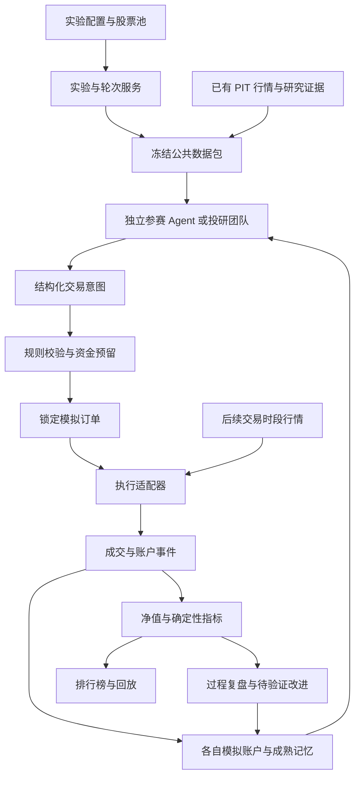

# 模拟交易与多 Agent 赛马设计

实现进度与逐项验收以[实施任务](plans/paper-trading-arena-implementation.md)为准；实际任务类型、页面使用和数据准备见[使用与运行](paper-trading-arena-operations.md)。下文保留调研时的设计拆分，首版将轮次、结算和估值编排合并到 `simulation_cycle`，模型决策及复盘分别使用 `simulation_decide`、`simulation_review`。

日期：2026-11-07。状态：首版代码已实现，逐项审查和最终验收以任务表为准；真实浏览器交互验收尚未通过。

当前实现范围：沪深主板普通 A 股、独立只做多账户、日线开盘价格代理、现金与等权基准、确定性净值及最大回撤、受预算约束的独立模型决策与复盘。Web 和友好 API 只开放固定内置方法下的模型比较与综合比较；不同方法正文、成熟复盘记忆策略保留在领域／运行层，尚无自定义编辑入口，友好创建默认不注入复盘记忆。多角色投研团队、额外因子／指数基准、收益差与更多行为指标、任意研究工具和盘中执行仍是后续设计，不属于当前已交付界面。下文保留这些设计目标，不能把目标清单当作已通过验收的能力。

在 zcharlie 内增加模拟投资实验室：用户选择股票池，多个 Agent 在相同数据和交易规则下独立管理虚拟资金，持续观察、比较并复盘。第一版采用前瞻运行的日线模拟，优先回答“谁做了什么、为什么、是否遵守规则、结果怎样”。

建议复用现有 Agent、时点数据、方法包、任务队列和 Web 工作台；新增独立的模拟账户与确定性执行内核。参考 StockBench 的连续决策评测、LiveTradeBench 的独立 Agent 账户、TradingAgents 的反证与复盘、NautilusTrader 的执行事件和模型分层。第一版不整体引入外部交易框架；盘中需求明确后，通过执行适配器评估 NautilusTrader。

## 项目调研与选型

调研依据为官方仓库、抽样源码、项目论文与官方文档。下表“适合本项目的用法”是设计判断；未将项目宣称的收益当作验证结果，也未运行这些仓库的模型调用或交易服务。公开源码与允许直接复用是两件事，许可按所查看版本列出。

| 项目 | 核实到的能力 | 适合本项目的用法 | 直接集成的主要边界 |
|---|---|---|---|
| [StockBench](https://github.com/ChenYXxxx/stockbench) | 连续组合决策、持仓与成交记录、收益／回撤／Sortino、买入持有基准 | 日频赛马、交易日志、基准设计的主要参考 | 面向历史美股数据；A 股规则、前瞻调度和现有证据链需另建。代码 Apache-2.0；外部数据授权另计 |
| [LiveTradeBench](https://github.com/ulab-uiuc/live-trade-bench) | 为各 LLM 建独立账户、统一行情轮次、分配目标仓位、性能查询；FastAPI 应用 | 实验、参赛者、轮次、账户的组织方式 | 代码采用非商业许可且含竞争限制；不列为默认依赖或移植来源 |
| [AI-Trader](https://github.com/HKUDS/AI-Trader) | 原论文评测多模型与多个市场；当前主分支提供 Agent 平台、信号互动、研究导出 | 前瞻比赛与行为观察的产品参考 | 当前主分支已不同于原论文实现；README 有 MIT 徽章，但所查树无 LICENSE 文件，复用许可待核实 |
| [TradingAgents](https://github.com/TauricResearch/TradingAgents) | 分析师、正反研究员、组合管理角色；结算后的反思记忆 | 可选“投研团队”参赛者，反证与复盘协议 | 多角色协作不等于独立账户赛马；当前 backtest 明确不是组合模拟器。Apache-2.0 |
| [TradingAgents-CN](https://github.com/hsliuping/TradingAgents-CN) | 中文 A 股研究产品，README 列有模拟交易与复盘 | 中文交互和研究入口参考 | v3.0 混合授权：核心指定目录 Apache-2.0，应用、前端等目录为专有源码可见；此项未验证模拟交易内部正确性 |
| [Qlib](https://github.com/microsoft/qlib) | 策略、交易决定、执行器、交易所模拟、组合分析 | 因子基准与离线对照候选；借鉴决策和执行分层 | 其数据和收益统计口径不能直接替换本项目 PIT 与账本；MIT |
| [RQAlpha](https://github.com/ricequant/rqalpha) | 中国市场回测，bar 撮合、开盘价格模式、成交量限制及滑点 | 用于识别需要覆盖的市场行为和测试场景；规则依据仍取交易所 | 许可对非商业与商业用途区别授权，不移植其实现，不作为默认依赖 |
| [VeighNa PaperAccount](https://github.com/vnpy/vnpy_paperaccount) | 基于实时行情事件的本地仿真，订单、持仓与滑点 | 简单事件驱动模拟的工程参考；MIT | 依赖 VeighNa 运行体系；所查撮合路径触价后将整单置为成交，不能直接满足容量约束 |
| [NautilusTrader](https://github.com/nautechsystems/nautilus_trader) | 事件驱动交易引擎、backtest／sandbox、fill／fee／latency 模型 | 盘中、部分成交、复杂订单的优先引擎候选 | 数据适配、恢复协议、A 股约束仍需验证；LGPL-3.0；本次查看 develop，不能当作已验证的稳定依赖版本 |
| [LEAN](https://github.com/QuantConnect/Lean) | C# 核心的多资产算法交易引擎，可使用 Python 策略 | 长期多市场执行架构备选 | 会引入独立运行栈与数据适配，首版日线需求不足以承担迁移成本；Apache-2.0 |

### 对设计有直接影响的源码证据

1. **研究结论与组合收益必须分开。** TradingAgents 当前 [backtest.py](https://github.com/TauricResearch/TradingAgents/blob/9fa1196fffbcfd9de5146d2dd2869df84ab99838/tradingagents/backtest.py)说明其评价独立的股票／日期判断，不管理连续数量、成交价和现金账本。本项目保留“观点结果观察”，另外建立有资金约束的模拟收益。
2. **一名参赛者对应独立账户。** LiveTradeBench 的 [stock_system.py](https://github.com/ulab-uiuc/live-trade-bench/blob/05fbfec8df76c2c309201e6b4b7c26aff7e6d0f9/live_trade_bench/systems/stock_system.py)把 agents 与 accounts 分别管理，并在一个 cycle 中提供公共行情、生成分配和更新账户。本项目增加持久化轮次、截止时间与独立记忆；不照搬进程内状态。
3. **基准同样需要资金与成本口径。** StockBench 的 [engine.py](https://github.com/ChenYXxxx/stockbench/blob/ce8b2b3483590646ad3b650ac8221f43f76fd091/stockbench/backtest/engine.py)包含组合、成交、成本和买入持有基准。本项目所有可投资基准走同一订单引擎，不用无成本价格曲线替代账户收益。
4. **行情触价不等于真实可成交。** VeighNa 的 [cross_order](https://github.com/vnpy/vnpy_paperaccount/blob/1167dec502331c3f4385972631de2e89dac80f71/vnpy_paperaccount/engine.py)展示简化买卖价撮合；RQAlpha 的 [bar matcher](https://github.com/ricequant/rqalpha/blob/0bf04946e8250b457e30c3c81d338a6b925da0bb/rqalpha/mod/rqalpha_mod_sys_simulation/matcher/bar_matcher.py)另外检查无量与成交量限制。本项目明确自己的保守成交假设，并给出不能模拟的情形。
5. **执行应可复现。** NautilusTrader 的[执行顺序](https://nautilustrader.io/docs/latest/concepts/backtesting/execution-flow/)与[行为模型](https://nautilustrader.io/docs/latest/concepts/behavioral_models/)将执行事件、成交、费用和延迟拆开。本项目冻结规则版本，并从冻结的订单与行情重放成交；不要求重新调用模型产生相同答案。
6. **指标名称不能替代公式契约。** Qlib 的[报告文档](https://github.com/microsoft/qlib/blob/54355232463878d2eebb91fe0ee5fa7fa1f5976c/docs/component/report.rst)说明部分累计指标采用加和口径。本项目收益由账户净值计算，接入外部报告前必须核对复利、费用、现金流与日期对齐。
7. **复盘需要匹配观察期限。** TradingAgents 的 [reflection.py](https://github.com/TauricResearch/TradingAgents/blob/9fa1196fffbcfd9de5146d2dd2869df84ab99838/tradingagents/memory/reflection.py)区分判断期限与结算窗口。本项目不能用几天的价格变化直接证伪数月的经营假设。

### 许可证对依赖选择的影响

首版只使用项目现有依赖与自主实现，不复制调研项目代码。以后引入外部模块时按固定版本保存来源和许可证。

- LiveTradeBench 的 [LICENSE](https://github.com/ulab-uiuc/live-trade-bench/blob/05fbfec8df76c2c309201e6b4b7c26aff7e6d0f9/LICENSE)写明非商业用途及竞争限制。
- RQAlpha 的 [LICENSE](https://github.com/ricequant/rqalpha/blob/0bf04946e8250b457e30c3c81d338a6b925da0bb/LICENSE)对商业使用设有授权要求。
- TradingAgents-CN 的 [v3.0 LICENSE](https://github.com/hsliuping/TradingAgents-CN/blob/v3.0/LICENSE)按目录区分开放组件与专有组件，不能把整仓视为 Apache-2.0。
- AI-Trader 的许可证徽章不足以单独确定所查代码版本的授权范围；本方案只参考产品机制与论文。

## 产品与实验协议

### 首版范围

调研时建议以 3 个 Agent、10～20 只用户选定股票、每账户 100 万元虚拟资金、每日收盘观察和每周允许调仓作为初始观察方案。当前页面允许选择模型数量与股票池，默认为每账户 100 万元和周频，也可配置每日调仓；上述调研数字不是全部产品默认值，也不是投资参数建议或有效性阈值。

首版证券范围为已具备完整规则与数据的沪深主板普通 A 股，人民币现金账户，只做多，不融资。创建实验时检查已开放证券范围和日历覆盖；每轮准备与成交确认时再核对交易单位、逐日涨跌停价格来源、未复权价格和公司行动覆盖。缺少后续逐日证据会等待，不代表创建实验即可交易。科创板、创业板、北交所等按规则包逐步启用，不套用统一交易单位。

现有 `MarketSnapshot` 已包含 OHLC、成交量、交易状态和 ST 标记，但没有直接提供完整的逐日涨跌停价格、全部证券规则和可卖批次。P0 需补齐规则元数据及行情适配，不能仅凭现有日线表就宣称能准确执行 A 股订单。实验股票可能不在既有采集池内，应增加按实验证券集合采集的受控 scope，复用行情任务并去重，不强行修改用户原有自选池。

固定赛季可以先设 12 周用于观察系统与行为，收益结论必须注明观察窗口。历史回放、前瞻模拟和盘中模拟分别标记，排行榜不混排。

### 比较模式

| 模式 | 固定项 | 可变化项 |
|---|---|---|
| 模型比较 | 数据、研究方法、工具、记忆策略、预算规则、执行规则 | 模型 |
| 方法比较 | 模型、公共数据、预算规则、执行规则 | 方法包与推理步骤 |
| 综合比赛 | 股票池、起始资金、公共数据截止、执行规则、资源约束 | 模型与方法组合；只声称组合表现差异 |

一个参赛者可以由一个 Agent 或一个投研团队组成。团队内可采用分析、反证、决策三个角色；团队最终只提交一份决策，消耗同一预算。参赛者之间独立，裁判和账本由确定性程序执行。

Agent 可以读取自己的持仓、已结算决策、复盘记忆和共同证据。比赛期间不能读取其他参赛者的研究、订单和排行榜工具；用户可以在界面查看。共同资料只包括事实和确定性计算，不能混入某个参赛者生成的分析。

基准账户至少包含现金、等权买入持有。可选第三个确定性规则基准使用项目已有、可冻结的因子规则。基准与 Agent 使用相同资金、合法交易数量、费用、撮合和公司行动处理。市场指数作为附加参照，并标明价格指数／全收益指数口径，不假装是可直接成交的组合。

### 公平性与变化管理

- 开赛冻结股票池、资金、模型与方法版本、工具集合、预算规则、成交规则、评价指标及试验结束时间。
- 每轮公共数据包相同，分别附加各账户状态；模型调用的排队顺序不能改变可见数据。
- 第一版采用冻结证据包模式。网页与数据刷新由公共采集任务完成，新增证据进入下一轮。开放自主联网研究应作为独立赛道，其资料差异属于实验变量。
- 预算以金额上限为主要口径，同时限定调用次数和截止时间；不同分词器的 token 数只作记录。团队所有角色的费用累计。
- 预先规定格式修复次数；格式错误、故障、拒单、空仓均保留。未按时提交不产生新订单，不能伪装成主动持有。不得按结果选择性重跑。
- 公共数据缺失阻塞该轮所有参赛者；单个模型故障只影响该参赛者。成交数据事后缺失时暂停受影响结算与正式排名，不使用零价格或未经标记的旧价格。
- 模型或策略变更创建新参赛版本；切换供应商不自动降级。若供应商只提供浮动模型名，保存请求配置和返回的模型标识，明确无法保证权重固定。
- 学习型参赛者可以积累自己已经成熟的复盘记忆，但必须在开赛时声明记忆策略。临时修改提示词、硬约束或评价规则另开实验。
- 股票池退出不等于持仓按最后价卖出。停牌、退市、规则变化通过预先声明的事件流程处理，保留损失和不确定性。规则不再适用时暂停，不能继续虚构成交。

## 系统架构

### 在现有项目中的落点

| 位置 | 职责 |
|---|---|
| `simulation/contracts.py` | 实验、规则包、决策、订单、成交与估值契约 |
| `simulation/service.py` | 实验生命周期、轮次、决策修订与锁定、结算、估值和导出编排 |
| `simulation/context.py` | 共同数据 manifest、内容 hash、PIT 引用、参赛者私有上下文 |
| `simulation/runtime.py`、`budget.py` | 冻结模型／方法、受限决策和模型复盘、请求预留与成本状态 |
| `simulation/risk.py`、`data.py` | 数量、资金、可卖持仓、暴露、逐日规则证据和采集门槛 |
| `simulation/execution.py` | 执行接口与首版日线适配器 |
| `simulation/ledger.py`、`metrics.py` | 追加账本、持仓投影、净值、绩效和对账 |
| `simulation/reviews.py`、`jobs.py` | 复盘、记忆成熟条件、调度与恢复 |
| `simulation/artifacts.py`、`baselines.py` | 内容寻址制品、安全导出、确定性基准 |
| `agent/` | 复用模型工厂、调用审计和结构化输出；首版模拟运行不开放研究工具 |
| `storage/models/simulation.py` | 独立的模拟业务表与 Alembic 迁移 |
| `api/routes/simulation.py`、`api/schemas/simulation.py`、Web 模板 | 实验管理、详情、受认证写入与安全导出 |

上表为当前源码落点。继续使用 FastAPI、Pydantic AI、SQLAlchemy、SQLite、现有 worker 和 scheduler；实际验收状态另见实施任务。

已有 [Agent 模型配置](../../src/investment_agent/agent/model.py)、[方法回执](../../src/investment_agent/agent/method_receipt.py)、[多模型评审记录](../../src/investment_agent/storage/models/review_panel.py)可复用相应结构。现有 [PortfolioService](../../src/investment_agent/portfolio/service.py)承载真实确认事实，账户列表未按模拟类型隔离，首版采用独立模拟表和写服务；仅抽取有测试支撑的纯计算逻辑共用。

模拟任务的 `experiment_id`、`participant_id`、`account_id`、`round_id` 由服务端授权绑定，不接受模型自行选择身份。每个工具调用校验身份、数据截止与允许引用。现有研究工具如会读取 latest 或写入共享 thesis，必须经过模拟适配；不能仅在提示词里要求“忽略未来”。

### 核心对象

| 对象 | 关键字段或不变量 |
|---|---|
| `simulation_experiment` | 赛季、模式、股票池快照、规则 hash、起止日期、状态、配置 revision |
| `simulation_participant` | 模型配置快照、方法回执、工具版本、预算和记忆策略；独立账户 |
| `simulation_round` | 观察交易日、cutoff、决策截止、下次执行日、manifest hash、状态 |
| `simulation_decision` | 参赛者、轮次、账户 revision、动作、理由、证据、反证、调用成本及失败分类 |
| `simulation_order` | 决策引用、证券、方向、固定数量、保护价、有效时段、预留金额／数量、状态 |
| `simulation_fill` | 订单引用、价格、数量、费用、行情引用、规则版本、确定性成交键 |
| `simulation_ledger_event` | 起始资金、成交、费用、权益、结算、修正；账户内递增序号 |
| `simulation_nav` | 账户版本、交易日、现金、应收、持仓价值、质量状态、估值与指标版本 |
| `simulation_review` | 原始决策、观察窗口、成熟时间、后来证据、指标引用、改进提案和记忆状态 |

共同资料和采集制品保存于 `data/simulation-runs/objects/<sha256>.json`，数据库保存业务记录、引用与摘要。模型调用复用现有 Agent 调用审计。公共 JSON 导出包含确定性结果和成本记录，但会省略完整模型参数快照、内部恢复指针及供应商收发内容，不能代替数据库与制品备份。密钥不进入实验配置快照或导出。

金额、数量和账本计算使用 Decimal；落库遵循项目的精确序列化约定。事件是事实，账户状态与排行榜是可重建投影。更正以追加事件与新估值版本完成，历史净值版本保留；专门的原始／重述视图切换和通用更正入口尚未开放。

## 决策与成交协议

### 决策输出

首版要求最终订单为固定股数与价格保护条件；目标仓位可以作为意图，但必须在锁单前使用当时的账户与价格，经确定性编译得到固定订单。不能等看到下一日开盘后重新优化数量。

每份决策包含：`round_id` 的服务端绑定、账户 revision、公共资料引用、`hold` 或交易列表、投资理由、反对证据、预期持有期限、复核条件。允许在截止前按 revision 修订，截止后只有一份最终提交。空交易列表必须区分主动不行动与系统失败。

每轮同一证券只接受一个最终方向；不支持同一轮自买自卖。校验失败保存具体原因，有限次数修复仍失败则该轮无新订单。风险系统不能悄悄把无效决策改造成另一套策略。

### 双时钟与日线执行

分别保存“经济发生时间”和“系统确认时间”。日线数据晚间到齐时，系统可以确认已事先锁定订单在当日开盘模型下的结果，但不能回写当时并未提交的决策。

1. T 日行情与必要证据采集完成后，先结算 T 日到期订单并完成账户估值，再生成 T 日观察包。
2. 包含所有符合共同 cutoff 的已归档资料，来源公开时间和系统取得时间均不能晚于 cutoff；只有日期或近似可得时间的资料采用版本化的保守规则。所有工具均读取这个包及允许的历史版本。
3. Agent 提交 T+1 交易日订单；共同截止时间必须早于 T+1 所用开盘事件。启动太晚或公共数据不完整则跳过该轮，不事后补单。
4. T+1 日线到齐后，`daily_open_v1` 使用开盘价格及已冻结滑点规则模拟一次执行机会。它是开盘价格代理，不能宣称还原集合竞价排队。
5. 未满足价格条件的订单本次不成交并到期，不根据当天 high/low 推断盘中成交。盘中限价、止损和分时再平衡属于后续执行适配器。
6. 成交、费用、冻结释放、持仓变更在一个账户事务内提交；估值完成后才更新排行榜和下一轮上下文。

首版产品显示“待行情确认”“模拟成交已结算”等状态，不显示虚假的实时成交反馈。暂停实验停止新决策并撤销尚未生效订单；对暂停之前已发生的执行时段仍完成结算，不能借暂停撤销经济结果。暂停后继续估值，结束不强制按最后收盘价清仓。

### 现金与可卖数量

买单按保护价、数量和费用上界预留现金；卖单预留已可卖数量。初版不允许用本轮尚未确认的卖出收入为同一开盘时段的买单融资，降低卖出失败后的资金歧义；这一限制对所有参赛者和基准相同。需要卖出再买入的组合在后续轮次使用已结算资金。

可卖日期按证券规则和交易日历计算；冻结现金不减少账户总权益。成交前再次检查账户 revision、费用、价格保护和规则适用性。被动价格上涨导致仓位越限时记录约束超限、阻止进一步扩大，不偷偷强制清仓；强制减仓只有在实验预先配置了相应规则时才执行。

### 撮合模型边界

| 场景 | 首版行为 |
|---|---|
| 普通交易 | 买入价格按开盘价施加不利滑点，卖出同理，按 tick 舍入，必须仍在订单保护价和合法价格范围内 |
| 停牌或零量 | 不成交，并保留原因 |
| 开盘处于不利方向涨跌停 | 买在涨停或卖在跌停采用保守不成交，不推断排队成交概率 |
| 行情或关键规则缺失 | 结算等待；达到期限后实验标记数据异常，不能用默认价格完成 |
| 容量 | 用决策前已知的历史成交额限制订单规模；日线无法证明开盘可成交量，披露此限制，不把全日成交量当开盘深度 |
| 超出容量、现金或可卖限制 | 锁单前明确拒绝或按已声明的数量编译规则缩减；结果可见 |
| 部分成交 | 首版固定为通过条件后全额模拟成交，否则不成交；状态契约预留部分成交，启用前需对应数据与模型 |
| 公司行动 | 登记日确定权益，除权日更新数量／应收，到账日增加可用现金，税费模型按版本计算；无法支持的事件暂停结算并显式标记 |
| 订单跨越公司行动 | 事件处理后若订单数量／保护价失效，首版取消并保留原因，不自行解释调整意图 |

费用、滑点、证券规则各自版本化。费率不能直接照抄研究框架示例。制度参数按交易所、证券、日期及实施状态选取；例如[上交所 2026 年交易规则](https://www.sse.com.cn/lawandrules/sselawsrules2025/trade/universal/c/c_20260424_10816492.shtml)另有暂缓实施条文。规则包验收以适用的交易所来源为准。

成交与持仓估值使用未复权价格，公司行动单独入账。指标计算不能再叠加一条已含分红／送转的复权收益，否则会重复计收益。停牌可沿用可解释的最后有效估值并标记陈旧；未知公司行动或价格缺口时正式指标为不完整，不能填零。

## 绩效与复盘

### 确定性指标

固定资金赛季不允许中途充值。若未来支持资金流，则单独实现时间加权收益；不得继续直接用期末资产除以期初资产。

- 权益：现金加应收权益加持仓市值减应付费用／税费；冻结部分仍属于权益。
- 累计净收益：`NAV_t / NAV_0 - 1`，已经包含交易费用和公司行动。
- 最大回撤：`max(1 - NAV_t / max(NAV_0 ... NAV_t))`，以非负百分比展示。
- 相对基准收益差：同一观察日期区间内的组合累计收益减基准累计收益；界面称“收益差”，不包装成风险调整 alpha。
- 行为指标：换手率、现金占比、单股／行业暴露、持有周期、拒单率、有效决策率。
- 资源指标：累计模型费用、每轮费用、延迟、调用数；费用不默认从模拟资金扣除，可另展示扣服务成本后的经济结果。

首版默认按累计净收益排序，同时展示回撤、基准差、样本长度、数据质量和运行成功率；不混合成任意综合能力分。Sharpe／Sortino 后续作为辅助指标启用时，需冻结无风险／最低目标收益、年化天数和公式；分母为零或样本不足返回不可计算而非零分。连续有效数据不足的账户不进入正式名次。

多次实验使用相同窗口和预声明起点，展示各窗口结果及稳定性。不能只保留赢家窗口，也不能在同一历史区间反复优化后把最终成绩当成样本外表现。冻结记录后的前瞻运行是主要证据；历史回放保留模型训练记忆泄漏的限制。StockBench 关于其评测时模型的数据污染控制，不能转化成今天所有模型在同一历史窗口都无污染的保证。[StockBench 论文](https://arxiv.org/abs/2510.02209)

### 复盘的四层证据

1. 决策层：当时的数据、判断、反证、预期观察期限，包含主动不交易。
2. 执行层：意图是否通过规则、是否成交、滑点与拒单如何影响结果。
3. 结果层：持仓变化、收益与基准差、风险暴露；这些数字只由计算服务提供。
4. 假设层：新证据支持还是推翻原判断，证伪触发后是否按时处理。

生成文字复盘的模型只能引用冻结事实、确定性指标和后续证据；不能改写原理由或给自己重算收益。未成熟判断标记“仍在观察”。复盘记忆只在其可知时间到达后供下一轮使用，保存来源、置信状态及验证期限。方法修改作为提案进入项目已有方法管理流程；新版本另行评估。

## 调度与恢复

原设计的准备、结算和估值阶段已合并为 `simulation_cycle`；实际注册的另外两种任务为 `simulation_decide`、`simulation_review`。它们复用现有任务租约、心跳和幂等基础，各业务阶段保留独立状态；不按旧设计名字配置 worker。

轮次状态为 `waiting_data → collecting_decisions → locked → awaiting_execution_data → settled`，另有 `skipped`、`blocked` 和 `cancelled`。单个参赛者决策状态单独记录，不要求一个模型成功才能结算其他已锁定订单。

- 每个实验与观察日只有一个正式轮次；补数据形成新资料版本，不悄悄重新比赛。
- 唯一约束覆盖参赛者／轮次最终决策、决策／订单序号、订单／执行时段／成交序号。
- 账户成交和事件追加使用 revision 比较及短事务；模型调用不占用写事务。跨账户原子性不强求，轮次完成由所有账户完成状态投影。
- worker 崩溃后从锁定订单和结算进度继续；已提交的成交按确定性键去重。应用保证一次业务生效，不声称模型供应商调用恰好一次。
- 请求发送后模型调用状态不明确时，不为选取更好输出自动重跑。按预设恢复政策记录未知调用与成本风险，保持截止时间约束。
- 用户暂停、数据故障与模型预算耗尽分别展示；系统恢复不补发已错过执行窗口的订单。
- 公共采集与模型预算分开计量；实验预算按参赛者、轮次和赛季封顶，不挤占已有交互任务的保留槽位。

## 页面与接口

用户从“模拟实验”创建股票池和参赛者。实验详情通过页内标签展示净值曲线、基准、名次、数据截止、规则版本、订单、运行异常、持仓、现金、决策、复盘和成本；交易与证据引用可追溯到已归档记录。实验导出包含规则、共同资料、订单、成交、净值、复盘及成本记录。

当前页面为 `/app/simulations` 和 `/app/simulations/{id}`；参赛者与轮次在实验详情中筛选查看，未提供独立的参赛者／轮次 Web 路径。

当前 API 在 `/api/simulations` 下提供创建／读取、启动、暂停、结束、轮次、参赛者、订单、成交、绩效、复盘和导出。写接口需认证和幂等键，生命周期与账户变更还校验预期 revision；启动实验即授权规则范围内的模拟决策，不要求用户逐笔确认。模拟订单工具不拥有现有真实账本的写入权限。

## 交付步骤与验收

| 阶段 | 交付 | 退出条件 |
|---|---|---|
| P0 交易规则与数据门槛 | 规则包、证券范围、数据 manifest、日线时钟、费用／公司行动契约、执行适配器接口 | 能确定哪些证券和日期可模拟；人工可核对普通交易与边界样本的预期结果 |
| P1 确定性模拟闭环 | 独立账户、订单、成交、账本、净值、现金及等权基准、基础页面 | 固定决策输入完整跑通；恢复、重复任务、费用和公司行动对账通过 |
| P2 Agent 前瞻实验 | 模拟决策工具、受限上下文、预算、失败状态、理由回放、周期复盘 | 单个 Agent 可持续运行，所有交易可追溯，无未来证据读取和账户越权 |
| P3 多 Agent 赛马 | 多参赛者、共同资料、独立记忆、比较模式、排行榜和导出 | 排队顺序不影响公共输入；故障不被隐藏；同规则基准可比较 |
| P4 盘中适配 | 分钟／tick 数据、NautilusTrader 固定版 PoC、部分成交与更复杂订单 | 数据时序、执行模型、A 股约束及崩溃恢复达到一致性要求后再启用 |

必要验证覆盖：同日买入的可卖限制、休市日、停牌、涨跌停、跳空越过保护价、费用导致资金不足、订单冻结冲突、分红应收与到账、送转后数量、未知公司行动、价格缺失、订单到期、零成交、空仓、被动越限、跨账户工具访问、错误 latest 读取、其他 Agent 记忆泄漏、截止后提交、模型超时、重复结算、成交提交后进程崩溃。

验收标准是：固定数据、锁定决策与规则版本可以重建相同的成交账本和净值；任何排名数字可追溯到权益与行情；数据不完整时不会输出看似完整的绩效。外部引擎仅作为补充对照，不作为正确性的唯一裁判。

## 调研版本记录

以下是本次 GitHub API 查询得到的提交，日期为相应提交时间；用于固定上述判断的范围，不等同于稳定发行版或运行验证。

| 仓库 | 提交 | 提交日期 |
|---|---|---|
| HKUDS/AI-Trader | `d03ff6c056b32ced735adf7c19ed8175adb1c8df` | 2026-06-11 |
| TauricResearch/TradingAgents | `9fa1196fffbcfd9de5146d2dd2869df84ab99838` | 2026-11-04 |
| microsoft/qlib | `54355232463878d2eebb91fe0ee5fa7fa1f5976c` | 2026-10-08 |
| ricequant/rqalpha | `0bf04946e8250b457e30c3c81d338a6b925da0bb` | 2026-10-27 |
| nautechsystems/nautilus_trader | `df64cfe7b63fb2920599a064a97ccabd22e3c48f` | 2026-11-06 |
| vnpy/vnpy_paperaccount | `1167dec502331c3f4385972631de2e89dac80f71` | 2026-10-05 |
| QuantConnect/Lean | `06eb5cb315c7265e00fd2c3c0eda1caef697e637` | 2026-11-05 |
| ulab-uiuc/live-trade-bench | `05fbfec8df76c2c309201e6b4b7c26aff7e6d0f9` | 2025-11-21 |
| ChenYXxxx/stockbench | `ce8b2b3483590646ad3b650ac8221f43f76fd091` | 2025-10-28 |

TradingAgents-CN 使用上文引用的 v3.0 页面作为产品与许可资料，未作引擎源码审查。补充论文参考：[AI-Trader](https://arxiv.org/abs/2512.10971)、[Agent Market Arena](https://arxiv.org/abs/2510.11695)。二者的实时观察与模型／Agent 架构比较支持本方案的实验方向，不构成本项目收益能力的证据。
