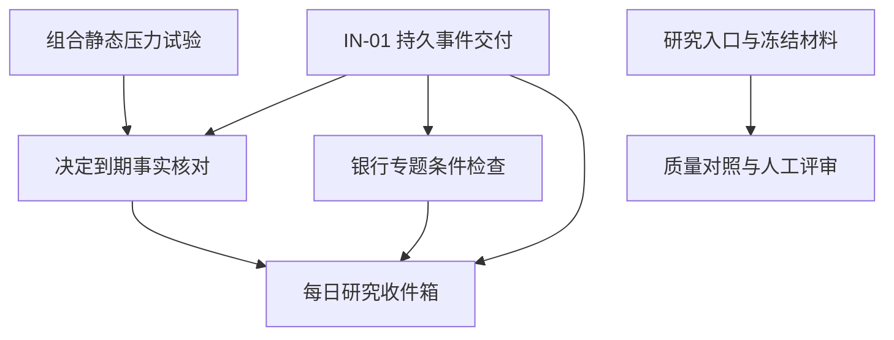

# 四个迭代方向的设计与实施顺序

基线：`1f62fa4`，2026-11-07。状态：设计主审完成，待实施与验收。本目录定义下一阶段方案；任务卡和验收场景均为待实施内容，不代表功能已经交付。

优先让一次研究有清楚的入口、材料边界与质量评价，再把已有变化汇总为每天可以处理的事项。银行专题提供可核对的真实研究场景；组合压力试验与决定核对分阶段交付。

## 方案入口

| 方向 | 设计 | 首期交付 | 优先级 |
|---|---|---|---|
| 可信研究工作流与质量对照 | [具体方案](01-research-quality.md) | 引导研究、冻结材料、真实方法对照、人工质量评审 | P0 |
| 每日论点变化收件箱 | [具体方案](02-research-inbox.md) | 可恢复的变化投影、无档案观察线索、版本化处置 | P0 |
| 银行财报专题工作台 | [具体方案](03-bank-topic.md) | 招行净利息收入变化的事实、分解、解释与后续检查 | P1 |
| 组合压力试验与决定事实核对 | [具体方案](04-portfolio-stress.md) | 先交付静态压力试验，再交付到期事实核对 | P2 |

[主代理审查记录](review.md)记录具体问题、修订结果和实施时仍需验证的风险。

后续完整实施见[任务拆分执行计划](execution-plan.md)：241个可派发子任务，包含独立代码Review、回修及离线验收；按最新要求不包含真实E2E测试。

## 共同工程约定

四个方案继续使用现有 FastAPI、SQLite、Alembic、数据库队列、授权、预算及版本化证据体系。新增对象需在领域服务中校验 owner、类型、版本与引用存在性；当前 SQLite 不执行外键约束，不能依赖模型中的 ForeignKey 自动保证完整性。

所有写接口沿用 API Key 或会话校验，以及现有会话写请求来源检查。请求重放先核对身份与访问范围，再按稳定 mutation ID 和规范化请求哈希返回原收据；同 ID 异参拒绝。对象版本冲突要求刷新后重新决定，不能自动把旧操作重放到新版本。

领域错误沿用`api/deps.py`与BusinessError，HTTP响应为`{"detail":{"code":"...","message":"...","field_errors":[],"retryable":false,"current_refs":[]}}`；field_errors元素为`{field,message}`。新错误码的状态映射必须显式加入`INVESTOR_ERROR_STATUS`并测试；未登记代码默认409，不能只在文档中声称会返回403、410或503。版本冲突信息使用现有field_errors/current_refs，不另建四套错误协议。

四个方向新增功能开关统一使用`feature_disabled→503`；既有`writes_disabled→403`及授权错误保持原语义，不为了新接口全局改码。功能关闭不阻止已获权限的历史读取。

各方案区分 immutable revision、当前 head、运行状态和用户阅读状态。状态更改不得覆盖历史证据；撤销权限和取消仍按当前状态检查，不能被冻结输入绕过。

金额、数量、比例使用现有 Decimal 契约，JSON 以字符串传递；未知值保持 null 和结构化原因。时间存 UTC、界面按 Asia/Shanghai 展示，业务期间、资料公开时间和系统取得时间分别记录。

新增配置在关闭状态下兼容现有流程；功能关闭阻止新动作，已提交任务的机械结账、状态恢复和可访问历史读取分别定义。数据库迁移在实施时基于实际 Alembic head 分配版本，四个方案不能各自假定占用相同的下一版本号。

## 持久事件交付

共享基础由收件箱方案的 IN-01 任务拥有，允许在收件箱页面之前独立交付。它仅支持本目录明确列出的领域事件，不扩展为任意脚本或通用消息平台。

事件采用 `event_id`、`event_type`、`owner_id`、`source_ref`、`source_revision`、`occurred_at`、`recorded_at`、`schema_version`、`payload_hash`、`payload`。`source_ref` 中的 revision 必须与 `source_revision` 一致；schema 版本与业务版本分别校验。payload_hash 覆盖规范化 payload，事件 payload 只包含已批准的路由信息和精确引用，不装入凭证、任意原文或模型运行秘密。

事件来源使用独立的EventSourceRef白名单及解析器；例如现有review_round使用整数ID，不把未知kind或任意字符串塞入正式ObjectRef。收件箱支持证券与账户两种明确归属；账户级结果保持账户归属，不拆成多只股票的研究结论。

内部单调 sequence 用于消费顺序；时间戳不充当游标。业务结果与事件在同一个数据库事务中提交。消费者在同一事务写投影、`(consumer, event_id)` 唯一消费收据及游标，重放保持幂等。暂时失败保留可恢复状态；无法处理的事件显式隔离并报告，不静默丢弃。受同一对象顺序约束的后续事件不得越过未解决前序。

多事项撤回按冻结目标集合有界分片，每片的投影、journal及effect_cursor同事务提交；全部完成才标applied。投影generation切换必须等待进行中的分片结清，不能在切换时改写其冻结清单。

源唯一性为 owner、事件类型、源对象类型与 ID、源版本。同一源版本需要多个不同业务通知时使用独立事件类型或在同一事件中提供多个明确对象引用，不能悄悄放宽唯一键。既有 `ResearchEventRevision` 表表示补充研究事实版本，不用作本次投递账本。

首次接入旧数据应使用有界 manifest，保留原发生时间并标记历史补入。补入不自动重发第三方通知或启动付费研究。实验输出保持与正式研究事件隔离；银行专题及决定核对通过白名单事件接入收件箱。

这一设计采用事务性 outbox 的同事务提交与幂等消费原则，具体使用现有数据库实现。[AWS 事务性 outbox 说明](https://docs.aws.amazon.com/prescriptive-guidance/latest/cloud-design-patterns/transactional-outbox.html)

## 实施依赖

箭头表示接口或交付依赖。银行专题的静态事实与量价分解可以先完成；它的自动条件检查接入持久事件基础。研究质量实验可以独立交付，不要求用户先使用收件箱。

## 建议里程碑

| 里程碑 | 可交付结果 | 退出条件 |
|---|---|---|
| M0 | 共享事件契约与故障恢复 | 结果提交后退出、重复消费、partial 结果和毒事件均有确定结果 |
| M1 | 一次引导研究与首批冻结样本 | 用户理解材料范围、结论、反证与未解决项；失败也留完整记录 |
| M2 | 收件箱最小版和质量对照报告 | 旧确认不吞新变化；两臂材料相同；质量评审与工程完成分别报告 |
| M3 | 招行年度专题 | 原页、口径、分解金额可核对，解释和条件可复查 |
| M4 | 组合压力试验 | 缺价与未知现金正确退化，损失来源可解释 |
| M5 | 决定事实核对 | 观察条件预先冻结，真实账本事件显式关联，迟到数据保留历史 |

按任务卡拆分后可安排不重叠的并行工作；领域引用枚举、事件注册、路由入口、设置注册和 Alembic 链由一个集成人员串行合并。表格不是按日历承诺上线日期，材料与真实模型质量以各方案退出条件判断。

## 开发与验收边界

本轮仅交付设计文档。实际实施应区分离线工程验证、真实模型研究质量、真实材料核验与生产启用。文档中的样本数、耗时和使用指标是验收目标，不能作为已测结果引用。

首轮实现不包含评分收益回测、完整账户收益归因、反事实投资收益、跨市场扩张或交易执行。这些工作需要独立的数据契约和评估范围。
