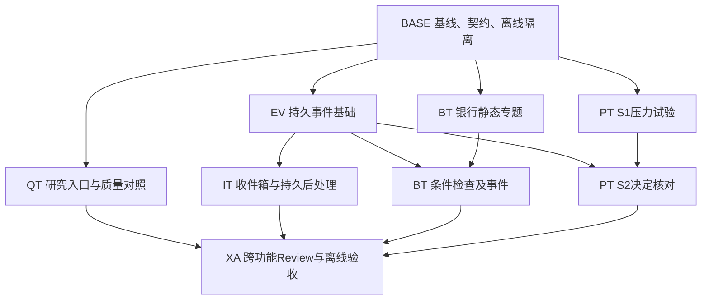

# 四个功能的完整实现任务拆分计划

日期：2026-11-07。状态：已开始实施，实际任务状态以execution/task-index.json为准。本计划覆盖四份已评审设计的全部范围：研究引导与质量对照、每日研究收件箱、银行静态专题与条件检查、组合压力试验与决定事实核对。

用户要求优先于原设计中的验收方式：**本计划不安排真实E2E测试**。原设计中真实浏览器、Android内嵌、真实模型试运行或真实全链路验收的要求，不成为本次实施完成条件。测试采用离线单元、组件、进程内API合约、临时数据库集成及局部故障注入。生产启用与真实使用效果不在任务范围内；不把这些未验证项写成已通过。

## 文档与任务入口

| 任务包 | 内容 | 使用方式 |
|---|---|---|
| [共享基础](execution/00-shared-tasks.md) | 基线、契约、隔离测试、资产打包、持久事件、专用维护进程、可信更正生产者 | 先执行BASE，再交付PK/EV及SV接缝 |
| [方向1任务](execution/01-quality-tasks.md) | G0研究入口、方法兼容性、冻结材料、准入/预算、盲评与页面 | 普通研究入口独立交付；质量核心不等待收件箱 |
| [方向2任务](execution/02-inbox-tasks.md) | 生产者、持久后处理、投影/重建、操作/API/UI | 复用EV，不重复开发事件平台 |
| [方向3任务](execution/03-bank-tasks.md) | 招行金样本、事实/计算/解释、条件DSL、年度检查及UI | 静态专题先行，条件检查接EV |
| [方向4任务](execution/04-portfolio-tasks.md) | S1压力计算、S2决定核对、账本关联、迟到事实与UI | S1先行，S2接EV并保留独立验收 |
| [跨功能Review与验收](execution/05-integration-tasks.md) | 来源适配、引用隔离、错误协议、迁移、配置、回归与最终验收 | 四条功能线交付后收口，不能用各自通过替代 |
| [机器可读任务索引](execution/task-index.json) | 所有任务的ID、依赖、写范围、退出条件、估算与初始状态 | 从任务卡生成，派发时选依赖完成且文件锁空闲的任务 |

每张卡对应一个有界sub task，优先控制在0.25–1人日。确实不可再拆的迁移、并发验证或综合审查可超过1人日，但单卡不得成为整方向实现。估算是人工工程容量，不是模型运行时间或自动交付承诺；回修列有预算，发现超出预算的问题仍必须修复并追加子卡。

## 任务规模与主审结果

共**241个子任务，估算180.75人日**；其中实现113项、集成41项、独立测试30项、代码Review19项、回修19项、验收19项。已经包含Review和回修预留，不再对总量额外乘一次同类预算；共享投入只计一次。不同文件可并行，迁移/注册/执行器等热点串行，不能直接把人日除以agent数量当作交付日期。

| 任务包 | 任务数 | 估算人日 |
|---|---:|---:|
| 共享准备、事件、资产及来源更正 | 24 | 18.25 |
| 研究入口与质量对照 | 50 | 38.75 |
| 每日研究收件箱 | 50 | 33.25 |
| 银行专题及条件检查 | 50 | 35 |
| 组合压力与决定核对 | 55 | 44.5 |
| 跨功能集成与最终验收 | 12 | 11 |
| 合计 | 241 | 180.75 |

四方向由Sol代理分别细拆，主代理逐份核对，并安排Sol独立检查共享接缝。已处理来源事件缺生产者、嵌套CSS漏打包、guard不覆盖兄弟测试目录等执行缺口，见[本轮计划审查记录](execution/plan-review.md)。任务索引已经检查ID唯一、依赖存在、无环、所有任务均可追溯到XA-12。以上是计划静态检查，任何实现卡或产品验收仍未执行。

## 实施范围与完成定义

| 功能 | 必须交付的范围 | 不用于替代完成的条件 |
|---|---|---|
| 可信研究工作流与质量对照 | 普通研究G0；12情境/开发评估拆分；真实方法校验；同模型两臂；冻结工具及非工具上下文；预算/取消/unknown；独立实验制品；盲评/报告；API和页面 | 不能仅做实验脚本；不能以模拟模型得分宣称研究质量提升 |
| 每日论点变化收件箱 | 新旧来源事务接入；原后处理持久受理；证券/账户事项；版本化阅读/处置；分页/增量；来源失效；分片恢复；journal重建；历史补入；维护进程和健康视图 | 不能只做聚合UI；不能将旧Markdown通知仍尽力交付误称全部通知可靠 |
| 银行财报专题 | 招行原件定位/口径核验；NII/NIM和量价分解；解释分级；静态历史版本；有限DSL/年度选择；到期/迟到/更正；条件检查事件；UI | 不能只做固定报告；不能以旧银行proof覆盖新增字段，或用季度值替代年度目标 |
| 组合压力与决定核对 | 冻结数量/现金/价格/行业；全局/行业/逐股冲击；缺数降级；S1页面；S2预登记谓词、账本关联、并发分配约束、完整声明、到期/迟到/更正与结果页面 | 不能只做S1；不加入收益归因、反事实收益或交易执行 |

一个功能完成须同时满足：实现卡完成、关联Review及回修关闭、对应离线验收卡通过、配置/迁移/操作文档可用。整个项目完成还须通过XA跨功能验收。新功能可默认关闭，但不能只交付空实现、占位API、固定成功页面或未接线的模块。

## 执行基线与文件所有权

基准commit为`1f62fa4ac3dd22be5ef65550ae6ac0444098b313`，但实际工作区存在并行的simulation代码、测试、`storage/models/__init__.py`改动和`061_simulation.py`迁移。它们不属于本计划，不回滚、不覆盖、不纳入本轮功能验收。BASE-01重新记录执行开始时的实际状态；不能从旧设计的060推断下一迁移就是061。

任务卡列出允许写集合。新文件归对应领域agent；共享文件由一个集成人员锁定串行合并。使用隔离worktree时，也只能把已review的精确提交合并到约定集成分支；不将整个dirty工作区复制、重置或自动stash。

| 共享热点 | 修改纪律 |
|---|---|
| `alembic/versions/`、`storage/models/__init__.py` | 一个集成人员按实际head顺序分配；每个迁移检查真实前驱；不改既有迁移 |
| `api/app.py`、`api/routes/__init__.py`、`api/deps.py` | 各方向先交路由模块/错误码清单，集成人员串行注册；不重定义BusinessError |
| `investor/common.py`及正式发布/证据白名单 | 引用kind及解析规则逐项审查；实验不加入ObjectRef；新topic/组合ref不自动进入正式财务采信 |
| `settings/registry.py`及配置schema | 各功能开关独立、默认关闭；共享feature_disabled=503；历史读取与机械结账语义保留 |
| `pyproject.toml` package-data及静态资产包装 | PK任务统一修改目录规则，各功能阶段验收检查实际wheel资产；不让S1或银行静态交付隐含依赖QT |
| `research/worker.py`、`scheduler/runner.py`、CLI和部署配置 | 先提交独立handler，集成人员串行接线；原pipeline状态枚举不增加cancelled |
| `research_events/registry.py`、`resolvers.py` | 共享基础定义接口；领域新增适配经集成卡注册；owner和subject须与来源一致 |
| `web/routes.py`、`base.html`、导航、全局CSS/JS、已有portfolio/agent模板 | 独立页面和模块优先；共享入口与旧页面插槽由集成人员锁定；不同时改同一文件 |
| `tests/conftest.py`、前端测试配置、CI | 优先局部fixture；通用guard/配置由BASE-03或XA集成任务串行改，不擅改全仓测试默认策略 |

任务的依赖完成只代表可以排队；写集合重叠时仍不可并发。某任务结束后记录实际改动范围，集成人员核对是否越界。任何超出任务范围但必要的修改先拆成新卡，不让同一个agent顺手修改其他方向。

“保留simulation/既有迁移”指本任务diff不得改写其内容，不要求其他并行任务整个开发期间停止变化。每次领取共享文件或集成迁移前刷新基线；上游合法变化须保留，必要时重新分配新迁移前驱，不能用最初hash覆盖后来的工作。

## 批次与并行安排

可用并发为主代理加最多3个worker。默认使用GPT-6.1 Sol实现与审查；审查者不能是该批主要作者。保持两个实现槽加一个审查/测试槽时，主代理持续处理依赖、共享文件合并及最终review。

| 批次 | 可并行工作 | 退出条件 |
|---|---|---|
| W0 | BASE-01先行，再并行BASE-02/03 | 工作区归属、接口和离线隔离明确 |
| W1 | 槽A：EV基础；槽B：G0及方法兼容性；槽C：银行静态事实与算法 | EV-12通过；G0可独立验收；银行金样本规则可用 |
| W2 | 槽A：收件箱模型/生产者/后处理；槽B：质量实验执行与评审；槽C：银行静态API/UI和条件核心 | 各自批次Review关闭；事件生产者及隔离边界可验证 |
| W3 | 空闲槽接S1压力试验；其他槽完成收件箱页面/恢复和银行条件队列 | 收件箱与银行功能线验收；质量功能线验收；S1独立验收 |
| W4 | S2账本关联与决定核对；已空闲槽执行交叉适配与独立Review | 四条功能线全部验收；没有设计内可选尾项遗留 |
| W5 | XA跨功能集成检查、独立Review、回修、最终验收 | 最终任务清单与证据齐全，所有阻断问题关闭 |

批次是调度建议，不是额外硬依赖：例如S1契约/纯算法在槽空闲时可以提前做；银行静态专题不等待收件箱。实际派发以每卡依赖DAG和文件锁为准。EV基础未完成时可以按冻结接口写纯函数或fixture，不能伪造已接通生产者。



## Sub agent派发协议

一个agent一次承接一张卡，或一组明确串行且总量不超过1–2人日的连续小卡；不把整个方向一次性丢给实现agent。只读Review可读取相关调用链，但只写审查记录。回修由原作者或另一个实现agent完成，原审查者复核关闭。

派发消息至少包含以下内容，可从任务索引生成：

```text
任务：<ID与任务目标>；角色：实现 / 集成 / Review / 验收。
项目与基线：<绝对cwd、HEAD/工作树、已合并的依赖任务和接口版本>。
必读：<对应设计、执行任务卡、共享契约、相关代码>。
允许写：<精确文件/新目录>；其他文件只读；共享文件需集成人员持锁。
交付：<代码/测试/文档或只读审查报告>。
验收：<本卡退出条件、离线命令及fixture>。
约束：不真实E2E，不调用真实provider/模型/行情/账户/外发；不改他人dirty内容。
停止条件：依赖/契约缺失、需越界写入、测试触及真实外部资源时报告阻塞并保留结果。
回报：实际改动、验证命令/结果、未验证范围、风险、commit或diff位置。
```

任务状态采用`planned → ready → running → review_pending → done`；遇真实阻塞记录`blocked`及依赖，不用“基本完成”越过验收。纯Review/验收任务不强求业务diff。索引初始全部planned；执行时单一协调者维护状态，避免多个agent并发改计划。

## 代码Review与回修规则

每个方向分批审查：先契约/存储，再算法/核心服务，再API/队列/页面，最后方向收口。每次输出至少含审查基线、文件列表、问题等级、位置、触发例、影响、建议修复与可验证关闭条件。没有发现也必须记录审查范围及实际检查内容。

阻断项包括数据损坏、越权、错误财务语义、实验污染正式材料、重复付费受理、预算逃逸、事件丢失/重复、竞态、时点混淆和任务范围缺失；必须修复并复审。一般问题若影响既定退出条件，同样不得带入验收。纯改进建议可记录，不得把设计内功能伪装成后续优化。

回修卡不是形式上的“读一遍”：须逐问题关联修改与回归测试。若发现根本契约冲突，由主代理先更新BASE-02接口记录及受影响任务，禁止两个方向各自加兼容补丁。合并后仅对新变更及受影响范围复测，不无限重复已通过且未受影响的测试。

## 验收策略：不包含真实E2E

| 层级 | 方法 | 重点 |
|---|---|---|
| 静态 | Ruff、mypy、TypeScript、构建、模板/API schema检查 | 接线、导入、类型、无占位路径；先记录现有基线，不把其他并行开发失败算成本功能修复范围 |
| 纯函数/单元 | 精确Decimal、假时钟、固定输入 | 量价分解、压力公式、三值逻辑、年度选择、hash及状态变迁 |
| 存储/服务集成 | 临时文件SQLite、真实session/事务、固定本地fixture | CAS、唯一键、账本分配、幂等、迁移、事务回滚与并发；锁测试不以仅内存库替代 |
| API合约 | ASGITransport/TestClient进程内调用，替换外部适配器 | owner/权限、错误体、HTTP码、分页、重复请求和丢响应恢复 |
| 页面组件 | Vitest/jsdom或现有等价组件工具、mock fetch | 加载/空/失败/partial、输入保留、键盘交互、原UUID恢复、假数据与历史标识 |
| 局部故障 | 单个handler或消费者的中断/重启/lease丢失、假provider响应丢失 | 结果/事件同事务、unknown结算保留、同链阻塞、分片续跑；不启动完整服务栈 |
| 交叉契约 | 实际生产者服务与实际投影服务在临时DB中直接组合 | 银行/账户事件归属、实验隔离、新引用不进入正式采信；不通过浏览器驱动完整产品流程 |

仅设置`-m "not network"`不等于已阻断真实网络。现有`tests/conftest.py`阻止dotenv及真实AkShare，但不能替代本计划的provider/传输guard。BASE-03建立allowlist和guard，验收使用惰性测试凭证、临时DATA_DIR及SQLite URL；测试不得读取用户真实账户、凭证或数据库。

现有CI含`tests/browser/run.sh`，本计划不调用它、不把现有整套CI通过作为执行本计划的暗含任务，也不删除现有仓库检查。XA只新增本计划离线检查入口并运行已核对的非E2E集合。不会为了验收启动Playwright/Selenium/真实浏览器/Android或生产worker，也不新增其安装任务。

命令以BASE-01核实的锁定环境为准，预期形式如下；`<测试文件清单>`必须在执行前由索引及基线allowlist展开为真实路径，不能直接照抄占位命令：

```text
.venv/bin/python scripts/check_next_iterations.py --scope <任务或方向> --offline
NEXT_ITERATIONS_OFFLINE=1 PYTHONPATH=tests/support .venv/bin/python -m pytest -p next_iterations_offline <测试文件清单> -m "not network" -q
.venv/bin/python -m ruff check <改动Python文件>
.venv/bin/python -m mypy <受影响模块>
node --import ./tests/support/next_iterations_dom.mjs --test <网页组件.mjs清单>
pnpm --dir mobile test -- <组件测试清单>
pnpm --dir mobile typecheck
pnpm --dir mobile build
```

jsdom不提供真实布局计算；响应式CSS及DOM结构检查不能证明390px/1440px真实屏幕无溢出。验收报告明确保留真实浏览器/设备视觉体验、真实模型研究质量、生产吞吐及外部数据兼容性未验证。源码、离线数据处理和UI逻辑仍须完整实现，这些限制不能成为漏做功能的理由。

FastAPI网页静态模块默认复用BASE-03的Node内建test/bootstrap（从已安装的mobile依赖解析jsdom），不为每方向安装一套runner。mobile自身已有Vitest套件仍使用pnpm；某方向沿用现有Python启动Node/Fake DOM的测试时，也必须注入同一离线约束。不要把Node语法检查当作DOM交互测试。

共享pytest plugin必须覆盖QT的unit/integration、IT/PT/BT独立测试目录、选定旧回归与子进程。wrapper负责加载plugin、环境及Node bootstrap；不经wrapper运行时也必须显式启用同等隔离。BASE-03用跨目录及子进程外连诱饵证明这一点，不能只测试guard自己的目录。wrapper也检查收集数量，避免空清单通过。

## 验收证据与最终交付

执行时每个批次在`execution/evidence/`写审查或验收记录，包含：基线/任务ID、实际命令及退出码、测试数量与失败、fixture及来源hash、改动范围、发现与关闭结果、未验证项。本轮不预生成成功日志；机器索引的planned状态不能自动改为done。

最终交付必须列出四功能入口、配置默认值、迁移顺序、回退方式、完整任务状态、未解决问题和离线验收结果。真实运行、发布或研究效果另行评价；本计划不包含它们，也不以它们未执行为理由阻止离线工程验收完成。
